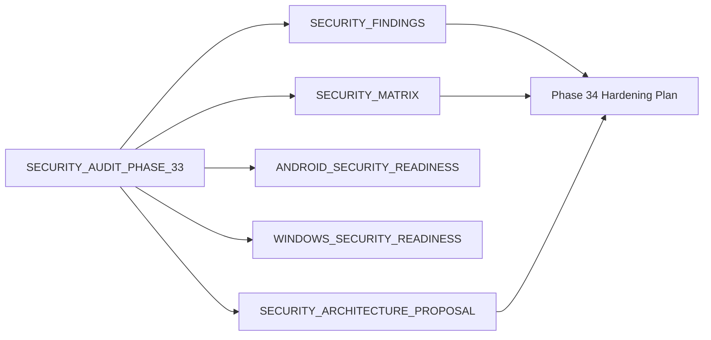

# DEPENDENCY_GRAPH.md — رسم الاعتماديات

> **مرجع لفهم العلاقات بين كل مكوّنات النظام**. يُستخدم لمعرفة تأثير أي تعديل قبل تنفيذه.

**آخر تحديث**: 2026-07-30

---

## 1. الاعتماديات على مستوى المراحل (Phases)

```
Phase 1: Project Discovery
   ↓
Phase 2: Requirements Analysis
   ↓
Phase 3: Brand Strategy
   ↓
Phase 4: Moodboard
   ↓
Phase 5: Visual Identity
   ↓
Phase 6: Design System
   ↓
Phase 7: User Flows ←──── Phase 6
   ↓
Phase 8: Information Architecture ←── Phase 7
   ↓
Phase 9: Wireframes ←── Phase 8
   ↓
Phase 10: High Fidelity Design ←── Phase 9
   ↓
Phase 11: Design Review ←── Phase 10
   ↓
Phase 12: Design Approval ←── Phase 11
   ↓
═══════════════════════════════
   DEVELOPMENT PHASES BEGIN
═══════════════════════════════
   ↓
Phase 13: System Architecture
   ↓
Phase 14: Database Design ←── Phase 13
   ↓
Phase 15: Backend Foundation ←── Phase 14
   ↓
Phase 16: Frontend Foundation ←── Phase 13
   ↓             ↓
   ↓     Phase 17: Authentication ←── P15, P16
   ↓             ↓
   ↓     Phase 18: Role & Permission ←── P17
   ↓             ↓
   ↓     Phase 19: University Management ←── P18
   ↓             ↓
   ↓     Phase 20: Question Bank ←── P19
   ↓             ↓
   ↓     Phase 21: Interactive Exams ←── P20
   ↓             ↓
   ↓     Phase 22: Offline Engine ←── P21
   ↓             ↓
   ↓     Phase 23: Digital Library ←── P21
   ↓             ↓
   ↓     Phase 24: Admin Dashboard ←── P18, P20
   ↓             ↓
   ↓     Phase 25: Notifications ←── P17, P24
   ↓             ↓
   ↓     Phase 26: Statistics ←── P20, P21
   ↓             ↓
   ↓     Phase 27: Leaderboard ←── P26
   ↓             ↓
Phase 28: Security Hardening ←── P17, P22
   ↓
Phase 29: Performance Optimization ←── P28
   ↓
Phase 30: Testing & QA ←── P29
   ↓
Phase 31: Deployment ←── P30
   ↓
Phase 32: Production Release ←── P31
```

---

## 2. الاعتماديات على مستوى الأنظمة (System-level Dependencies)

### 2.1 Frontend (Student App) Dependencies
```
React 19
├── React Router 7
├── TanStack Query 5
├── Zustand 5
├── React Hook Form 7
├── Zod 3
└── Tailwind CSS 4
    ├── shadcn/ui (مخصص)
    ├── Lucide React (icons)
    └── Framer Motion (animations)
```

### 2.2 Frontend (Admin App) Dependencies
```
React 19
├── (نفس Student App dependencies)
├── TanStack Table 8 (data tables)
├── Recharts (charts)
└── react-dropzone (file uploads)
```

### 2.3 Backend Dependencies
```
ASP.NET Core 9
├── Entity Framework Core 9
│   └── Npgsql.EntityFrameworkCore.PostgreSQL
├── MediatR 12 (CQRS)
├── AutoMapper 13
├── FluentValidation 11
├── Serilog 4
│   ├── Serilog.Sinks.Console
│   ├── Serilog.Sinks.PostgreSQL
│   └── Serilog.Sinks.Seq
├── StackExchange.Redis (Redis client)
├── AWSSDK.S3 (Cloudflare R2 compatibility)
├── FirebaseAdmin (FCM)
├── JWT Bearer Authentication
└── Swashbuckle.AspNetCore (Swagger)
```

### 2.4 Infrastructure Dependencies
```
PostgreSQL 16
├── (Primary database)
├── Read Replicas (Phase 28+)
└── pgvector (for semantic search later)

Redis 7
├── Cache layer
├── Rate limiting store
├── Session store (optional)
└── Background job queues (Hangfire)

Cloudflare R2
├── PDF files storage
├── Image storage
├── HTML files storage
└── Encrypted offline content

Firebase Cloud Messaging
├── Push notifications (Web)
├── Push notifications (iOS — via PWA)
└── Push notifications (Android — via PWA)
```

---

## 3. الاعتماديات بين الوحدات (Module Dependencies)

```
                    ┌─────────────────┐
                    │ Authentication  │
                    └────────┬────────┘
                             │
              ┌──────────────┼──────────────┐
              ↓              ↓              ↓
     ┌────────────┐  ┌────────────┐  ┌────────────┐
     │  Students  │  │   Admins   │  │ Subscriptions │
     └──────┬─────┘  └──────┬─────┘  └──────┬─────┘
            │               │               │
            └───────┬───────┴───────┬───────┘
                    ↓               ↓
            ┌──────────────┐ ┌──────────────┐
            │ Universities │ │   Devices    │
            │   Hierarchy  │ │   Binding    │
            └──────┬───────┘ └──────────────┘
                   │
       ┌───────────┼───────────┐
       ↓           ↓           ↓
 ┌──────────┐ ┌──────────┐ ┌──────────┐
 │ Questions│ │  Library │ │  Exams   │
 └────┬─────┘ └────┬─────┘ └────┬─────┘
      │            │            │
      └──────┬─────┴─────┬──────┘
             ↓           ↓
     ┌────────────┐ ┌────────────┐
     │ Statistics │ │Leaderboard │
     └──────┬─────┘ └──────┬─────┘
            │               │
            └───────┬───────┘
                    ↓
            ┌──────────────┐
            │ Notifications│
            └──────┬───────┘
                   ↓
            ┌──────────────┐
            │ Security Logs│
            └──────────────┘
```

---

## 4. الاعتماديات على مستوى قاعدة البيانات (DB Foreign Keys)

| الجدول الفرعي | الجدول الأب | نوع العلاقة |
|---------------|-------------|-------------|
| colleges | universities | Many-to-One |
| academic_years | colleges | Many-to-One |
| semesters | academic_years | Many-to-One |
| subjects | semesters | Many-to-One |
| lectures | subjects | Many-to-One |
| exams | subjects | Many-to-One |
| questions | exams (nullable), lectures (nullable) | Many-to-One |
| question_options | questions | Many-to-One |
| student_subscriptions | students, subscription_codes | Many-to-One |
| subscription_codes | universities, colleges, academic_years, semesters, subjects (nullable) | Many-to-One |
| attempt_logs | students, questions, exams | Many-to-One |
| favorites | students, questions, favorite_lists | Many-to-One |
| favorite_lists | students | Many-to-One |
| library_files | subjects | Many-to-One |
| notifications | students (nullable), admins (sender) | Many-to-One |
| device_bindings | students | One-to-One |
| security_logs | students (nullable), admins (nullable) | Many-to-One |
| admin_permissions | admins, admin_roles | Many-to-Many (via join table) |

---

## 5. الاعتماديات على مستوى API

### 5.1 الـ APIs التي تتطلب مصادقة (Auth required)
كل الـ APIs ما عدا:
- `POST /api/v1/auth/login`
- `POST /api/v1/auth/register`
- `POST /api/v1/auth/refresh`
- `GET /api/v1/health`
- `GET /api/v1/metadata/universities` (للتسجيل)

### 5.2 الـ APIs التي تتطلب صلاحيات إدارية (Admin required)
- كل `/api/v1/admin/*`
- `POST /api/v1/questions`
- `PUT /api/v1/questions/{id}`
- `DELETE /api/v1/questions/{id}`
- `POST /api/v1/library/files`
- `POST /api/v1/codes`
- `POST /api/v1/notifications`

### 5.3 الـ APIs التي تتطلب نطاقاً أكاديمياً (Scoped)
المدير الذي يدير "كلية الطب" فقط لا يستطيع الوصول إلى بيانات "كلية الصيدلة". يُطبّق عبر:
- Policy-based authorization في ASP.NET Core
- Claims تحوي `scope_university_id`, `scope_college_id`, `scope_year_id`, `scope_subject_id`

---

## 6. الاعتماديات الخارجية (External Dependencies)

### 6.1 خدمات سحابية
| الخدمة | الغرض | البديل عند الانقطاع |
|--------|------|---------------------|
| Cloudflare R2 | تخزين الملفات | التحويل إلى Backblaze B2 |
| Cloudflare CDN | توصيل المحتوى | — (لا بديل مباشر) |
| Firebase FCM | Push notifications | OneSignal (fallback) |
| Vercel | استضافة Frontend | Netlify |
| Railway | استضافة Backend + DB | Render / Fly.io |

### 6.2 مكتبات خارجية حرجة
| المكتبة | البديل |
|---------|--------|
| React | Vue 3 (في حال فشل الفريق) |
| EF Core | Dapper (للأداء العالي) |
| MediatR | Brighter أو Manual CQRS |
| Cairo font | Tajawal / IBM Plex Sans Arabic |

---

## 7. مصفوفة تأثير التعديل (Impact Matrix)

عند تعديل أي مكوّن، استخدم هذه المصفوفة لمعرفة ما يتأثر:

| إذا عدّلت... | تأكد من تحديث... |
|--------------|------------------|
| `CONTEXT.md` | كل الملفات التي تشير إليه |
| بنية قاعدة البيانات | Backend Models, EF Migrations, Frontend Types, API Docs |
| API endpoint | Frontend services, API docs, Postman collection |
| نظام الألوان | Tailwind config, CSS variables, كل المكونات |
| نظام الخطوط | Tailwind config, CSS imports, كل المكونات |
| نظام الصلاحيات | Backend policies, Frontend route guards, Admin UI |
| هيكل هرمي الجامعات | كل الكيانات الفرعية + Frontend navigation + Search |

---

## 8. نقاط الفشل المنفردة (Single Points of Failure)

| النقطة | الخطر | خطة التعافي |
|--------|------|-------------|
| PostgreSQL الأساسية | توقف الخدمة كاملاً | Read Replica + Automated Backups + Point-in-time recovery |
| Redis | بطء عام + فقدان الكاش | Cluster mode + Persistence enabled |
| Cloudflare R2 | عدم الوصول للملفات | Multi-region bucket + CDN cache |
| Vercel | توقف Frontend | Netlify كـ standby |
| Firebase FCM | عدم وصول الإشعارات | OneSignal كـ fallback |

---

**نهاية ملف DEPENDENCY_GRAPH.md**

---

## Phase 33 — Security Documentation Dependencies (2026-08-18)



- ملفات Phase 33 تعتمد على مراجعة شيفرة المصدر والتهيئة المرفقة فقط.
- `SECURITY_FINDINGS.md` و`SECURITY_MATRIX.md` هما مرجع أولوية Phase 34.
- لا تمثل ملفات Phase 33 اعتماداً تنفيذياً جديداً ولا تضيف مكتبات أو خدمات.
