# ARCHITECTURE.md — Phase 13: System Architecture

> **بنية نظام CMS الكاملة**. يحدد كل القرارات المعمارية، مخططات النظام، تدفقات البيانات، والبنية التقنية للـ Backend و Frontend و Infrastructure.

**المرحلة**: Phase 13
**الحالة**: ✅ Completed
**تاريخ الإنجاز**: 2026-07-30

---

## جدول المحتويات

1. [نظرة عامة معمارية (Architecture Overview)](#1-نظرة-عامة-معمارية)
2. [المخطط المعماري عالي المستوى (High-Level Architecture)](#2-المخطط-المعماري-عالي-المستوى)
3. [بنية الـ Backend (Clean Architecture + CQRS)](#3-بنية-الـ-backend)
4. [بنية الـ Frontend (React 19 + Vite)](#4-بنية-الـ-frontend)
5. [بنية قاعدة البيانات (Database Architecture)](#5-بنية-قاعدة-البيانات)
6. [بنية البنية التحتية (Infrastructure Architecture)](#6-بنية-البنية-التحتية)
7. [بنية الأمان (Security Architecture)](#7-بنية-الأمان)
8. [تدفقات البيانات (Data Flow Diagrams)](#8-تدفقات-البيانات)
9. [مبادئ تصميم الـ API](#9-مبادئ-تصميم-الـ-api)
10. [بنية الـ Monorepo](#10-بنية-الـ-monorepo)
11. [بنية النشر (Deployment Architecture)](#11-بنية-النشر)
12. [المراقبة والرصد (Monitoring & Observability)](#12-المراقبة-والرصد)
13. [استراتيجية التوسّع (Scalability Strategy)](#13-استراتيجية-التوسع)
14. [التعافي من الكوارث (Disaster Recovery)](#14-التعافي-من-الكوارث)
15. [قرارات معمارية إضافية (Architectural Decisions)](#15-قرارات-معمارية-إضافية)

---

## 1. نظرة عامة معمارية

### 1.1 نمط البنية المعمارية

CMS يتبع **3 أنماط معمارية** رئيسية:

1. **Clean Architecture** (للـ Backend) — فصل واضح للطبقات.
2. **CQRS** (Command Query Responsibility Segregation) — فصل القراءة عن الكتابة.
3. **Modular Monolith** (للـ Backend) — وحدة واحدة معزّزة قابلة للتقسيم لاحقاً.

### 1.2 المبادئ المعمارية الثمانية

#### AP-1: الفصل بين المسؤوليات (Separation of Concerns)
- كل طبقة لها مسؤولية واحدة.
- لا تخلط بين منطق الأعمال وعرض البيانات.

#### AP-2: الاعتماد على التجريد (Dependency Inversion)
- الطبقات العليا لا تعتمد على الطبقات الدنيا.
- كلاهما يعتمد على تجريدات (Interfaces).

#### AP-3: Stateless Backend
- لا حالة محفوظة في الخادم.
- كل الـ state في الـ client أو الـ Redis.

#### AP-4: API-First Design
- API هو المنتج.
- الـ Frontend و Admin هما مستهلكان للـ API.

#### AP-5: Defense in Depth
- طبقات أمان متعدّدة (WAF + Rate Limiting + Auth + RBAC + Encryption).

#### AP-6: Design for Failure
- افترض أن أي مكوّن قد يفشل.
- آليات fallback + retry + circuit breaker.

#### AP-7: Observability by Design
- logging منظم من البداية.
- metrics + tracing + health checks.

#### AP-8: Cost-Effective Scaling
- ابدأ صغيراً، وسّع عند الحاجة.
- استخدم managed services قدر الإمكان.

### 1.3 ملخص تقني

| المكوّن | التقنية | السبب |
|---------|--------|------|
| Frontend (Student) | React 19 + Vite | أحدث، سريع، PWA |
| Frontend (Admin) | React 19 + Vite | نفس الـ stack |
| Backend | ASP.NET Core 9 (C# 13) | أداء عالٍ، type-safe |
| Database | PostgreSQL 16 | علائقية، موثوقة، JSON support |
| Cache | Redis 7 | سريع، متعدد الاستخدامات |
| File Storage | Cloudflare R2 | بدون رسوم egress |
| CDN | Cloudflare | شبكة عالمية + WAF |
| Push Notifications | Firebase FCM | مجاني، يدعم Web Push |
| Frontend Hosting | Vercel | متكامل مع React، deploy سهل |
| Backend Hosting | Railway | managed PostgreSQL + Redis + App |
| CI/CD | GitHub Actions | متكامل مع GitHub |

---

## 2. المخطط المعماري عالي المستوى

### 2.1 مخطط بنية النظام (System Architecture Diagram)

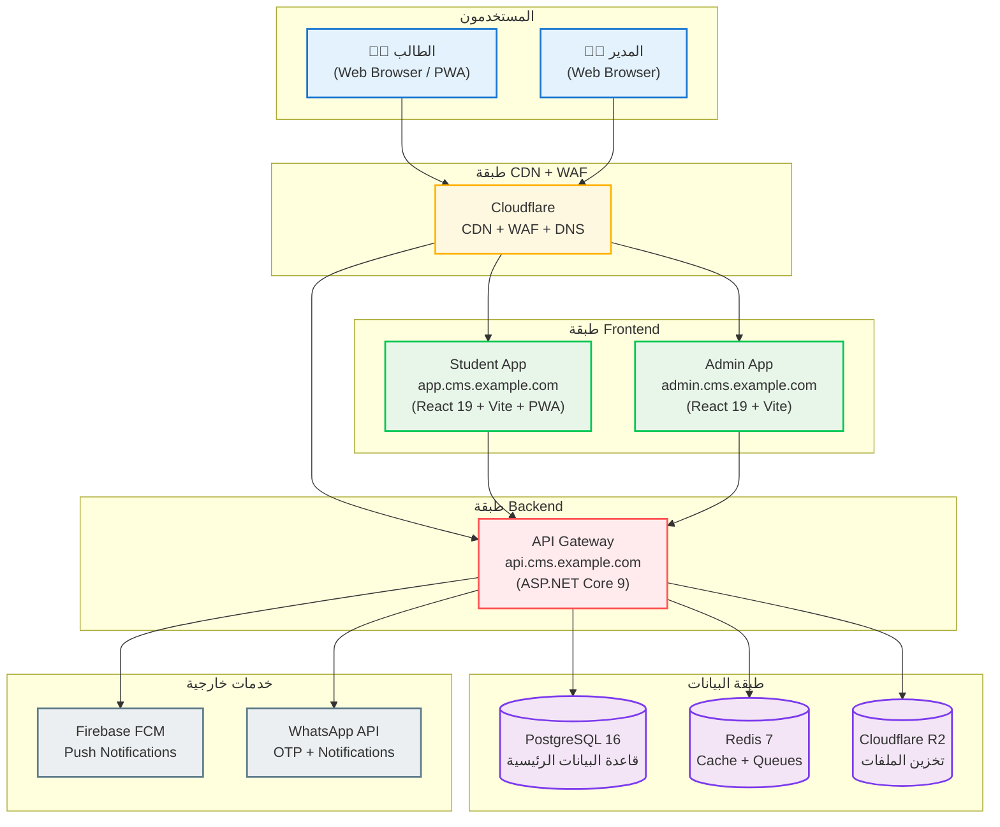

### 2.2 طبقات النظام (System Layers)

```
┌─────────────────────────────────────────────────────────────────┐
│ Layer 7: المستخدمون (Users)                                    │
│   طالب (PWA) | مدير (Web)                                     │
├─────────────────────────────────────────────────────────────────┤
│ Layer 6: CDN + WAF (Cloudflare)                               │
│   DNS + CDN + WAF + DDoS Protection + SSL Termination         │
├─────────────────────────────────────────────────────────────────┤
│ Layer 5: Frontend (React 19 + Vite)                           │
│   Student App (Vercel) | Admin App (Vercel)                  │
├─────────────────────────────────────────────────────────────────┤
│ Layer 4: API Gateway (ASP.NET Core 9)                         │
│   JWT Auth | Rate Limiting | Validation | Logging             │
├─────────────────────────────────────────────────────────────────┤
│ Layer 3: Application Layer (CQRS + MediatR)                   │
│   Commands | Queries | Handlers | Validators                 │
├─────────────────────────────────────────────────────────────────┤
│ Layer 2: Domain Layer (Entities + Business Logic)             │
│   Entities | Value Objects | Domain Events | Rules           │
├─────────────────────────────────────────────────────────────────┤
│ Layer 1: Infrastructure Layer                                 │
│   PostgreSQL | Redis | R2 | FCM | WhatsApp                   │
└─────────────────────────────────────────────────────────────────┘
```

---

## 3. بنية الـ Backend

### 3.1 Clean Architecture (4 طبقات)

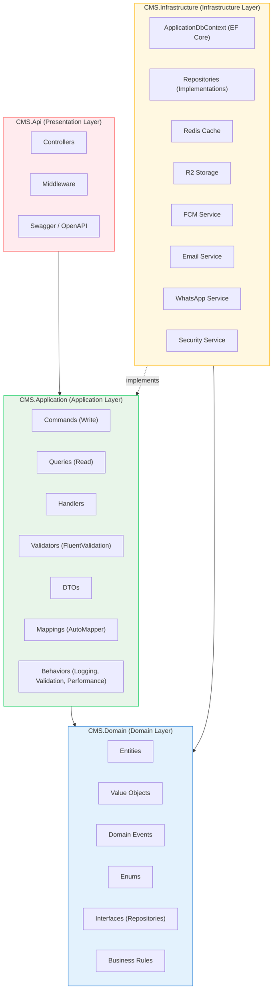

### 3.2 قاعدة الاعتماد (Dependency Rule)

> **الاعتماد دائماً نحو الداخل** (Inward).
> 
> الطبقة الخارجية تعتمد على الداخلية، لا العكس.

```
CMS.Api → CMS.Application → CMS.Domain
                                    ↑
CMS.Infrastructure ──────────────────┘
(Infrastructure يعتمد على Domain عبر Interfaces)
```

### 3.3 تفصيل الطبقات

#### Layer 1: CMS.Domain (المجال)

```csharp
// مثال: Entity
public class Question : BaseEntity
{
    public Guid Id { get; private set; }
    public string Text { get; private set; }
    public QuestionType Type { get; private set; }
    public Guid SubjectId { get; private set; }
    public Difficulty Difficulty { get; private set; }
    
    // Navigation
    public Subject Subject { get; private set; }
    public List<QuestionOption> Options { get; private set; }
    
    // Business Logic
    public bool IsCorrectAnswer(string optionId)
    {
        var option = Options.FirstOrDefault(o => o.Id == optionId);
        return option?.IsCorrect ?? false;
    }
    
    public void UpdateExplanation(string explanation)
    {
        if (string.IsNullOrWhiteSpace(explanation))
            throw new DomainException("Explanation is required");
        Explanation = explanation;
        UpdatedAt = DateTime.UtcNow;
    }
}

// مثال: Value Object
public class QuestionText : ValueObject
{
    public string Value { get; }
    
    public QuestionText(string value)
    {
        if (string.IsNullOrWhiteSpace(value))
            throw new DomainException("Question text is required");
        if (value.Length > 2000)
            throw new DomainException("Question text too long");
        Value = value;
    }
    
    protected override IEnumerable<object> GetEqualityComponents()
    {
        yield return Value;
    }
}

// مثال: Domain Event
public class QuestionAnsweredEvent : DomainEvent
{
    public Guid StudentId { get; }
    public Guid QuestionId { get; }
    public bool IsCorrect { get; }
    public DateTime AnsweredAt { get; }
    
    public QuestionAnsweredEvent(Guid studentId, Guid questionId, bool isCorrect)
    {
        StudentId = studentId;
        QuestionId = questionId;
        IsCorrect = isCorrect;
        AnsweredAt = DateTime.UtcNow;
    }
}
```

#### Layer 2: CMS.Application (التطبيق)

```csharp
// مثال: Command (Write)
public record CreateQuestionCommand(
    string Text,
    QuestionType Type,
    Guid SubjectId,
    Guid? LectureId,
    List<CreateOptionDto> Options,
    string CorrectOptionId,
    string Explanation,
    Difficulty Difficulty,
    List<string> Tags
) : IRequest<Result<QuestionDto>>;

// مثال: Query (Read)
public record GetQuestionByIdQuery(Guid Id) : IRequest<Result<QuestionDto>>;

// مثال: Handler
public class CreateQuestionCommandHandler : IRequestHandler<CreateQuestionCommand, Result<QuestionDto>>
{
    private readonly IQuestionRepository _questionRepository;
    private readonly ISubjectRepository _subjectRepository;
    private readonly IUnitOfWork _unitOfWork;
    
    public async Task<Result<QuestionDto>> Handle(CreateQuestionCommand request, CancellationToken ct)
    {
        // 1. Validate subject exists
        var subject = await _subjectRepository.GetByIdAsync(request.SubjectId, ct);
        if (subject is null)
            return Result.Failure<QuestionDto>(Errors.SubjectNotFound);
        
        // 2. Create question
        var question = Question.Create(
            request.Text,
            request.Type,
            request.SubjectId,
            request.LectureId,
            request.Difficulty,
            request.Tags
        );
        
        // 3. Add options
        foreach (var option in request.Options)
        {
            question.AddOption(option.Text, option.Id == request.CorrectOptionId);
        }
        
        // 4. Save
        await _questionRepository.AddAsync(question, ct);
        await _unitOfWork.SaveChangesAsync(ct);
        
        return Result.Success(question.ToDto());
    }
}

// مثال: Validator (FluentValidation)
public class CreateQuestionCommandValidator : AbstractValidator<CreateQuestionCommand>
{
    public CreateQuestionCommandValidator()
    {
        RuleFor(x => x.Text)
            .NotEmpty().WithMessage("Question text is required")
            .MaximumLength(2000).WithMessage("Question text too long");
        
        RuleFor(x => x.Options)
            .Must(o => o.Count >= 2 && o.Count <= 10)
            .WithMessage("Question must have 2-10 options");
        
        RuleFor(x => x.CorrectOptionId)
            .NotEmpty().WithMessage("Correct answer is required");
    }
}

// مثال: Pipeline Behavior (Cross-cutting concerns)
public class ValidationBehavior<TRequest, TResponse> : IPipelineBehavior<TRequest, TResponse>
    where TRequest : IRequest<TResponse>
{
    private readonly IEnumerable<IValidator<TRequest>> _validators;
    
    public async Task<TResponse> Handle(TRequest request, RequestHandlerDelegate<TResponse> next, CancellationToken ct)
    {
        if (_validators.Any())
        {
            var context = new ValidationContext<TRequest>(request);
            var results = await Task.WhenAll(_validators.Select(v => v.ValidateAsync(context, ct)));
            var failures = results.SelectMany(r => r.Errors).Where(f => f != null);
            
            if (failures.Any())
                throw new ValidationException(failures);
        }
        
        return await next();
    }
}
```

#### Layer 3: CMS.Infrastructure (البنية التحتية)

```csharp
// مثال: Repository Implementation
public class QuestionRepository : IQuestionRepository
{
    private readonly ApplicationDbContext _context;
    
    public QuestionRepository(ApplicationDbContext context)
    {
        _context = context;
    }
    
    public async Task<Question?> GetByIdAsync(Guid id, CancellationToken ct)
    {
        return await _context.Questions
            .Include(q => q.Options)
            .Include(q => q.Subject)
            .FirstOrDefaultAsync(q => q.Id == id, ct);
    }
    
    public async Task<PagedList<Question>> GetBySubjectAsync(
        Guid subjectId, 
        QuestionFilter filter, 
        CancellationToken ct)
    {
        var query = _context.Questions
            .Where(q => q.SubjectId == subjectId);
        
        // Apply filters
        if (filter.Difficulty.HasValue)
            query = query.Where(q => q.Difficulty == filter.Difficulty);
        
        if (filter.Tags?.Any() == true)
            query = query.Where(q => q.Tags.Any(t => filter.Tags.Contains(t)));
        
        // Apply sorting
        query = filter.SortBy switch
        {
            QuestionSortBy.Newest => query.OrderByDescending(q => q.CreatedAt),
            QuestionSortBy.Oldest => query.OrderBy(q => q.CreatedAt),
            QuestionSortBy.MostViewed => query.OrderByDescending(q => q.ViewsCount),
            _ => query.OrderByDescending(q => q.CreatedAt)
        };
        
        return await PagedList<Question>.ToPagedListAsync(query, filter.Page, filter.PageSize);
    }
    
    public async Task AddAsync(Question question, CancellationToken ct)
    {
        await _context.Questions.AddAsync(question, ct);
    }
}

// مثال: Redis Cache Service
public class RedisCacheService : ICacheService
{
    private readonly IDatabase _redis;
    
    public async Task<T?> GetAsync<T>(string key, CancellationToken ct)
    {
        var value = await _redis.StringGetAsync(key);
        return value.HasValue ? JsonSerializer.Deserialize<T>(value!) : default;
    }
    
    public async Task SetAsync<T>(string key, T value, TimeSpan? expiry, CancellationToken ct)
    {
        var serialized = JsonSerializer.Serialize(value);
        await _redis.StringSetAsync(key, serialized, expiry);
    }
    
    public async Task RemoveAsync(string key, CancellationToken ct)
    {
        await _redis.KeyDeleteAsync(key);
    }
}

// مثال: R2 Storage Service
public class R2StorageService : IFileStorageService
{
    private readonly IAmazonS3 _client;
    private readonly string _bucketName;
    
    public async Task<string> UploadAsync(Stream fileStream, string fileName, string contentType, CancellationToken ct)
    {
        var key = $"library/{Guid.NewGuid()}/{fileName}";
        
        var request = new PutObjectRequest
        {
            BucketName = _bucketName,
            Key = key,
            InputStream = fileStream,
            ContentType = contentType,
            CannedACL = S3CannedACL.Private
        };
        
        await _client.PutObjectAsync(request, ct);
        return key;
    }
    
    public async Task<string> GetSignedUrlAsync(string key, TimeSpan expiry)
    {
        var request = new GetPreSignedUrlRequest
        {
            BucketName = _bucketName,
            Key = key,
            Expires = DateTime.UtcNow.Add(expiry),
            Verb = HttpVerb.GET
        };
        
        return _client.GetPreSignedURL(request);
    }
}
```

#### Layer 4: CMS.Api (العرض)

```csharp
// مثال: Controller
[ApiController]
[Route("api/v1/[controller]")]
[Authorize]
public class QuestionsController : ControllerBase
{
    private readonly ISender _mediator;
    
    public QuestionsController(ISender mediator)
    {
        _mediator = mediator;
    }
    
    [HttpGet("{id:guid}")]
    [ProducesResponseType(typeof(QuestionDto), StatusCodes.Status200OK)]
    [ProducesResponseType(StatusCodes.Status404NotFound)]
    public async Task<ActionResult<QuestionDto>> GetById(Guid id, CancellationToken ct)
    {
        var result = await _mediator.Send(new GetQuestionByIdQuery(id), ct);
        return result.IsSuccess ? Ok(result.Value) : NotFound(result.Error);
    }
    
    [HttpPost]
    [Authorize(Policy = "QuestionManagement")]
    [ProducesResponseType(typeof(QuestionDto), StatusCodes.Status201Created)]
    [ProducesResponseType(typeof(ValidationProblemDetails), StatusCodes.Status400BadRequest)]
    public async Task<ActionResult<QuestionDto>> Create([FromBody] CreateQuestionCommand command, CancellationToken ct)
    {
        var result = await _mediator.Send(command, ct);
        return result.IsSuccess 
            ? CreatedAtAction(nameof(GetById), new { id = result.Value.Id }, result.Value)
            : BadRequest(result.Error);
    }
}

// مثال: Middleware
public class ExceptionHandlingMiddleware
{
    private readonly RequestDelegate _next;
    private readonly ILogger<ExceptionHandlingMiddleware> _logger;
    
    public async Task InvokeAsync(HttpContext context)
    {
        try
        {
            await _next(context);
        }
        catch (ValidationException ex)
        {
            await HandleValidationException(context, ex);
        }
        catch (DomainException ex)
        {
            await HandleDomainException(context, ex);
        }
        catch (NotFoundException ex)
        {
            await HandleNotFoundException(context, ex);
        }
        catch (UnauthorizedAccessException ex)
        {
            await HandleUnauthorizedException(context, ex);
        }
        catch (Exception ex)
        {
            await HandleUnhandledException(context, ex);
        }
    }
}

// مثال: Program.cs (Startup)
var builder = WebApplication.CreateBuilder(args);

// Database
builder.Services.AddDbContext<ApplicationDbContext>(options =>
    options.UseNpgsql(builder.Configuration.GetConnectionString("PostgreSQL")));

// Redis
builder.Services.AddSingleton<IConnectionMultiplexer>(sp =>
    ConnectionMultiplexer.Connect(builder.Configuration.GetConnectionString("Redis")));

// MediatR + CQRS
builder.Services.AddMediatR(cfg =>
{
    cfg.RegisterServicesFromAssembly(typeof(CreateQuestionCommand).Assembly);
    cfg.AddBehavior(typeof(IPipelineBehavior<,>), typeof(ValidationBehavior<,>));
    cfg.AddBehavior(typeof(IPipelineBehavior<,>), typeof(LoggingBehavior<,>));
    cfg.AddBehavior(typeof(IPipelineBehavior<,>), typeof(PerformanceBehavior<,>));
});

// Repositories
builder.Services.AddScoped<IQuestionRepository, QuestionRepository>();
builder.Services.AddScoped<IUnitOfWork, UnitOfWork>();

// External Services
builder.Services.AddSingleton<ICacheService, RedisCacheService>();
builder.Services.AddSingleton<IFileStorageService, R2StorageService>();
builder.Services.AddSingleton<IPushNotificationService, FCMService>();

// Auth
builder.Services.AddAuthentication(JwtBearerDefaults.AuthenticationScheme)
    .AddJwtBearer(options =>
    {
        options.TokenValidationParameters = new TokenValidationParameters
        {
            ValidateIssuer = true,
            ValidateAudience = true,
            ValidateLifetime = true,
            ValidateIssuerSigningKey = true,
            ValidIssuer = builder.Configuration["Jwt:Issuer"],
            ValidAudience = builder.Configuration["Jwt:Audience"],
            IssuerSigningKey = new SymmetricSecurityKey(
                Encoding.UTF8.GetBytes(builder.Configuration["Jwt:Secret"]))
        };
    });

// Authorization
builder.Services.AddAuthorization(options =>
{
    options.AddPolicy("QuestionManagement", policy =>
        policy.RequireRole("Admin", "SubjectAdmin"));
    options.AddPolicy("StudentOnly", policy =>
        policy.RequireRole("Student"));
});

// Rate Limiting
builder.Services.AddRateLimiter(options =>
{
    options.AddFixedWindowLimiter("api", opt =>
    {
        opt.PermitLimit = 100;
        opt.Window = TimeSpan.FromMinutes(1);
    });
});

// Swagger
builder.Services.AddEndpointsApiExplorer();
builder.Services.AddSwaggerGen(c =>
{
    c.SwaggerDoc("v1", new OpenApiInfo { Title = "CMS API", Version = "v1" });
    c.AddSecurityDefinition("Bearer", new OpenApiSecurityScheme
    {
        Type = SecuritySchemeType.Http,
        Scheme = "bearer",
        BearerFormat = "JWT"
    });
});

// CORS
builder.Services.AddCors(options =>
{
    options.AddPolicy("CMS", policy =>
    {
        policy.WithOrigins(
                "https://app.cms.example.com",
                "https://admin.cms.example.com")
              .AllowAnyHeader()
              .AllowAnyMethod()
              .AllowCredentials();
    });
});

var app = builder.Build();

// Middleware Pipeline
app.UseSwagger();
app.UseSwaggerUI();
app.UseHttpsRedirection();
app.UseCors("CMS");
app.UseRateLimiter();
app.UseAuthentication();
app.UseAuthorization();
app.UseMiddleware<ExceptionHandlingMiddleware>();
app.MapControllers();

app.Run();
```

### 3.4 CQRS Pattern

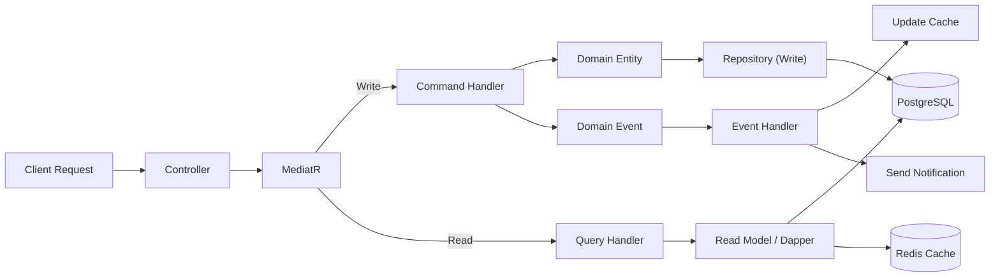

### 3.5 قاعدة CQRS

- **Commands** (Write):
  - تغيّر الحالة.
  - لا تُرجع بيانات (فقط Result).
  - تمر عبر Domain.
  
- **Queries** (Read):
  - لا تغيّر الحالة.
  - تُرجع بيانات (DTOs).
  - يمكن أن تتجاوز Domain (تستخدم Dapper للـ performance).

---

## 4. بنية الـ Frontend

### 4.1 بنية تطبيق الطالب (Student App)

```
apps/student-web/
├── src/
│   ├── app/                      # إعداد التطبيق
│   │   ├── App.tsx
│   │   ├── router.tsx            # React Router 7
│   │   ├── providers.tsx         # جميع الـ Providers
│   │   └── error-boundary.tsx
│   │
│   ├── config/                   # الإعدادات
│   │   ├── env.ts                # متغيرات البيئة
│   │   ├── constants.ts          # الثوابت
│   │   └── i18n.ts               # الترجمة
│   │
│   ├── features/                 # الميزات (Feature-based)
│   │   ├── auth/
│   │   │   ├── components/       # LoginForm, RegisterForm, etc.
│   │   │   ├── hooks/            # useAuth, useLogin
│   │   │   ├── services/         # authApi
│   │   │   ├── types.ts
│   │   │   └── index.ts
│   │   │
│   │   ├── dashboard/
│   │   ├── subjects/
│   │   ├── questions/
│   │   ├── library/
│   │   ├── search/
│   │   ├── profile/
│   │   ├── favorites/
│   │   ├── leaderboard/
│   │   └── notifications/
│   │
│   ├── components/               # مكوّنات مشتركة
│   │   ├── ui/                   # من packages/ui
│   │   ├── layouts/
│   │   └── common/
│   │
│   ├── hooks/                    # Hooks مشتركة
│   │   ├── useDebounce.ts
│   │   ├── useLocalStorage.ts
│   │   ├── useMediaQuery.ts
│   │   └── useOfflineMode.ts
│   │
│   ├── stores/                   # Zustand stores
│   │   ├── auth-store.ts
│   │   ├── ui-store.ts
│   │   └── notification-store.ts
│   │
│   ├── services/                 # API services
│   │   ├── api-client.ts         # Axios instance
│   │   ├── query-client.ts       # React Query
│   │   └── socket.ts             # WebSocket (مستقبلاً)
│   │
│   ├── types/                    # TypeScript types
│   │   ├── api.types.ts
│   │   └── common.types.ts
│   │
│   ├── utils/                    # أدوات
│   │   ├── cn.ts                 # clsx + tailwind-merge
│   │   ├── format.ts             # formatting helpers
│   │   └── security.ts           # device fingerprint, etc.
│   │
│   ├── styles/                   # الأنماط
│   │   ├── globals.css
│   │   └── tailwind.css
│   │
│   └── main.tsx                  # نقطة الدخول
│
├── public/                       # ملفات عامة
│   ├── manifest.json             # PWA manifest
│   ├── sw.js                     # Service Worker
│   ├── icons/                    # PWA icons
│   └── fonts/                    # خطوط (fallback)
│
├── tests/                        # الاختبارات
│   ├── unit/
│   ├── integration/
│   └── e2e/
│
├── vite.config.ts                # إعداد Vite
├── tailwind.config.ts            # إعداد Tailwind
├── tsconfig.json
└── package.json
```

### 4.2 بنية تطبيق الإدارة (Admin App)

نفس بنية تطبيق الطالب، لكن مع ميزات مختلفة:

```
apps/admin-web/src/features/
├── dashboard/
├── universities/          # إدارة الجامعات
├── colleges/              # إدارة الكليات
├── years/                 # إدارة السنوات
├── semesters/             # إدارة الفصول
├── subjects/              # إدارة المواد
├── lectures/              # إدارة المحاضرات
├── questions/             # بنك الأسئلة
├── exams/                 # الدورات
├── library/               # المكتبة
├── codes/                 # أكواد الاشتراك
├── students/              # الطلاب
├── admins/                # المدراء
├── roles/                 # الأدوار
├── notifications/         # الإشعارات
├── announcements/         # الإعلانات
├── reports/               # التقارير
└── settings/              # الإعدادات
```

### 4.3 إدارة الحالة (State Management)

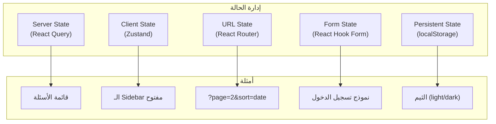

### 4.4 React Query Strategy

```typescript
// مثال: Query مع cache strategy
export function useQuestions(subjectId: string, filter: QuestionFilter) {
  return useQuery({
    queryKey: ['questions', subjectId, filter],
    queryFn: () => questionsApi.list(subjectId, filter),
    staleTime: 1000 * 60 * 5,  // 5 دقائق
    cacheTime: 1000 * 60 * 30, // 30 دقيقة
    enabled: !!subjectId,
  });
}

// مثال: Mutation مع optimistic update
export function useAnswerQuestion() {
  const queryClient = useQueryClient();
  
  return useMutation({
    mutationFn: (answer: AnswerRequest) => questionsApi.answer(answer),
    onMutate: async (answer) => {
      // Optimistic update
      await queryClient.cancelQueries({ queryKey: ['question', answer.questionId] });
      const previous = queryClient.getQueryData(['question', answer.questionId]);
      queryClient.setQueryData(['question', answer.questionId], (old) => ({
        ...old,
        userAnswer: answer.optionId,
      }));
      return { previous };
    },
    onError: (err, answer, context) => {
      // Rollback on error
      queryClient.setQueryData(['question', answer.questionId], context.previous);
    },
    onSettled: (data, err, answer) => {
      queryClient.invalidateQueries({ queryKey: ['question', answer.questionId] });
    },
  });
}
```

### 4.5 PWA Architecture

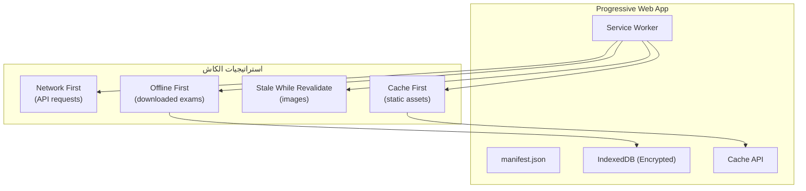

---

## 5. بنية قاعدة البيانات

### 5.1 PostgreSQL Configuration

```sql
-- إعدادات PostgreSQL 16
shared_buffers = 256MB          -- 25% من RAM
effective_cache_size = 1GB       -- 75% من RAM
work_mem = 4MB
maintenance_work_mem = 64MB
max_connections = 100
random_page_cost = 1.1           -- لـ SSD
effective_io_concurrency = 200   -- لـ SSD

-- Extensions
CREATE EXTENSION IF NOT EXISTS "uuid-ossp";
CREATE EXTENSION IF NOT EXISTS "pgcrypto";        -- للتشفير
CREATE EXTENSION IF NOT EXISTS "pg_trgm";         -- للبحث fuzzy
CREATE EXTENSION IF NOT EXISTS "unaccent";        -- تطبيع النصوص العربية
```

### 5.2 استراتيجية الفهرسة

```sql
-- فهارس أساسية
CREATE INDEX idx_questions_subject_id ON questions(subject_id);
CREATE INDEX idx_questions_lecture_id ON questions(lecture_id);
CREATE INDEX idx_questions_difficulty ON questions(difficulty);
CREATE INDEX idx_questions_status ON questions(status);
CREATE INDEX idx_questions_created_at ON questions(created_at DESC);

-- فهارس مركّبة
CREATE INDEX idx_questions_subject_status ON questions(subject_id, status);
CREATE INDEX idx_questions_subject_difficulty ON questions(subject_id, difficulty);

-- فهارس للبحث النصي (Full-text Search)
CREATE INDEX idx_questions_text_search ON questions 
USING gin(to_tsvector('arabic', text));
CREATE INDEX idx_questions_explanation_search ON questions 
USING gin(to_tsvector('arabic', explanation));

-- فهارس للبحث fuzzy (trigram)
CREATE INDEX idx_questions_text_trgm ON questions 
USING gin(text gin_trgm_ops);

-- فهارس للـ JSON
CREATE INDEX idx_questions_tags ON questions USING gin(tags);

-- فهارس للجداول الكبيرة
CREATE INDEX idx_attempt_logs_student_question ON attempt_logs(student_id, question_id);
CREATE INDEX idx_attempt_logs_created_at ON attempt_logs(created_at DESC);
CREATE INDEX idx_security_logs_student_created ON security_logs(student_id, created_at DESC);
```

### 5.3 استراتيجية الـ Read Replicas (مستقبلاً)

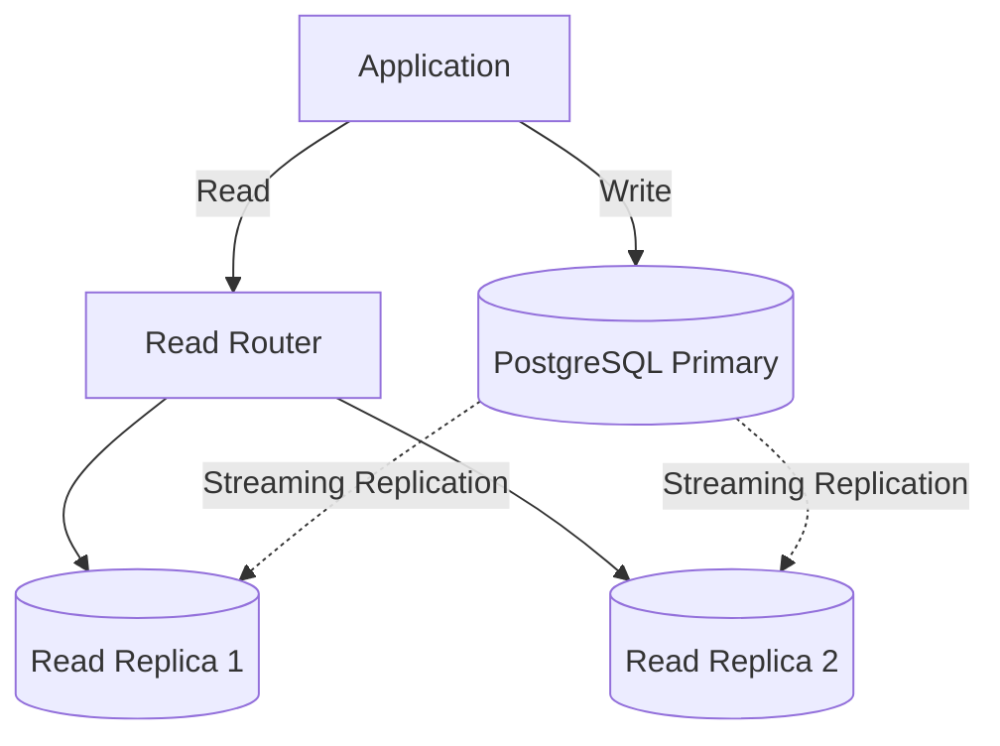

> **ملاحظة**: الـ Read Replicas ستُضاف في Phase 28 (Performance Optimization) عند الحاجة.

### 5.4 Redis Configuration

```csharp
// استراتيجيات الكاش
public static class CacheKeys
{
    // Questions - 5 دقائق
    public static string Question(Guid id) => $"question:{id}";
    public static string QuestionList(Guid subjectId, int page) => $"questions:{subjectId}:{page}";
    
    // Subjects - 1 ساعة (نادراً ما تتغيّر)
    public static string Subject(Guid id) => $"subject:{id}";
    public static string SubjectHierarchy(Guid id) => $"subject:hierarchy:{id}";
    
    // User - 15 دقيقة
    public static string User(Guid id) => $"user:{id}";
    public static string UserStats(Guid id) => $"user:stats:{id}";
    
    // Leaderboard - 1 ساعة (يُحدّث يومياً)
    public static string Leaderboard(string scope, Guid id) => $"leaderboard:{scope}:{id}";
    
    // Rate Limiting
    public static string RateLimit(string ip, string endpoint) => $"rate:{ip}:{endpoint}";
}

// Cache-Aside Pattern
public async Task<QuestionDto?> GetQuestionAsync(Guid id)
{
    var cacheKey = CacheKeys.Question(id);
    
    // 1. Try cache
    var cached = await _cache.GetAsync<QuestionDto>(cacheKey);
    if (cached != null) return cached;
    
    // 2. Get from DB
    var question = await _questionRepository.GetByIdAsync(id);
    if (question == null) return null;
    
    var dto = question.ToDto();
    
    // 3. Cache it
    await _cache.SetAsync(cacheKey, dto, TimeSpan.FromMinutes(5));
    
    return dto;
}
```

---

## 6. بنية البنية التحتية

### 6.1 Cloudflare Configuration

```yaml
# Cloudflare Settings
DNS:
  - A record: app.cms.example.com → Vercel
  - A record: admin.cms.example.com → Vercel
  - A record: api.cms.example.com → Railway
  - CNAME: cdn.cms.example.com → Cloudflare R2

WAF Rules:
  - Block SQL Injection
  - Block XSS
  - Rate limit: 100 req/min per IP
  - Geographic restrictions (optional)

SSL/TLS:
  - Mode: Full (Strict)
  - Min TLS Version: 1.3
  - HSTS: enabled

Caching:
  - Static assets: 1 year
  - API responses: no-cache
  - HTML: no-cache

Page Rules:
  - /*api* → Cache Level: Bypass
  - /*assets* → Cache Level: Cache Everything
```

### 6.2 Vercel Configuration (Frontend)

```json
// vercel.json
{
  "framework": "vite",
  "buildCommand": "pnpm build",
  "outputDirectory": "dist",
  "regions": ["fra1"],  // Frankfurt (أقرب لسوريا)
  "headers": [
    {
      "source": "/assets/(.*)",
      "headers": [
        { "key": "Cache-Control", "value": "public, max-age=31536000, immutable" }
      ]
    },
    {
      "source": "/sw.js",
      "headers": [
        { "key": "Cache-Control", "value": "no-cache" }
      ]
    }
  ],
  "redirects": [
    { "source": "/", "destination": "/dashboard", "permanent": false }
  ]
}
```

### 6.3 Railway Configuration (Backend)

```yaml
# railway.yml
services:
  api:
    build: .
    port: 8080
    env:
      - ASPNETCORE_ENVIRONMENT=Production
      - ASPNETCORE_URLS=http://+:8080
      - ConnectionStrings__PostgreSQL=${{PostgreSQL.DATABASE_URL}}
      - ConnectionStrings__Redis=${{Redis.REDIS_URL}}
    healthcheck:
      - /health
    deploy:
      restartPolicy:
        type: ON_FAILURE
        maxRetries: 3

  postgresql:
    image: postgres:16-alpine
    volume:
      - /var/lib/postgresql/data
    config:
      shared_buffers: 256MB
      max_connections: 100

  redis:
    image: redis:7-alpine
    volume:
      - /data
    command: redis-server --maxmemory 256mb --maxmemory-policy allkeys-lru
```

---

## 7. بنية الأمان

### 7.1 طبقات الأمان (Defense in Depth)

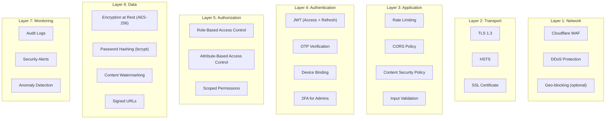

### 7.2 JWT Strategy

```csharp
// Access Token: 15 دقيقة
// Refresh Token: 7 أيام (httpOnly cookie)
// Device Token: 30 يوم (للـ device binding)

public class TokenService
{
    public (string accessToken, string refreshToken) GenerateTokens(User user, DeviceInfo device)
    {
        var accessToken = GenerateAccessToken(user);
        var refreshToken = GenerateRefreshToken();
        
        // Store refresh token in DB (hashed)
        await _refreshTokenRepository.AddAsync(new RefreshToken
        {
            UserId = user.Id,
            TokenHash = HashToken(refreshToken),
            DeviceFingerprint = device.Fingerprint,
            ExpiresAt = DateTime.UtcNow.AddDays(7)
        });
        
        return (accessToken, refreshToken);
    }
    
    private string GenerateAccessToken(User user)
    {
        var claims = new[]
        {
            new Claim(JwtRegisteredClaimNames.Sub, user.Id.ToString()),
            new Claim(JwtRegisteredClaimNames.Email, user.Email),
            new Claim(ClaimTypes.Role, user.Role),
            new Claim("scope_university_id", user.ScopeUniversityId?.ToString() ?? ""),
            new Claim("scope_college_id", user.ScopeCollegeId?.ToString() ?? ""),
            new Claim("device_id", user.DeviceId.ToString()),
            new Claim(JwtRegisteredClaimNames.Jti, Guid.NewGuid().ToString())
        };
        
        var token = new JwtSecurityToken(
            issuer: _config["Jwt:Issuer"],
            audience: _config["Jwt:Audience"],
            claims: claims,
            expires: DateTime.UtcNow.AddMinutes(15),
            signingCredentials: _signingCredentials
        );
        
        return new JwtSecurityTokenHandler().WriteToken(token);
    }
}
```

### 7.3 Content Protection Strategy

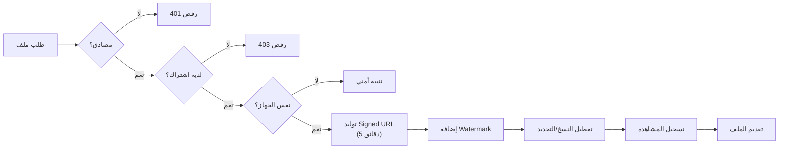

---

## 8. تدفقات البيانات

### 8.1 Data Flow: تسجيل الدخول

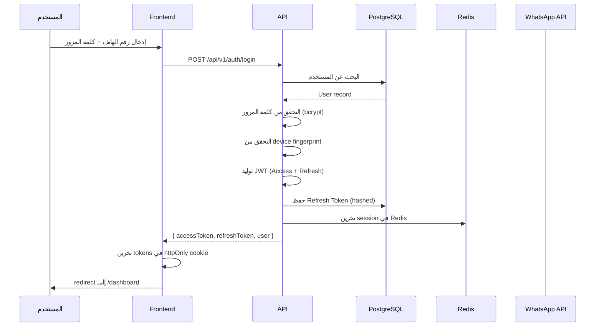

### 8.2 Data Flow: حل سؤال

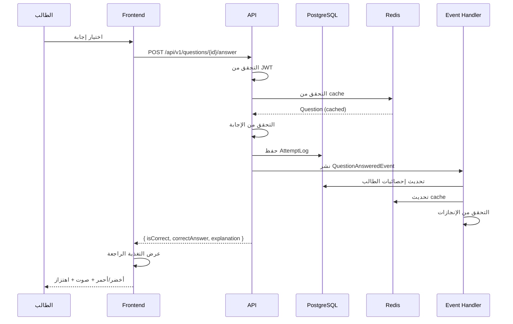

### 8.3 Data Flow: رفع ملف

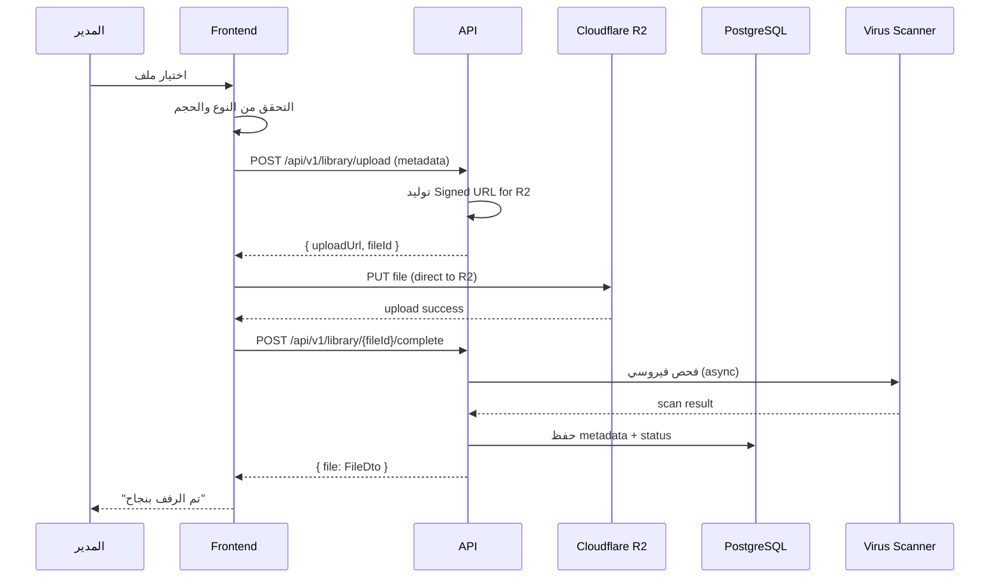

---

## 9. مبادئ تصميم الـ API

### 9.1 RESTful Principles

```
Base URL: https://api.cms.example.com/api/v1

Endpoints:
  GET    /questions              → قائمة
  GET    /questions/{id}         → عنصر واحد
  POST   /questions              → إنشاء
  PUT    /questions/{id}         → تحديث كامل
  PATCH  /questions/{id}         → تحديث جزئي
  DELETE /questions/{id}         → حذف
  
  POST   /questions/{id}/answer  → إجراء مخصص
  POST   /questions/{id}/report  → إجراء مخصص
```

### 9.2 Response Format (Problem Details - RFC 7807)

```json
// Success
{
  "data": { ... },
  "meta": {
    "page": 1,
    "pageSize": 20,
    "total": 100,
    "totalPages": 5
  }
}

// Error
{
  "type": "https://cms.example.com/errors/validation",
  "title": "Validation Error",
  "status": 400,
  "detail": "The request contains invalid data",
  "errors": {
    "text": ["Question text is required"],
    "options": ["At least 2 options required"]
  },
  "traceId": "abc-123-def"
}
```

### 9.3 Pagination

```
GET /api/v1/questions?page=1&pageSize=20&sortBy=createdAt&order=desc

Response:
{
  "data": [...],
  "meta": {
    "page": 1,
    "pageSize": 20,
    "total": 150,
    "totalPages": 8,
    "hasNext": true,
    "hasPrev": false
  }
}
```

### 9.4 Rate Limiting

```csharp
// Rate Limits
Public endpoints (login, register): 5 req/min per IP
Authenticated endpoints: 100 req/min per user
File upload: 10 req/hour per admin
Search: 30 req/min per user
```

---

## 10. بنية الـ Monorepo

### 10.1 الهيكل الكامل

```
cms-platform/
├── .github/
│   └── workflows/
│       ├── ci.yml                # CI pipeline
│       ├── deploy.yml            # Deploy pipeline
│       └── security.yml          # Security scans
│
├── apps/
│   ├── student-web/              # تطبيق الطالب (React 19)
│   ├── admin-web/                # لوحة الإدارة (React 19)
│   └── api/                      # الـ Backend (ASP.NET Core 9)
│       ├── src/
│       │   ├── CMS.Api/
│       │   ├── CMS.Application/
│       │   ├── CMS.Domain/
│       │   ├── CMS.Infrastructure/
│       │   └── CMS.Tests/
│       └── tests/
│
├── packages/
│   ├── ui/                       # مكتبة المكونات (shadcn/ui + custom)
│   ├── types/                    # أنواع TypeScript مشتركة
│   ├── utils/                    # أدوات مشتركة
│   └── config/                   # إعدادات مشتركة (ESLint, Prettier, etc.)
│
├── docs/                         # التوثيق
├── design/                       # أصول التصميم
├── scripts/                      # سكريبتات الأتمتة
│   ├── setup.sh
│   ├── seed.ts                   # بيانات تجريبية
│   └── deploy.sh
│
├── .editorconfig
├── .gitignore
├── .npmrc
├── pnpm-workspace.yaml
├── turbo.json
├── package.json
└── README.md
```

### 10.2 pnpm-workspace.yaml

```yaml
packages:
  - "apps/*"
  - "packages/*"
```

### 10.3 turbo.json

```json
{
  "$schema": "https://turbo.build/schema.json",
  "globalDependencies": ["**/.env.*local"],
  "pipeline": {
    "build": {
      "dependsOn": ["^build"],
      "outputs": ["dist/**", ".next/**", "build/**"]
    },
    "test": {
      "dependsOn": ["build"],
      "outputs": []
    },
    "lint": {
      "outputs": []
    },
    "dev": {
      "cache": false,
      "persistent": true
    }
  }
}
```

---

## 11. بنية النشر

### 11.1 Deployment Diagram

```mermaid
flowchart TB
    subgraph Dev["بيئة التطوير (Development)"]
        DevLocal["Local Machine<br/>Docker Compose"
        DevDB["PostgreSQL (Docker)"]
        DevRedis["Redis (Docker)"]
    end
    
    subgraph Staging["بيئة التجريب (Staging)"]
        StagingApp["Railway (Staging)"]
        StagingDB["Railway PostgreSQL"]
        StagingRedis["Railway Redis"]
        StagingR2["R2 (staging bucket)"]
    end
    
    subgraph Prod["بيئة الإنتاج (Production)"]
        Cloudflare["Cloudflare<br/>(CDN + WAF + DNS)"]
        
        VercelProd["Vercel<br/>(Student + Admin)"]
        
        RailwayProd["Railway<br/>(API + PostgreSQL + Redis)"]
        
        R2Prod["Cloudflare R2<br/>(production bucket)"]
        
        FCM["Firebase FCM"]
        
        Sentry["Sentry<br/>(Error Tracking)"]
        
        BetterStack["Better Stack<br/>(Uptime Monitoring)"]
    end
    
    DevLocal --> DevDB
    DevLocal --> DevRedis
    
    StagingApp --> StagingDB
    StagingApp --> StagingRedis
    StagingApp --> StagingR2
    
    Cloudflare --> VercelProd
    Cloudflare --> RailwayProd
    RailwayProd --> R2Prod
    RailwayProd --> FCM
    RailwayProd -.->|errors| Sentry
    Cloudflare -.->|uptime| BetterStack
```

### 11.2 CI/CD Pipeline

```yaml
# .github/workflows/ci.yml
name: CI/CD Pipeline

on:
  push:
    branches: [main, develop]
  pull_request:
    branches: [main]

jobs:
  # ===== Frontend =====
  frontend-lint-test:
    runs-on: ubuntu-latest
    steps:
      - uses: actions/checkout@v4
      - uses: pnpm/action-setup@v3
      - uses: actions/setup-node@v4
        with:
          node-version: 20
          cache: pnpm
      - run: pnpm install --frozen-lockfile
      - run: pnpm lint
      - run: pnpm test
      - run: pnpm build

  # ===== Backend =====
  backend-lint-test:
    runs-on: ubuntu-latest
    steps:
      - uses: actions/checkout@v4
      - uses: actions/setup-dotnet@v4
        with:
          dotnet-version: 9.0
      - run: dotnet restore
      - run: dotnet build --no-restore
      - run: dotnet test --no-build --verbosity normal

  # ===== Security =====
  security-scan:
    runs-on: ubuntu-latest
    steps:
      - uses: actions/checkout@v4
      - name: Run CodeQL Analysis
        uses: github/codeql-action/analyze@v3
      - name: Run Trivy (container scan)
        run: trivy fs .

  # ===== Deploy =====
  deploy-staging:
    if: github.ref == 'refs/heads/develop'
    needs: [frontend-lint-test, backend-lint-test, security-scan]
    runs-on: ubuntu-latest
    steps:
      - name: Deploy Frontend to Vercel (Staging)
        run: vercel --prod --token ${{ secrets.VERCEL_TOKEN }}
      - name: Deploy Backend to Railway (Staging)
        run: railway up --service api --environment staging

  deploy-production:
    if: github.ref == 'refs/heads/main'
    needs: [frontend-lint-test, backend-lint-test, security-scan]
    runs-on: ubuntu-latest
    environment: production
    steps:
      - name: Deploy Frontend to Vercel (Production)
        run: vercel --prod --token ${{ secrets.VERCEL_TOKEN }}
      - name: Deploy Backend to Railway (Production)
        run: railway up --service api --environment production
```

### 11.3 Environment Strategy

| البيئة | النطاق | الغرض | قاعدة البيانات |
|--------|--------|------|---------------|
| Development | localhost | تطوير محلي | Docker PostgreSQL |
| Staging | staging.cms.example.com | اختبار قبل الإنتاج | Railway (staging) |
| Production | cms.example.com | الإنتاج | Railway (production) |

---

## 12. المراقبة والرصد

### 12.1 Observability Stack

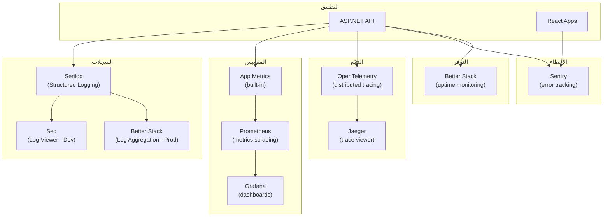

### 12.2 Health Checks

```csharp
// Health Check Endpoints
// GET /health          → overall health
// GET /health/ready    → readiness (DB + Redis connected)
// GET /health/live     → liveness (app is running)

public void ConfigureHealthChecks(IHealthChecksBuilder builder)
{
    builder.AddCheck("self", () => HealthCheckResult.Healthy());
    builder.AddNpgSql(connectionString, name: "postgresql");
    builder.AddRedis(redisConnectionString, name: "redis");
    builder.AddUrlGroup(new Uri("https://api.r2.cloudflarestorage.com"), name: "r2");
}
```

### 12.3 Key Metrics to Track

| الفئة | المقياس | الهدف |
|------|--------|------|
| **Performance** | API Response Time (P95) | < 200ms |
| **Performance** | Page Load Time | < 2.5s |
| **Availability** | Uptime | ≥ 99.9% |
| **Errors** | Error Rate | < 0.1% |
| **Business** | Active Users (DAU) | growing |
| **Business** | Questions Answered/day | growing |
| **Business** | Subscription Activations | growing |
| **Security** | Failed Login Attempts | monitor for spikes |
| **Security** | Security Alerts | 0 critical |

---

## 13. استراتيجية التوسّع

### 13.1 Horizontal Scaling

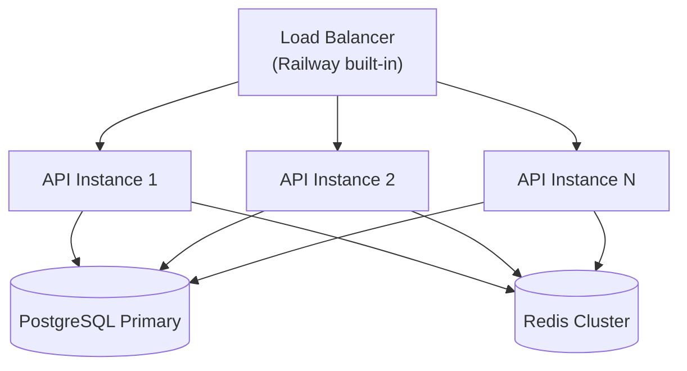

### 13.2 Scaling Triggers

| المورد | الشرط | الإجراء |
|--------|------|---------|
| API | CPU > 70% لـ 5 دقائق | إضافة instance |
| API | Memory > 80% | إضافة instance |
| PostgreSQL | Connections > 80 | إضافة read replica |
| Redis | Memory > 80% | إضافة node للـ cluster |
| Storage | استخدام > 80% | توسيع السعة |

### 13.3 Caching Strategy

```
L1: Browser Cache (Cache-Control headers)
   ↓ miss
L2: Service Worker Cache (PWA)
   ↓ miss
L3: Cloudflare CDN Cache (edge)
   ↓ miss
L4: Redis Cache (application)
   ↓ miss
L5: PostgreSQL (source of truth)
```

---

## 14. التعافي من الكوارث

### 14.1 Backup Strategy

| البيانات | التكرار | الاحتفاظ |
|---------|--------|---------|
| PostgreSQL | كل ساعة (point-in-time recovery) | 30 يوم |
| Redis | كل 6 ساعات (RDB snapshot) | 7 أيام |
| R2 Files | مدمج مع R2 (99.999999999% durability) | دائم |
| Code | GitHub (multiple branches + tags) | دائم |
| Documentation | GitHub | دائم |

### 14.2 Recovery Procedures

| السيناريو | RTO | RPO | الإجراء |
|----------|-----|-----|---------|
| فشل API instance | < 1min | 0 | إعادة تشغيل تلقائية |
| فشل PostgreSQL Primary | < 30min | < 15min | promote read replica |
| فشل Redis | < 5min | < 6h | استعادة من RDB snapshot |
| فشل منطقة Railway | < 2h | < 1h | إعادة النشر في منطقة أخرى |
| فقدان بيانات | < 4h | < 1h | استعادة من backup |

### 14.3 Disaster Recovery Plan

```bash
# 1. Restore PostgreSQL from backup
pg_restore --dbname=$DATABASE_URL --verbose /backups/latest.dump

# 2. Restore Redis from snapshot
redis-cli --rdb /backups/redis/dump.rdb

# 3. Verify data integrity
curl https://api.cms.example.com/health/ready

# 4. Switch DNS if needed (Cloudflare)
# (done via Cloudflare API)

# 5. Notify users
# (via FCM push notification)
```

---

## 15. قرارات معمارية إضافية

### D-012: Modular Monolith (بدلاً من Microservices)

- **القرار**: بناء Modular Monolith بدلاً من Microservices.
- **السبب**:
  - تكلفة أقل في البداية.
  - تعقيد أقل للتشغيل.
  - يمكن تقسيمه لاحقاً عند الحاجة.
- **التأثير**: بنية واحدة قابلة للتقسيم.

### D-013: CQRS مع MediatR

- **القرار**: تطبيق CQRS كامل (Commands/Queries منفصلة).
- **السبب**:
  - فصل واضح بين القراءة والكتابة.
  - سهولة التوسّع المستقبلي (read replicas).
  - منطق أعمال نظيف.
- **التأثير**: عدد ملفات أكبر، لكن أوضح.

### D-014: Server-Side Caching مع Redis

- **القرار**: استخدام Redis كطبقة كاش أساسية.
- **السبب**:
  - تقليل الحمل على PostgreSQL.
  - استجابة أسرع للمستخدم.
  - دعم rate limiting + sessions.
- **التأثير**: تكلفة إضافية ~$10/شهر، لكن أداء أفضل بـ 10x.

### D-015: Direct-to-R2 Uploads (Signed URLs)

- **القرار**: رفع الملفات مباشرة من المتصفح إلى R2.
- **السبب**:
  - لا تمر الملفات عبر الـ Backend (أداء أفضل).
  - توفير bandwidth الـ Backend.
- **التأثير**: تعقيد أمني إضافي (Signed URLs).

### D-016: PWA مع Service Worker

- **القرار**: PWA كامل مع Service Worker.
- **السبب**:
  - دعم Offline.
  - إمكانية التثبيت.
  - Push notifications.
- **التأثير**: تعقيد إضافي في إدارة الكاش.

### D-017: Feature-based Folder Structure (Frontend)

- **القرار**: تنظيم الـ Frontend حسب الميزات (Feature-based) بدلاً من النوع (Type-based).
- **السبب**:
  - سهولة الصيانة.
  - فصل واضح للمسؤوليات.
  - قابلية إعادة الاستخدام.
- **التأثير**: بنية أوضح لكن قد تتكرر بعض الـ patterns.

### D-018: Database-First Design مع EF Core Migrations

- **القرار**: استخدام EF Core migrations لإدارة الـ schema.
- **السبب**:
  - تحكّم إصداري في الـ schema.
  - rollback سهل.
  - توثيق التغييرات.
- **التأثير**: عملية تعلّم initial لكن مفيدة على المدى الطويل.

---

## 16. ملخص البنية المعمارية

### 16.1 الإحصائيات

| المؤشر | القيمة |
|--------|--------|
| **الطبقات المعمارية (Backend)** | 4 (Clean Architecture) |
| **النمط الرئيسي (Backend)** | CQRS + Modular Monolith |
| **التطبيقات (Frontend)** | 2 (Student + Admin) |
| **قواعد البيانات** | PostgreSQL 16 + Redis 7 |
| **التخزين السحابي** | Cloudflare R2 |
| **الـ CDN + WAF** | Cloudflare |
| **الـ Push Notifications** | Firebase FCM |
| **الاستضافة** | Vercel (Frontend) + Railway (Backend) |
| **الـ CI/CD** | GitHub Actions |
| **المراقبة** | Sentry + Better Stack + Seq |
| **طبقات الأمان** | 7 طبقات (Defense in Depth) |
| **القرارات المعمارية الجديدة** | 7 (D-012 → D-018) |

### 16.2 الالتزامات

- ✅ البنية قابلة للتوسّع (Horizontal + Vertical).
- ✅ البنية آمنة (7 طبقات أمان).
- ✅ البنية قابلة للمراقبة (Observability built-in).
- ✅ البنية قابلة للتعافي (Backup + Recovery).
- ✅ البنية موثّقة بالكامل.
- ✅ البنية تستخدم managed services (تكلفة أقل).

---

## 17. الخطوة التالية

الانتقال إلى **Phase 14: Database Design** لتفصيل الـ 28 جدول:

- SQL Schema كامل لكل جدول.
- EF Core entities + configurations.
- Migrations أولية.
- Seed data strategy.
- Indexing strategy تفصيلية.
- Data retention policies.

**المخرجات المتوقعة من Phase 14**:
- `docs/DATABASE_SCHEMA.md` — الـ schema الكامل
- `apps/api/src/CMS.Infrastructure/Migrations/` — EF Core migrations

---

**نهاية ملف ARCHITECTURE.md**
