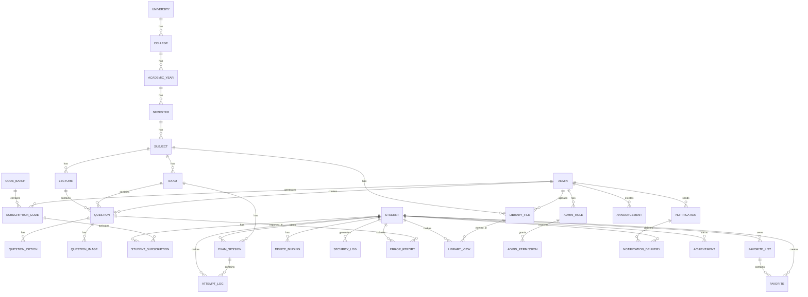

# DATABASE_SCHEMA.md — Phase 14: Database Design

> **تصميم قاعدة البيانات الكامل لمنصة CMS**. يحدد كل الجداول، الأعمدة، الأنواع، الفهارس، القيود، والعلاقات — مع SQL Schema كامل + EF Core Entities + Migrations Strategy.

**المرحلة**: Phase 14
**الحالة**: ✅ Completed
**تاريخ الإنجاز**: 2026-07-30
**قاعدة البيانات**: PostgreSQL 16
**ORM**: Entity Framework Core 9

---

## جدول المحتويات

1. [نظرة عامة على قاعدة البيانات](#1-نظرة-عامة)
2. [اتفاقيات التسمية (Naming Conventions)](#2-اتفاقيات-التسمية)
3. [الأنماط المشتركة (Common Patterns)](#3-الأنماط-المشتركة)
4. [الجداول الأكاديمية (Academic Tables)](#4-الجداول-الأكاديمية)
5. [جداول الأسئلة (Question Tables)](#5-جداول-الأسئلة)
6. [جداول المستخدمين (User Tables)](#6-جداول-المستخدمين)
7. [جداول الاشتراكات (Subscription Tables)](#7-جداول-الاشتراكات)
8. [جداول النشاط والمحاولات (Activity Tables)](#8-جداول-النشاط-والمحاولات)
9. [جداول المكتبة (Library Tables)](#9-جداول-المكتبة)
10. [جداول المفضلة (Favorites Tables)](#10-جداول-المفضلة)
11. [جداول الإشعارات (Notification Tables)](#11-جداول-الإشعارات)
12. [جداول الأمان (Security Tables)](#12-جداول-الأمان)
13. [جداول إضافية (Additional Tables)](#13-جداول-إضافية)
14. [استراتيجية الفهرسة الكاملة](#14-استراتيجية-الفهرسة-الكاملة)
15. [EF Core Configuration](#15-ef-core-configuration)
16. [Migrations Strategy](#16-migrations-strategy)
17. [Seed Data Strategy](#17-seed-data-strategy)
18. [Data Retention Policies](#18-data-retention-policies)
19. [Performance Considerations](#19-performance-considerations)

---

## 1. نظرة عامة

### 1.1 إحصائيات قاعدة البيانات

| المؤشر | القيمة |
|--------|--------|
| **عدد الجداول** | 30 جدول |
| **قاعدة البيانات** | PostgreSQL 16 |
| **ORM** | Entity Framework Core 9 |
| **نوع المفاتيح** | UUID (v4) |
| **الترميز** | UTF-8 |
| **Collation** | `en_US.utf8` (مع دعم العربية عبر `unaccent` + `pg_trgm`) |
| **Timezone** | UTC (تخزين) + تحويل عند العرض |

### 1.2 تصنيف الجداول

| الفئة | العدد | الجداول |
|------|------|---------|
| **أكاديمية** | 6 | universities, colleges, academic_years, semesters, subjects, lectures |
| **أسئلة** | 4 | questions, question_options, question_images, exams |
| **مستخدمين** | 4 | students, admins, admin_roles, admin_permissions |
| **اشتراكات** | 3 | subscription_codes, student_subscriptions, code_batches |
| **نشاط** | 2 | attempt_logs, exam_sessions |
| **مكتبة** | 2 | library_files, library_views |
| **مفضلة** | 2 | favorites, favorite_lists |
| **إشعارات** | 3 | notifications, notification_deliveries, announcements |
| **أمان** | 3 | device_bindings, security_logs, error_reports |
| **إضافية** | 1 | achievements |
| **الإجمالي** | **30** | |

### 1.3 ERD Diagram (Mermaid)



---

## 2. اتفاقيات التسمية

### 2.1 أسماء الجداول

| القاعدة | مثال |
|---------|------|
| **جمع** (plural) | `questions`, `students` |
| **snake_case** | `subscription_codes`, `library_files` |
| **أسماء وصل** (junction) | `student_subscriptions`, `notification_deliveries` |
| **بادئة الجدول** في FK | `subject_id`, `student_id` |

### 2.2 أسماء الأعمدة

| القاعدة | مثال |
|---------|------|
| **snake_case** | `created_at`, `first_name` |
| **المفتاح الأساسي** | `id` (UUID) |
| **المفاتيح الأجنبية** | `<table_singular>_id` (مثل `subject_id`) |
| **الطوابع الزمنية** | `created_at`, `updated_at`, `deleted_at` |
| **القيم المنطقية** | `is_<adjective>` (مثل `is_active`, `is_correct`) |
| **العدادات** | `<noun>_count` (مثل `views_count`) |

### 2.3 أسماء الفهارس

| القاعدة | مثال |
|---------|------|
| `idx_<table>_<columns>` | `idx_questions_subject_id` |
| `idx_<table>_<columns>_unique` | `idx_students_phone_unique` |
| `gin_<table>_<column>` | `gin_questions_text_search` |

### 2.4 أسماء القيود

| القاعدة | مثال |
|---------|------|
| Primary Key: `pk_<table>` | `pk_questions` |
| Foreign Key: `fk_<table>_<referenced>` | `fk_questions_subject` |
| Unique: `uq_<table>_<columns>` | `uq_students_phone` |
| Check: `ck_<table>_<rule>` | `ck_questions_difficulty` |

---

## 3. الأنماط المشتركة

### 3.1 BaseEntity (النمط الأساسي)

كل الجداول ترث من هذا النمط:

```sql
-- Common columns for all tables
id UUID PRIMARY KEY DEFAULT uuid_generate_v4(),
created_at TIMESTAMPTZ NOT NULL DEFAULT NOW(),
updated_at TIMESTAMPTZ NOT NULL DEFAULT NOW(),
-- deleted_at TIMESTAMPTZ NULL  -- للجداول التي تدعم soft delete
```

### 3.2 Soft Delete Pattern

الجداول التي تدعم الحذف الناعم:

```sql
deleted_at TIMESTAMPTZ NULL,
deleted_by UUID NULL,  -- من حذف (admin_id)

-- Index for filtering non-deleted records
CREATE INDEX idx_<table>_deleted_at ON <table>(deleted_at) WHERE deleted_at IS NULL;
```

### 3.3 Audit Columns

للجداول التي تحتاج تتبّع التعديلات:

```sql
created_by UUID NOT NULL,  -- من أنشأ (admin_id)
updated_by UUID NULL,      -- من عدّل آخر مرة
version INT NOT NULL DEFAULT 1,  -- للـ optimistic concurrency
```

### 3.4 Status Enum Pattern

```sql
-- استخدام VARCHAR مع CHECK بدلاً من ENUM (لمرونة أكبر)
status VARCHAR(20) NOT NULL DEFAULT 'active' 
  CHECK (status IN ('active', 'inactive', 'suspended', 'banned', 'draft', 'published', 'archived', 'deleted'))
```

### 3.5 JSON Columns

```sql
-- للأعمدة المرنة (tags, metadata, settings)
tags JSONB NOT NULL DEFAULT '[]'::jsonb,
metadata JSONB NOT NULL DEFAULT '{}'::jsonb,
```

---

## 4. الجداول الأكاديمية

### 4.1 universities

```sql
CREATE TABLE universities (
    id UUID PRIMARY KEY DEFAULT uuid_generate_v4(),
    name_ar VARCHAR(200) NOT NULL,
    name_en VARCHAR(200),
    slug VARCHAR(100) NOT NULL,
    description TEXT,
    logo_url VARCHAR(500),
    country VARCHAR(100) NOT NULL DEFAULT 'سوريا',
    city VARCHAR(100),
    website VARCHAR(500),
    status VARCHAR(20) NOT NULL DEFAULT 'active' 
        CHECK (status IN ('active', 'inactive', 'archived')),
    sort_order INT NOT NULL DEFAULT 0,
    created_at TIMESTAMPTZ NOT NULL DEFAULT NOW(),
    updated_at TIMESTAMPTZ NOT NULL DEFAULT NOW(),
    deleted_at TIMESTAMPTZ NULL
);

-- Indexes
CREATE UNIQUE INDEX uq_universities_slug ON universities(slug) WHERE deleted_at IS NULL;
CREATE INDEX idx_universities_status ON universities(status) WHERE deleted_at IS NULL;
CREATE INDEX idx_universities_sort ON universities(sort_order);

-- Trigger for updated_at
CREATE TRIGGER trg_universities_updated_at 
    BEFORE UPDATE ON universities 
    FOR EACH ROW EXECUTE FUNCTION update_updated_at_column();
```

### 4.2 colleges

```sql
CREATE TABLE colleges (
    id UUID PRIMARY KEY DEFAULT uuid_generate_v4(),
    university_id UUID NOT NULL REFERENCES universities(id) ON DELETE CASCADE,
    name_ar VARCHAR(200) NOT NULL,
    name_en VARCHAR(200),
    slug VARCHAR(100) NOT NULL,
    description TEXT,
    icon VARCHAR(100),
    status VARCHAR(20) NOT NULL DEFAULT 'active',
    sort_order INT NOT NULL DEFAULT 0,
    created_at TIMESTAMPTZ NOT NULL DEFAULT NOW(),
    updated_at TIMESTAMPTZ NOT NULL DEFAULT NOW(),
    deleted_at TIMESTAMPTZ NULL
);

CREATE INDEX idx_colleges_university ON colleges(university_id);
CREATE UNIQUE INDEX uq_colleges_slug_university ON colleges(university_id, slug) WHERE deleted_at IS NULL;
CREATE INDEX idx_colleges_status ON colleges(status);
```

### 4.3 academic_years

```sql
CREATE TABLE academic_years (
    id UUID PRIMARY KEY DEFAULT uuid_generate_v4(),
    college_id UUID NOT NULL REFERENCES colleges(id) ON DELETE CASCADE,
    name_ar VARCHAR(100) NOT NULL,  -- "السنة الثالثة"
    name_en VARCHAR(100),
    slug VARCHAR(50) NOT NULL,
    year_number INT NOT NULL CHECK (year_number BETWEEN 1 AND 7),
    description TEXT,
    status VARCHAR(20) NOT NULL DEFAULT 'active',
    sort_order INT NOT NULL DEFAULT 0,
    created_at TIMESTAMPTZ NOT NULL DEFAULT NOW(),
    updated_at TIMESTAMPTZ NOT NULL DEFAULT NOW(),
    deleted_at TIMESTAMPTZ NULL
);

CREATE INDEX idx_academic_years_college ON academic_years(college_id);
CREATE UNIQUE INDEX uq_academic_years_slug_college ON academic_years(college_id, slug) WHERE deleted_at IS NULL;
```

### 4.4 semesters

```sql
CREATE TABLE semesters (
    id UUID PRIMARY KEY DEFAULT uuid_generate_v4(),
    academic_year_id UUID NOT NULL REFERENCES academic_years(id) ON DELETE CASCADE,
    name_ar VARCHAR(100) NOT NULL,  -- "الفصل الأول"
    name_en VARCHAR(100),
    slug VARCHAR(50) NOT NULL,
    semester_number INT NOT NULL CHECK (semester_number BETWEEN 1 AND 3),
    status VARCHAR(20) NOT NULL DEFAULT 'active',
    sort_order INT NOT NULL DEFAULT 0,
    created_at TIMESTAMPTZ NOT NULL DEFAULT NOW(),
    updated_at TIMESTAMPTZ NOT NULL DEFAULT NOW(),
    deleted_at TIMESTAMPTZ NULL
);

CREATE INDEX idx_semesters_year ON semesters(academic_year_id);
```

### 4.5 subjects

```sql
CREATE TABLE subjects (
    id UUID PRIMARY KEY DEFAULT uuid_generate_v4(),
    semester_id UUID NOT NULL REFERENCES semesters(id) ON DELETE CASCADE,
    name_ar VARCHAR(200) NOT NULL,  -- "الباطنة"
    name_en VARCHAR(200),           -- "Internal Medicine"
    slug VARCHAR(100) NOT NULL,
    code VARCHAR(20),               -- "MED301"
    description TEXT,
    icon VARCHAR(100),
    color VARCHAR(7),               -- "#1976D2"
    credits INT,
    status VARCHAR(20) NOT NULL DEFAULT 'active',
    sort_order INT NOT NULL DEFAULT 0,
    created_at TIMESTAMPTZ NOT NULL DEFAULT NOW(),
    updated_at TIMESTAMPTZ NOT NULL DEFAULT NOW(),
    deleted_at TIMESTAMPTZ NULL
);

CREATE INDEX idx_subjects_semester ON subjects(semester_id);
CREATE UNIQUE INDEX uq_subjects_slug_semester ON subjects(semester_id, slug) WHERE deleted_at IS NULL;
CREATE INDEX idx_subjects_status ON subjects(status);
```

### 4.6 lectures

```sql
CREATE TABLE lectures (
    id UUID PRIMARY KEY DEFAULT uuid_generate_v4(),
    subject_id UUID NOT NULL REFERENCES subjects(id) ON DELETE CASCADE,
    title_ar VARCHAR(300) NOT NULL,
    title_en VARCHAR(300),
    slug VARCHAR(150) NOT NULL,
    description TEXT,
    lecture_number INT NOT NULL,
    duration_minutes INT,
    status VARCHAR(20) NOT NULL DEFAULT 'active',
    sort_order INT NOT NULL DEFAULT 0,
    created_at TIMESTAMPTZ NOT NULL DEFAULT NOW(),
    updated_at TIMESTAMPTZ NOT NULL DEFAULT NOW(),
    deleted_at TIMESTAMPTZ NULL
);

CREATE INDEX idx_lectures_subject ON lectures(subject_id);
CREATE UNIQUE INDEX uq_lectures_subject_number ON lectures(subject_id, lecture_number) WHERE deleted_at IS NULL;
CREATE INDEX idx_lectures_sort ON lectures(subject_id, sort_order);
```

---

## 5. جداول الأسئلة

### 5.1 questions

```sql
CREATE TABLE questions (
    id UUID PRIMARY KEY DEFAULT uuid_generate_v4(),
    type VARCHAR(30) NOT NULL DEFAULT 'mcq' 
        CHECK (type IN ('mcq', 'true_false', 'multiple_select', 'ordering', 'matching', 'clinical', 'image_based', 'interactive')),
    subject_id UUID NOT NULL REFERENCES subjects(id) ON DELETE CASCADE,
    lecture_id UUID REFERENCES lectures(id) ON DELETE SET NULL,
    exam_id UUID REFERENCES exams(id) ON DELETE SET NULL,
    
    -- Content
    text TEXT NOT NULL,
    text_html TEXT,  -- نسخة غنية (مع LaTeX)
    correct_answer VARCHAR(100) NOT NULL,  -- option_id أو 'true'/'false'
    explanation TEXT NOT NULL,
    explanation_html TEXT,
    
    -- Metadata
    tags JSONB NOT NULL DEFAULT '[]'::jsonb,
    difficulty VARCHAR(10) NOT NULL DEFAULT 'medium' 
        CHECK (difficulty IN ('easy', 'medium', 'hard')),
    year INT,  -- سنة الدورة (مثل 2024)
    reference VARCHAR(500),  -- "ديفيدسون ص. 245"
    
    -- Stats (denormalized)
    views_count INT NOT NULL DEFAULT 0,
    attempts_count INT NOT NULL DEFAULT 0,
    correct_attempts INT NOT NULL DEFAULT 0,
    reports_count INT NOT NULL DEFAULT 0,
    
    -- Status
    status VARCHAR(20) NOT NULL DEFAULT 'draft' 
        CHECK (status IN ('draft', 'review', 'published', 'archived', 'deleted')),
    
    -- Audit
    created_by UUID NOT NULL REFERENCES admins(id),
    created_at TIMESTAMPTZ NOT NULL DEFAULT NOW(),
    updated_at TIMESTAMPTZ NOT NULL DEFAULT NOW(),
    deleted_at TIMESTAMPTZ NULL
);

-- Basic indexes
CREATE INDEX idx_questions_subject ON questions(subject_id);
CREATE INDEX idx_questions_lecture ON questions(lecture_id);
CREATE INDEX idx_questions_exam ON questions(exam_id);
CREATE INDEX idx_questions_difficulty ON questions(difficulty);
CREATE INDEX idx_questions_status ON questions(status);
CREATE INDEX idx_questions_year ON questions(year);
CREATE INDEX idx_questions_created_at ON questions(created_at DESC);

-- Composite indexes
CREATE INDEX idx_questions_subject_status ON questions(subject_id, status);
CREATE INDEX idx_questions_subject_difficulty ON questions(subject_id, difficulty);

-- Full-text search (Arabic)
CREATE INDEX gin_questions_text_search ON questions 
    USING gin(to_tsvector('arabic', text));
CREATE INDEX gin_questions_explanation_search ON questions 
    USING gin(to_tsvector('arabic', explanation));

-- Trigram for fuzzy search
CREATE INDEX gin_questions_text_trgm ON questions 
    USING gin(text gin_trgm_ops);

-- JSON index for tags
CREATE INDEX gin_questions_tags ON questions USING gin(tags);

-- Updated_at trigger
CREATE TRIGGER trg_questions_updated_at 
    BEFORE UPDATE ON questions 
    FOR EACH ROW EXECUTE FUNCTION update_updated_at_column();
```

### 5.2 question_options

```sql
CREATE TABLE question_options (
    id UUID PRIMARY KEY DEFAULT uuid_generate_v4(),
    question_id UUID NOT NULL REFERENCES questions(id) ON DELETE CASCADE,
    option_letter VARCHAR(5) NOT NULL,  -- 'A', 'B', 'C', 'D'
    text TEXT NOT NULL,
    text_html TEXT,
    image_url VARCHAR(500),
    is_correct BOOLEAN NOT NULL DEFAULT FALSE,
    sort_order INT NOT NULL DEFAULT 0,
    created_at TIMESTAMPTZ NOT NULL DEFAULT NOW(),
    updated_at TIMESTAMPTZ NOT NULL DEFAULT NOW()
);

CREATE INDEX idx_question_options_question ON question_options(question_id);
CREATE UNIQUE INDEX uq_question_options_question_letter ON question_options(question_id, option_letter);
CREATE INDEX idx_question_options_sort ON question_options(question_id, sort_order);

-- Ensure exactly one correct answer for MCQ
CREATE UNIQUE INDEX uq_question_options_correct_mcq 
    ON question_options(question_id) 
    WHERE is_correct = TRUE;
```

### 5.3 question_images

```sql
CREATE TABLE question_images (
    id UUID PRIMARY KEY DEFAULT uuid_generate_v4(),
    question_id UUID NOT NULL REFERENCES questions(id) ON DELETE CASCADE,
    image_url VARCHAR(500) NOT NULL,
    alt_text VARCHAR(300),
    caption VARCHAR(500),
    sort_order INT NOT NULL DEFAULT 0,
    created_at TIMESTAMPTZ NOT NULL DEFAULT NOW()
);

CREATE INDEX idx_question_images_question ON question_images(question_id);
```

### 5.4 exams

```sql
CREATE TABLE exams (
    id UUID PRIMARY KEY DEFAULT uuid_generate_v4(),
    subject_id UUID NOT NULL REFERENCES subjects(id) ON DELETE CASCADE,
    title_ar VARCHAR(300) NOT NULL,
    title_en VARCHAR(300),
    slug VARCHAR(150) NOT NULL,
    description TEXT,
    exam_type VARCHAR(20) NOT NULL DEFAULT 'final' 
        CHECK (exam_type IN ('final', 'midterm', 'quiz', 'practice')),
    year INT NOT NULL,
    duration_minutes INT NOT NULL DEFAULT 60,
    total_questions INT NOT NULL DEFAULT 0,
    passing_score DECIMAL(5,2) NOT NULL DEFAULT 60.00,
    shuffle_questions BOOLEAN NOT NULL DEFAULT TRUE,
    shuffle_options BOOLEAN NOT NULL DEFAULT TRUE,
    show_results_immediately BOOLEAN NOT NULL DEFAULT TRUE,
    allow_review BOOLEAN NOT NULL DEFAULT TRUE,
    status VARCHAR(20) NOT NULL DEFAULT 'draft',
    created_by UUID NOT NULL REFERENCES admins(id),
    created_at TIMESTAMPTZ NOT NULL DEFAULT NOW(),
    updated_at TIMESTAMPTZ NOT NULL DEFAULT NOW(),
    deleted_at TIMESTAMPTZ NULL
);

CREATE INDEX idx_exams_subject ON exams(subject_id);
CREATE INDEX idx_exams_year ON exams(year);
CREATE INDEX idx_exams_status ON exams(status);
CREATE UNIQUE INDEX uq_exams_subject_slug ON exams(subject_id, slug) WHERE deleted_at IS NULL;
```

---

## 6. جداول المستخدمين

### 6.1 students

```sql
CREATE TABLE students (
    id UUID PRIMARY KEY DEFAULT uuid_generate_v4(),
    phone VARCHAR(20) NOT NULL,  -- "0991234567"
    phone_normalized VARCHAR(20) NOT NULL,  -- "+963991234567"
    password_hash VARCHAR(255) NOT NULL,
    full_name VARCHAR(200) NOT NULL,
    avatar_url VARCHAR(500),
    
    -- Academic info
    university_id UUID REFERENCES universities(id),
    college_id UUID REFERENCES colleges(id),
    academic_year_id UUID REFERENCES academic_years(id),
    
    -- Optional info
    email VARCHAR(255),
    gender VARCHAR(20) CHECK (gender IN ('male', 'female', 'prefer_not_to_say')),
    birth_date DATE,
    
    -- Status
    status VARCHAR(20) NOT NULL DEFAULT 'active' 
        CHECK (status IN ('active', 'suspended', 'banned')),
    ban_reason TEXT,
    ban_until TIMESTAMPTZ,
    
    -- Verification
    phone_verified_at TIMESTAMPTZ,
    otp_code VARCHAR(10),
    otp_expires_at TIMESTAMPTZ,
    
    -- Stats (denormalized)
    last_login TIMESTAMPTZ,
    login_count INT NOT NULL DEFAULT 0,
    questions_answered INT NOT NULL DEFAULT 0,
    correct_answers INT NOT NULL DEFAULT 0,
    current_streak INT NOT NULL DEFAULT 0,
    longest_streak INT NOT NULL DEFAULT 0,
    last_activity_date DATE,
    
    -- Preferences
    preferences JSONB NOT NULL DEFAULT '{
        "theme": "light",
        "notifications": true,
        "sounds": true,
        "vibration": true
    }'::jsonb,
    
    created_at TIMESTAMPTZ NOT NULL DEFAULT NOW(),
    updated_at TIMESTAMPTZ NOT NULL DEFAULT NOW(),
    deleted_at TIMESTAMPTZ NULL
);

-- Unique phone (only for non-deleted)
CREATE UNIQUE INDEX uq_students_phone ON students(phone_normalized) WHERE deleted_at IS NULL;
CREATE UNIQUE INDEX uq_students_email ON students(email) WHERE email IS NOT NULL AND deleted_at IS NULL;

-- Indexes
CREATE INDEX idx_students_university ON students(university_id);
CREATE INDEX idx_students_college ON students(college_id);
CREATE INDEX idx_students_status ON students(status);
CREATE INDEX idx_students_created_at ON students(created_at DESC);
CREATE INDEX idx_students_last_login ON students(last_login DESC);
CREATE INDEX idx_students_otp ON students(otp_code) WHERE otp_code IS NOT NULL;
```

### 6.2 admins

```sql
CREATE TABLE admins (
    id UUID PRIMARY KEY DEFAULT uuid_generate_v4(),
    email VARCHAR(255) NOT NULL,
    password_hash VARCHAR(255) NOT NULL,
    full_name VARCHAR(200) NOT NULL,
    avatar_url VARCHAR(500),
    phone VARCHAR(20),
    
    -- Role & Permissions
    role_id UUID NOT NULL REFERENCES admin_roles(id),
    
    -- 2FA
    two_factor_enabled BOOLEAN NOT NULL DEFAULT FALSE,
    two_factor_secret VARCHAR(255),
    recovery_codes JSONB,  -- ["code1", "code2", ...]
    
    -- Scope (for scoped admins)
    scope_university_id UUID REFERENCES universities(id),
    scope_college_id UUID REFERENCES colleges(id),
    scope_year_id UUID REFERENCES academic_years(id),
    scope_subject_id UUID REFERENCES subjects(id),
    
    -- Status
    status VARCHAR(20) NOT NULL DEFAULT 'active' 
        CHECK (status IN ('active', 'suspended', 'disabled')),
    
    -- Activity
    last_login TIMESTAMPTZ,
    login_count INT NOT NULL DEFAULT 0,
    
    created_at TIMESTAMPTZ NOT NULL DEFAULT NOW(),
    updated_at TIMESTAMPTZ NOT NULL DEFAULT NOW(),
    deleted_at TIMESTAMPTZ NULL
);

CREATE UNIQUE INDEX uq_admins_email ON admins(email) WHERE deleted_at IS NULL;
CREATE INDEX idx_admins_role ON admins(role_id);
CREATE INDEX idx_admins_status ON admins(status);
CREATE INDEX idx_admins_scope_university ON admins(scope_university_id) WHERE scope_university_id IS NOT NULL;
CREATE INDEX idx_admins_scope_college ON admins(scope_college_id) WHERE scope_college_id IS NOT NULL;
CREATE INDEX idx_admins_scope_subject ON admins(scope_subject_id) WHERE scope_subject_id IS NOT NULL;
```

### 6.3 admin_roles

```sql
CREATE TABLE admin_roles (
    id UUID PRIMARY KEY DEFAULT uuid_generate_v4(),
    name VARCHAR(50) NOT NULL,  -- "super_admin", "university_admin", etc.
    name_ar VARCHAR(100) NOT NULL,
    description TEXT,
    is_system BOOLEAN NOT NULL DEFAULT FALSE,  -- true for default roles
    created_at TIMESTAMPTZ NOT NULL DEFAULT NOW(),
    updated_at TIMESTAMPTZ NOT NULL DEFAULT NOW()
);

CREATE UNIQUE INDEX uq_admin_roles_name ON admin_roles(name);

-- Seed data (system roles)
INSERT INTO admin_roles (id, name, name_ar, description, is_system) VALUES
    (uuid_generate_v4(), 'super_admin', 'مدير عام', 'صلاحيات كاملة', TRUE),
    (uuid_generate_v4(), 'university_admin', 'مدير جامعة', 'إدارة جامعة محددة', TRUE),
    (uuid_generate_v4(), 'college_admin', 'مدير كلية', 'إدارة كلية محددة', TRUE),
    (uuid_generate_v4(), 'year_admin', 'مدير سنة', 'إدارة سنة محددة', TRUE),
    (uuid_generate_v4(), 'subject_admin', 'مدير مادة', 'إدارة مادة محددة', TRUE);
```

### 6.4 admin_permissions

```sql
CREATE TABLE admin_permissions (
    id UUID PRIMARY KEY DEFAULT uuid_generate_v4(),
    role_id UUID NOT NULL REFERENCES admin_roles(id) ON DELETE CASCADE,
    resource VARCHAR(50) NOT NULL,  -- 'questions', 'students', 'codes', etc.
    actions JSONB NOT NULL DEFAULT '[]'::jsonb,  -- ["view", "create", "edit", "delete", "export"]
    scope VARCHAR(20) NOT NULL DEFAULT 'own' CHECK (scope IN ('own', 'all')),
    created_at TIMESTAMPTZ NOT NULL DEFAULT NOW()
);

CREATE INDEX idx_admin_permissions_role ON admin_permissions(role_id);
CREATE INDEX idx_admin_permissions_resource ON admin_permissions(resource);
CREATE UNIQUE INDEX uq_admin_permissions_role_resource ON admin_permissions(role_id, resource);
```

---

## 7. جداول الاشتراكات

### 7.1 code_batches

```sql
CREATE TABLE code_batches (
    id UUID PRIMARY KEY DEFAULT uuid_generate_v4(),
    name VARCHAR(200) NOT NULL,  -- "دفعة الجراحة - ديسمبر 2024"
    description TEXT,
    quantity INT NOT NULL,
    scope_type VARCHAR(20) NOT NULL,
    scope_university_id UUID REFERENCES universities(id),
    scope_college_id UUID REFERENCES colleges(id),
    scope_year_id UUID REFERENCES academic_years(id),
    scope_subject_id UUID REFERENCES subjects(id),
    duration_days INT,
    starts_at DATE,
    expires_at DATE,
    code_expires_at TIMESTAMPTZ,  -- متى ينتهي صلاحية الكود نفسه
    created_by UUID NOT NULL REFERENCES admins(id),
    created_at TIMESTAMPTZ NOT NULL DEFAULT NOW()
);

CREATE INDEX idx_code_batches_created_by ON code_batches(created_by);
CREATE INDEX idx_code_batches_created_at ON code_batches(created_at DESC);
```

### 7.2 subscription_codes

```sql
CREATE TABLE subscription_codes (
    id UUID PRIMARY KEY DEFAULT uuid_generate_v4(),
    code VARCHAR(12) NOT NULL,  -- "CMS7X9K2M4Q8"
    batch_id UUID REFERENCES code_batches(id) ON DELETE SET NULL,
    
    -- Scope
    scope_type VARCHAR(20) NOT NULL 
        CHECK (scope_type IN ('subject', 'semester', 'year', 'college', 'university')),
    scope_university_id UUID REFERENCES universities(id),
    scope_college_id UUID REFERENCES colleges(id),
    scope_year_id UUID REFERENCES academic_years(id),
    scope_subject_id UUID REFERENCES subjects(id),
    
    -- Duration
    duration_days INT,  -- بديل عن starts_at/expires_at
    starts_at DATE,
    expires_at DATE,
    
    -- Code itself expiration
    code_expires_at TIMESTAMPTZ,  -- متى يصبح الكود غير قابل للتفعيل
    
    -- Usage
    status VARCHAR(20) NOT NULL DEFAULT 'active' 
        CHECK (status IN ('active', 'used', 'expired', 'cancelled')),
    used_by UUID REFERENCES students(id),
    used_at TIMESTAMPTZ,
    
    -- Audit
    created_by UUID NOT NULL REFERENCES admins(id),
    notes TEXT,  -- ملاحظات داخلية
    created_at TIMESTAMPTZ NOT NULL DEFAULT NOW(),
    updated_at TIMESTAMPTZ NOT NULL DEFAULT NOW()
);

-- Critical: unique code
CREATE UNIQUE INDEX uq_subscription_codes_code ON subscription_codes(code);

-- Indexes
CREATE INDEX idx_codes_batch ON subscription_codes(batch_id);
CREATE INDEX idx_codes_status ON subscription_codes(status);
CREATE INDEX idx_codes_used_by ON subscription_codes(used_by) WHERE used_by IS NOT NULL;
CREATE INDEX idx_codes_scope_subject ON subscription_codes(scope_subject_id) WHERE scope_subject_id IS NOT NULL;
CREATE INDEX idx_codes_created_at ON subscription_codes(created_at DESC);
```

### 7.3 student_subscriptions

```sql
CREATE TABLE student_subscriptions (
    id UUID PRIMARY KEY DEFAULT uuid_generate_v4(),
    student_id UUID NOT NULL REFERENCES students(id) ON DELETE CASCADE,
    code_id UUID NOT NULL REFERENCES subscription_codes(id),
    
    -- Scope (denormalized from code for performance)
    scope_type VARCHAR(20) NOT NULL,
    scope_university_id UUID REFERENCES universities(id),
    scope_college_id UUID REFERENCES colleges(id),
    scope_year_id UUID REFERENCES academic_years(id),
    scope_subject_id UUID REFERENCES subjects(id),
    
    -- Duration
    starts_at TIMESTAMPTZ NOT NULL,
    expires_at TIMESTAMPTZ NOT NULL,
    
    -- Status
    status VARCHAR(20) NOT NULL DEFAULT 'active' 
        CHECK (status IN ('active', 'expired', 'cancelled')),
    cancelled_at TIMESTAMPTZ,
    cancelled_reason TEXT,
    
    created_at TIMESTAMPTZ NOT NULL DEFAULT NOW(),
    updated_at TIMESTAMPTZ NOT NULL DEFAULT NOW()
);

CREATE INDEX idx_subscriptions_student ON student_subscriptions(student_id);
CREATE INDEX idx_subscriptions_code ON student_subscriptions(code_id);
CREATE INDEX idx_subscriptions_status ON student_subscriptions(status);
CREATE INDEX idx_subscriptions_expires_at ON student_subscriptions(expires_at);
CREATE INDEX idx_subscriptions_active ON student_subscriptions(student_id, expires_at) 
    WHERE status = 'active';

-- View: active subscriptions per student
CREATE VIEW v_active_subscriptions AS
SELECT * FROM student_subscriptions 
WHERE status = 'active' AND expires_at > NOW();
```

---

## 8. جداول النشاط والمحاولات

### 8.1 exam_sessions

```sql
CREATE TABLE exam_sessions (
    id UUID PRIMARY KEY DEFAULT uuid_generate_v4(),
    student_id UUID NOT NULL REFERENCES students(id) ON DELETE CASCADE,
    exam_id UUID NOT NULL REFERENCES exams(id) ON DELETE CASCADE,
    
    -- Timing
    started_at TIMESTAMPTZ NOT NULL,
    completed_at TIMESTAMPTZ,
    duration_seconds INT,  -- calculated
    
    -- Results
    total_questions INT NOT NULL,
    answered_questions INT NOT NULL DEFAULT 0,
    correct_answers INT NOT NULL DEFAULT 0,
    score DECIMAL(5,2),  -- percentage
    passed BOOLEAN,
    
    -- Status
    status VARCHAR(20) NOT NULL DEFAULT 'in_progress' 
        CHECK (status IN ('in_progress', 'completed', 'abandoned', 'expired')),
    is_first_attempt BOOLEAN NOT NULL DEFAULT TRUE,
    
    -- Offline
    is_offline BOOLEAN NOT NULL DEFAULT FALSE,
    synced_at TIMESTAMPTZ,
    
    created_at TIMESTAMPTZ NOT NULL DEFAULT NOW(),
    updated_at TIMESTAMPTZ NOT NULL DEFAULT NOW()
);

CREATE INDEX idx_exam_sessions_student ON exam_sessions(student_id);
CREATE INDEX idx_exam_sessions_exam ON exam_sessions(exam_id);
CREATE INDEX idx_exam_sessions_status ON exam_sessions(status);
CREATE INDEX idx_exam_sessions_started_at ON exam_sessions(started_at DESC);
CREATE INDEX idx_exam_sessions_student_exam ON exam_sessions(student_id, exam_id);
CREATE INDEX idx_exam_sessions_first_attempt ON exam_sessions(student_id, exam_id) 
    WHERE is_first_attempt = TRUE;
```

### 8.2 attempt_logs

```sql
CREATE TABLE attempt_logs (
    id UUID PRIMARY KEY DEFAULT uuid_generate_v4(),
    student_id UUID NOT NULL REFERENCES students(id) ON DELETE CASCADE,
    question_id UUID NOT NULL REFERENCES questions(id) ON DELETE CASCADE,
    exam_session_id UUID REFERENCES exam_sessions(id) ON DELETE CASCADE,
    
    -- Answer
    selected_answer VARCHAR(100) NOT NULL,
    is_correct BOOLEAN NOT NULL,
    is_first_attempt BOOLEAN NOT NULL DEFAULT TRUE,
    attempt_number INT NOT NULL DEFAULT 1,
    
    -- Timing
    duration_seconds INT,
    answered_at TIMESTAMPTZ NOT NULL DEFAULT NOW(),
    
    -- Offline
    is_offline BOOLEAN NOT NULL DEFAULT FALSE,
    synced_at TIMESTAMPTZ,
    
    created_at TIMESTAMPTZ NOT NULL DEFAULT NOW()
);

-- Partition by month for performance (see section 14)
CREATE INDEX idx_attempt_logs_student ON attempt_logs(student_id);
CREATE INDEX idx_attempt_logs_question ON attempt_logs(question_id);
CREATE INDEX idx_attempt_logs_session ON attempt_logs(exam_session_id) WHERE exam_session_id IS NOT NULL;
CREATE INDEX idx_attempt_logs_created_at ON attempt_logs(created_at DESC);
CREATE INDEX idx_attempt_logs_student_question ON attempt_logs(student_id, question_id);
CREATE INDEX idx_attempt_logs_first_attempt ON attempt_logs(student_id, question_id) 
    WHERE is_first_attempt = TRUE;
```

---

## 9. جداول المكتبة

### 9.1 library_files

```sql
CREATE TABLE library_files (
    id UUID PRIMARY KEY DEFAULT uuid_generate_v4(),
    subject_id UUID NOT NULL REFERENCES subjects(id) ON DELETE CASCADE,
    lecture_id UUID REFERENCES lectures(id) ON DELETE SET NULL,
    
    -- Content
    type VARCHAR(20) NOT NULL 
        CHECK (type IN ('pdf', 'html', 'image', 'video', 'summary', 'comprehensive', 'paragraph')),
    title VARCHAR(300) NOT NULL,
    description TEXT,
    
    -- Storage
    file_url VARCHAR(500) NOT NULL,  -- R2 path
    file_size INT NOT NULL,  -- bytes
    file_format VARCHAR(20),  -- 'pdf', 'jpg', 'webp', 'mp4'
    
    -- Media-specific
    duration_seconds INT,  -- for videos
    pages_count INT,  -- for PDFs
    thumbnail_url VARCHAR(500),
    
    -- YouTube (for videos)
    youtube_video_id VARCHAR(20),
    youtube_playlist_id VARCHAR(50),
    
    -- Metadata
    tags JSONB NOT NULL DEFAULT '[]'::jsonb,
    
    -- Stats (denormalized)
    views_count INT NOT NULL DEFAULT 0,
    favorites_count INT NOT NULL DEFAULT 0,
    
    -- Status
    status VARCHAR(20) NOT NULL DEFAULT 'draft',
    
    -- Security
    virus_scan_status VARCHAR(20) NOT NULL DEFAULT 'pending' 
        CHECK (virus_scan_status IN ('pending', 'clean', 'infected', 'error')),
    virus_scanned_at TIMESTAMPTZ,
    
    -- Audit
    created_by UUID NOT NULL REFERENCES admins(id),
    created_at TIMESTAMPTZ NOT NULL DEFAULT NOW(),
    updated_at TIMESTAMPTZ NOT NULL DEFAULT NOW(),
    deleted_at TIMESTAMPTZ NULL
);

CREATE INDEX idx_library_subject ON library_files(subject_id);
CREATE INDEX idx_library_lecture ON library_files(lecture_id);
CREATE INDEX idx_library_type ON library_files(type);
CREATE INDEX idx_library_status ON library_files(status);
CREATE INDEX idx_library_created_at ON library_files(created_at DESC);
CREATE INDEX idx_library_views ON library_files(views_count DESC);
CREATE INDEX gin_library_tags ON library_files USING gin(tags);

-- Full-text search
CREATE INDEX gin_library_title_search ON library_files 
    USING gin(to_tsvector('arabic', title));
```

### 9.2 library_views

```sql
CREATE TABLE library_views (
    id UUID PRIMARY KEY DEFAULT uuid_generate_v4(),
    student_id UUID NOT NULL REFERENCES students(id) ON DELETE CASCADE,
    file_id UUID NOT NULL REFERENCES library_files(id) ON DELETE CASCADE,
    
    viewed_at TIMESTAMPTZ NOT NULL DEFAULT NOW(),
    duration_seconds INT,
    pages_viewed INT,  -- for PDFs
    completion_percentage DECIMAL(5,2),
    
    -- Device
    device_fingerprint VARCHAR(255),
    ip_address INET,
    
    created_at TIMESTAMPTZ NOT NULL DEFAULT NOW()
);

CREATE INDEX idx_library_views_student ON library_views(student_id);
CREATE INDEX idx_library_views_file ON library_views(file_id);
CREATE INDEX idx_library_views_viewed_at ON library_views(viewed_at DESC);
CREATE INDEX idx_library_views_student_file ON library_views(student_id, file_id);
```

---

## 10. جداول المفضلة

### 10.1 favorite_lists

```sql
CREATE TABLE favorite_lists (
    id UUID PRIMARY KEY DEFAULT uuid_generate_v4(),
    student_id UUID NOT NULL REFERENCES students(id) ON DELETE CASCADE,
    name VARCHAR(100) NOT NULL,
    description TEXT,
    color VARCHAR(7),  -- hex color
    is_private BOOLEAN NOT NULL DEFAULT TRUE,
    questions_count INT NOT NULL DEFAULT 0,  -- denormalized
    created_at TIMESTAMPTZ NOT NULL DEFAULT NOW(),
    updated_at TIMESTAMPTZ NOT NULL DEFAULT NOW()
);

CREATE INDEX idx_favorite_lists_student ON favorite_lists(student_id);
```

### 10.2 favorites

```sql
CREATE TABLE favorites (
    id UUID PRIMARY KEY DEFAULT uuid_generate_v4(),
    student_id UUID NOT NULL REFERENCES students(id) ON DELETE CASCADE,
    question_id UUID NOT NULL REFERENCES questions(id) ON DELETE CASCADE,
    list_id UUID REFERENCES favorite_lists(id) ON DELETE CASCADE,
    notes TEXT,
    created_at TIMESTAMPTZ NOT NULL DEFAULT NOW()
);

CREATE UNIQUE INDEX uq_favorites_student_question ON favorites(student_id, question_id);
CREATE INDEX idx_favorites_list ON favorites(list_id) WHERE list_id IS NOT NULL;
CREATE INDEX idx_favorites_student ON favorites(student_id);
CREATE INDEX idx_favorites_created_at ON favorites(created_at DESC);
```

---

## 11. جداول الإشعارات

### 11.1 notifications

```sql
CREATE TABLE notifications (
    id UUID PRIMARY KEY DEFAULT uuid_generate_v4(),
    type VARCHAR(30) NOT NULL 
        CHECK (type IN ('announcement', 'subscription_alert', 'new_content', 'security', 'message', 'achievement')),
    title VARCHAR(200) NOT NULL,
    body TEXT NOT NULL,
    icon VARCHAR(100),
    action_url VARCHAR(500),
    action_label VARCHAR(100),
    
    -- Targeting
    target_type VARCHAR(20) NOT NULL 
        CHECK (target_type IN ('student', 'subject', 'semester', 'year', 'college', 'university', 'all')),
    target_id UUID,  -- null for 'all'
    
    -- Scheduling
    scheduled_at TIMESTAMPTZ,
    sent_at TIMESTAMPTZ,
    status VARCHAR(20) NOT NULL DEFAULT 'draft' 
        CHECK (status IN ('draft', 'scheduled', 'sending', 'sent', 'cancelled')),
    
    -- Audit
    sent_by UUID NOT NULL REFERENCES admins(id),
    created_at TIMESTAMPTZ NOT NULL DEFAULT NOW(),
    updated_at TIMESTAMPTZ NOT NULL DEFAULT NOW()
);

CREATE INDEX idx_notifications_status ON notifications(status);
CREATE INDEX idx_notifications_scheduled ON notifications(scheduled_at) WHERE status = 'scheduled';
CREATE INDEX idx_notifications_target ON notifications(target_type, target_id);
CREATE INDEX idx_notifications_created_at ON notifications(created_at DESC);
```

### 11.2 notification_deliveries

```sql
CREATE TABLE notification_deliveries (
    id UUID PRIMARY KEY DEFAULT uuid_generate_v4(),
    notification_id UUID NOT NULL REFERENCES notifications(id) ON DELETE CASCADE,
    student_id UUID NOT NULL REFERENCES students(id) ON DELETE CASCADE,
    
    channel VARCHAR(20) NOT NULL CHECK (channel IN ('push', 'in_app', 'toast')),
    status VARCHAR(20) NOT NULL DEFAULT 'pending' 
        CHECK (status IN ('pending', 'sent', 'delivered', 'failed', 'read', 'clicked')),
    
    sent_at TIMESTAMPTZ,
    delivered_at TIMESTAMPTZ,
    read_at TIMESTAMPTZ,
    clicked_at TIMESTAMPTZ,
    
    failure_reason TEXT,
    
    created_at TIMESTAMPTZ NOT NULL DEFAULT NOW()
);

CREATE INDEX idx_deliveries_notification ON notification_deliveries(notification_id);
CREATE INDEX idx_deliveries_student ON notification_deliveries(student_id);
CREATE INDEX idx_deliveries_status ON notification_deliveries(status);
CREATE INDEX idx_deliveries_student_unread ON notification_deliveries(student_id, status) 
    WHERE status IN ('pending', 'delivered');
CREATE INDEX idx_deliveries_created_at ON notification_deliveries(created_at DESC);
```

### 11.3 announcements

```sql
CREATE TABLE announcements (
    id UUID PRIMARY KEY DEFAULT uuid_generate_v4(),
    title VARCHAR(200) NOT NULL,
    body TEXT NOT NULL,
    type VARCHAR(20) NOT NULL DEFAULT 'info' 
        CHECK (type IN ('info', 'warning', 'success', 'danger')),
    icon VARCHAR(100),
    
    target_audience VARCHAR(20) NOT NULL DEFAULT 'all' 
        CHECK (target_audience IN ('all', 'students', 'admins', 'specific')),
    
    dismissible BOOLEAN NOT NULL DEFAULT TRUE,
    starts_at TIMESTAMPTZ NOT NULL DEFAULT NOW(),
    ends_at TIMESTAMPTZ,
    
    status VARCHAR(20) NOT NULL DEFAULT 'active',
    created_by UUID NOT NULL REFERENCES admins(id),
    created_at TIMESTAMPTZ NOT NULL DEFAULT NOW(),
    updated_at TIMESTAMPTZ NOT NULL DEFAULT NOW()
);

CREATE INDEX idx_announcements_status ON announcements(status);
CREATE INDEX idx_announcements_active ON announcements(starts_at, ends_at) WHERE status = 'active';
```

---

## 12. جداول الأمان

### 12.1 device_bindings

```sql
CREATE TABLE device_bindings (
    id UUID PRIMARY KEY DEFAULT uuid_generate_v4(),
    student_id UUID NOT NULL REFERENCES students(id) ON DELETE CASCADE,
    device_fingerprint VARCHAR(255) NOT NULL,
    device_name VARCHAR(200),  -- "iPhone 12 - Safari"
    device_type VARCHAR(20) CHECK (device_type IN ('mobile', 'tablet', 'desktop')),
    os VARCHAR(100),
    browser VARCHAR(100),
    user_agent TEXT,
    ip_address INET,
    location VARCHAR(200),  -- GeoIP
    
    is_active BOOLEAN NOT NULL DEFAULT TRUE,
    bound_at TIMESTAMPTZ NOT NULL DEFAULT NOW(),
    last_used TIMESTAMPTZ NOT NULL DEFAULT NOW(),
    
    created_at TIMESTAMPTZ NOT NULL DEFAULT NOW(),
    updated_at TIMESTAMPTZ NOT NULL DEFAULT NOW()
);

CREATE UNIQUE INDEX uq_device_bindings_student_fingerprint 
    ON device_bindings(student_id, device_fingerprint);
CREATE INDEX idx_device_bindings_student ON device_bindings(student_id);
CREATE INDEX idx_device_bindings_active ON device_bindings(student_id) WHERE is_active = TRUE;
```

### 12.2 security_logs

```sql
CREATE TABLE security_logs (
    id UUID PRIMARY KEY DEFAULT uuid_generate_v4(),
    student_id UUID REFERENCES students(id) ON DELETE SET NULL,
    admin_id UUID REFERENCES admins(id) ON DELETE SET NULL,
    
    event_type VARCHAR(50) NOT NULL 
        CHECK (event_type IN (
            'login_success', 'login_failed', 'logout',
            'device_change', 'device_binding_failed',
            'devtools_detected', 'screenshot_attempt', 
            'copy_attempt', 'download_attempt', 'print_attempt',
            'multiple_accounts_suspected',
            'ban_issued', 'ban_lifted',
            'password_changed', 'password_reset_requested',
            'otp_sent', 'otp_verified', 'otp_failed',
            'suspicious_activity'
        )),
    severity VARCHAR(20) NOT NULL DEFAULT 'info' 
        CHECK (severity IN ('info', 'warning', 'critical')),
    description TEXT NOT NULL,
    
    -- Context
    ip_address INET,
    user_agent TEXT,
    device_fingerprint VARCHAR(255),
    metadata JSONB NOT NULL DEFAULT '{}'::jsonb,
    
    created_at TIMESTAMPTZ NOT NULL DEFAULT NOW()
);

CREATE INDEX idx_security_logs_student ON security_logs(student_id);
CREATE INDEX idx_security_logs_admin ON security_logs(admin_id);
CREATE INDEX idx_security_logs_event_type ON security_logs(event_type);
CREATE INDEX idx_security_logs_severity ON security_logs(severity);
CREATE INDEX idx_security_logs_created_at ON security_logs(created_at DESC);
CREATE INDEX idx_security_logs_student_recent ON security_logs(student_id, created_at DESC);

-- Partition by month (see section 14)
```

### 12.3 error_reports

```sql
CREATE TABLE error_reports (
    id UUID PRIMARY KEY DEFAULT uuid_generate_v4(),
    student_id UUID NOT NULL REFERENCES students(id) ON DELETE CASCADE,
    question_id UUID NOT NULL REFERENCES questions(id) ON DELETE CASCADE,
    
    reason_type VARCHAR(30) NOT NULL 
        CHECK (reason_type IN ('scientific', 'typo', 'missing_option', 'unclear_explanation', 'other')),
    description TEXT NOT NULL,
    screenshot_url VARCHAR(500),
    
    status VARCHAR(20) NOT NULL DEFAULT 'pending' 
        CHECK (status IN ('pending', 'reviewing', 'resolved', 'rejected')),
    
    resolved_by UUID REFERENCES admins(id),
    resolution_notes TEXT,
    resolved_at TIMESTAMPTZ,
    
    created_at TIMESTAMPTZ NOT NULL DEFAULT NOW(),
    updated_at TIMESTAMPTZ NOT NULL DEFAULT NOW()
);

CREATE INDEX idx_error_reports_student ON error_reports(student_id);
CREATE INDEX idx_error_reports_question ON error_reports(question_id);
CREATE INDEX idx_error_reports_status ON error_reports(status);
CREATE INDEX idx_error_reports_created_at ON error_reports(created_at DESC);
CREATE INDEX idx_error_reports_pending ON error_reports(question_id, status) WHERE status = 'pending';
```

---

## 13. جداول إضافية

### 13.1 achievements

```sql
CREATE TABLE achievements (
    id UUID PRIMARY KEY DEFAULT uuid_generate_v4(),
    student_id UUID NOT NULL REFERENCES students(id) ON DELETE CASCADE,
    
    type VARCHAR(50) NOT NULL 
        CHECK (type IN (
            'first_question', 'first_exam', 'first_correct',
            'streak_7', 'streak_30', 'streak_100',
            'questions_100', 'questions_500', 'questions_1000',
            'exam_passed', 'exam_perfect',
            'subject_completed', 'all_subjects',
            'top_10', 'top_3', 'top_1',
            'daily_goal_7', 'daily_goal_30',
            'library_explorer', 'video_watcher',
            'early_adopter', 'helpful_reporter'
        )),
    title VARCHAR(200) NOT NULL,
    description TEXT,
    icon VARCHAR(100),
    
    earned_at TIMESTAMPTZ NOT NULL DEFAULT NOW(),
    metadata JSONB NOT NULL DEFAULT '{}'::jsonb,
    
    created_at TIMESTAMPTZ NOT NULL DEFAULT NOW()
);

CREATE INDEX idx_achievements_student ON achievements(student_id);
CREATE INDEX idx_achievements_type ON achievements(type);
CREATE INDEX idx_achievements_earned_at ON achievements(earned_at DESC);
CREATE UNIQUE INDEX uq_achievements_student_type ON achievements(student_id, type);
```

### 13.2 refresh_tokens

```sql
CREATE TABLE refresh_tokens (
    id UUID PRIMARY KEY DEFAULT uuid_generate_v4(),
    user_id UUID NOT NULL,  -- student_id or admin_id
    user_type VARCHAR(10) NOT NULL CHECK (user_type IN ('student', 'admin')),
    token_hash VARCHAR(255) NOT NULL,
    device_fingerprint VARCHAR(255),
    expires_at TIMESTAMPTZ NOT NULL,
    revoked_at TIMESTAMPTZ,
    replaced_by UUID REFERENCES refresh_tokens(id),
    
    created_at TIMESTAMPTZ NOT NULL DEFAULT NOW()
);

CREATE INDEX idx_refresh_tokens_user ON refresh_tokens(user_id, user_type);
CREATE UNIQUE INDEX uq_refresh_tokens_hash ON refresh_tokens(token_hash);
CREATE INDEX idx_refresh_tokens_expires ON refresh_tokens(expires_at) WHERE revoked_at IS NULL;
```

### 13.3 audit_logs

```sql
CREATE TABLE audit_logs (
    id UUID PRIMARY KEY DEFAULT uuid_generate_v4(),
    entity_type VARCHAR(50) NOT NULL,  -- 'question', 'student', 'code', etc.
    entity_id UUID NOT NULL,
    action VARCHAR(20) NOT NULL CHECK (action IN ('create', 'update', 'delete', 'restore', 'archive')),
    changes JSONB,  -- {field: {old, new}}
    
    performed_by UUID NOT NULL,  -- admin_id
    performed_by_type VARCHAR(10) NOT NULL CHECK (performed_by_type IN ('admin', 'system')),
    
    ip_address INET,
    user_agent TEXT,
    
    created_at TIMESTAMPTZ NOT NULL DEFAULT NOW()
);

CREATE INDEX idx_audit_logs_entity ON audit_logs(entity_type, entity_id);
CREATE INDEX idx_audit_logs_performed_by ON audit_logs(performed_by);
CREATE INDEX idx_audit_logs_created_at ON audit_logs(created_at DESC);
```

---

## 14. استراتيجية الفهرسة الكاملة

### 14.1 أنواع الفهارس المستخدمة

| النوع | الاستخدام | العدد التقريبي |
|------|----------|---------------|
| **B-tree** | المفاتيح الأجنبية، البحث الدقيق | ~60 |
| **GIN** | البحث النصي، JSON، trigram | ~8 |
| **BRIN** | الجداول الكبيرة (logs) | ~3 |
| **Partial** | الفلترة الشائعة (WHERE deleted_at IS NULL) | ~10 |
| **Composite** | الاستعلامات المتعدّدة الأعمدة | ~12 |

### 14.2 Partitioning للجداول الكبيرة

```sql
-- Partition attempt_logs by month
CREATE TABLE attempt_logs (
    id UUID NOT NULL DEFAULT uuid_generate_v4(),
    -- ... columns ...
    created_at TIMESTAMPTZ NOT NULL DEFAULT NOW()
) PARTITION BY RANGE (created_at);

-- Monthly partitions
CREATE TABLE attempt_logs_2026_07 PARTITION OF attempt_logs
    FOR VALUES FROM ('2026-07-01') TO ('2026-08-01');
CREATE TABLE attempt_logs_2026_08 PARTITION OF attempt_logs
    FOR VALUES FROM ('2026-08-01') TO ('2026-09-01');
-- ... etc

-- Same for security_logs and audit_logs
```

### 14.3 Full-Text Search Configuration

```sql
-- Custom Arabic search configuration
CREATE TEXT SEARCH CONFIGURATION arabic_unaccent (COPY = arabic);
ALTER TEXT SEARCH CONFIGURATION arabic_unaccent
    ALTER MAPPING FOR hword, hword_part, word
    WITH unaccent, arabic_stem;

-- Use in queries
SELECT * FROM questions 
WHERE to_tsvector('arabic_unaccent', text) @@ to_tsquery('arabic_unaccent', 'قلب');
```

---

## 15. EF Core Configuration

### 15.1 BaseEntity Class

```csharp
// CMS.Domain/Common/BaseEntity.cs
public abstract class BaseEntity
{
    public Guid Id { get; protected set; }
    public DateTime CreatedAt { get; protected set; } = DateTime.UtcNow;
    public DateTime UpdatedAt { get; protected set; } = DateTime.UtcNow;
}

public abstract class AuditableEntity : BaseEntity
{
    public Guid CreatedBy { get; set; }
    public DateTime? DeletedAt { get; set; }
    public Guid? DeletedBy { get; set; }
}
```

### 15.2 Question Entity

```csharp
// CMS.Domain/Entities/Question.cs
public class Question : AuditableEntity
{
    public QuestionType Type { get; private set; }
    public Guid SubjectId { get; private set; }
    public Guid? LectureId { get; private set; }
    public Guid? ExamId { get; private set; }
    
    public string Text { get; private set; }
    public string? TextHtml { get; private set; }
    public string CorrectAnswer { get; private set; }
    public string Explanation { get; private set; }
    public string? ExplanationHtml { get; private set; }
    
    public List<string> Tags { get; private set; } = new();
    public Difficulty Difficulty { get; private set; }
    public int? Year { get; private set; }
    public string? Reference { get; private set; }
    
    public int ViewsCount { get; private set; }
    public int AttemptsCount { get; private set; }
    public int CorrectAttempts { get; private set; }
    public int ReportsCount { get; private set; }
    
    public ContentStatus Status { get; private set; }
    
    // Navigation
    public Subject Subject { get; private set; } = null!;
    public Lecture? Lecture { get; private set; }
    public Exam? Exam { get; private set; }
    public List<QuestionOption> Options { get; private set; } = new();
    public List<QuestionImage> Images { get; private set; } = new();
    
    // Factory method
    public static Question Create(
        string text,
        QuestionType type,
        Guid subjectId,
        Guid? lectureId,
        Difficulty difficulty,
        List<string> tags,
        Guid createdBy)
    {
        if (string.IsNullOrWhiteSpace(text))
            throw new DomainException("Question text is required");
        
        return new Question
        {
            Text = text,
            Type = type,
            SubjectId = subjectId,
            LectureId = lectureId,
            Difficulty = difficulty,
            Tags = tags,
            Status = ContentStatus.Draft,
            CreatedBy = createdBy
        };
    }
    
    public void AddOption(string text, bool isCorrect, string letter = "")
    {
        Options.Add(QuestionOption.Create(Id, text, isCorrect, letter, Options.Count));
    }
    
    public void Publish()
    {
        if (!Options.Any(o => o.IsCorrect))
            throw new DomainException("Cannot publish question without correct answer");
        Status = ContentStatus.Published;
        UpdatedAt = DateTime.UtcNow;
    }
}

public enum QuestionType { Mcq, TrueFalse, MultipleSelect, Ordering, Matching, Clinical, ImageBased, Interactive }
public enum Difficulty { Easy, Medium, Hard }
public enum ContentStatus { Draft, Review, Published, Archived, Deleted }
```

### 15.3 Question Configuration

```csharp
// CMS.Infrastructure/Persistence/Configurations/QuestionConfiguration.cs
public class QuestionConfiguration : IEntityTypeConfiguration<Question>
{
    public void Configure(EntityTypeBuilder<Question> builder)
    {
        builder.ToTable("questions");
        builder.HasKey(q => q.Id);
        
        builder.Property(q => q.Id).HasDefaultValueSql("uuid_generate_v4()");
        builder.Property(q => q.Text).IsRequired().HasColumnType("text");
        builder.Property(q => q.TextHtml).HasColumnType("text");
        builder.Property(q => q.CorrectAnswer).IsRequired().HasMaxLength(100);
        builder.Property(q => q.Explanation).IsRequired().HasColumnType("text");
        builder.Property(q => q.Reference).HasMaxLength(500);
        
        // Tags as JSON
        builder.Property(q => q.Tags)
            .HasConversion(
                t => JsonSerializer.Serialize(t, (JsonSerializerOptions?)null),
                t => JsonSerializer.Deserialize<List<string>>(t, (JsonSerializerOptions?)null) ?? new())
            .HasColumnType("jsonb")
            .HasDefaultValueSql("'[]'::jsonb");
        
        // Enums
        builder.Property(q => q.Type).HasConversion<string>().HasMaxLength(30);
        builder.Property(q => q.Difficulty).HasConversion<string>().HasMaxLength(10);
        builder.Property(q => q.Status).HasConversion<string>().HasMaxLength(20);
        
        // Relationships
        builder.HasOne(q => q.Subject)
            .WithMany(s => s.Questions)
            .HasForeignKey(q => q.SubjectId)
            .OnDelete(DeleteBehavior.Cascade);
        
        builder.HasOne(q => q.Lecture)
            .WithMany(l => l.Questions)
            .HasForeignKey(q => q.LectureId)
            .OnDelete(DeleteBehavior.SetNull);
        
        builder.HasOne(q => q.Exam)
            .WithMany(e => e.Questions)
            .HasForeignKey(q => q.ExamId)
            .OnDelete(DeleteBehavior.SetNull);
        
        builder.HasMany(q => q.Options)
            .WithOne(o => o.Question)
            .HasForeignKey(o => o.QuestionId)
            .OnDelete(DeleteBehavior.Cascade);
        
        // Indexes
        builder.HasIndex(q => q.SubjectId);
        builder.HasIndex(q => q.LectureId);
        builder.HasIndex(q => q.ExamId);
        builder.HasIndex(q => q.Status);
        builder.HasIndex(q => q.Difficulty);
        builder.HasIndex(q => new { q.SubjectId, q.Status });
        builder.HasIndex(q => q.CreatedAt);
        
        // Soft delete filter
        builder.HasQueryFilter(q => q.DeletedAt == null);
    }
}
```

### 15.4 ApplicationDbContext

```csharp
// CMS.Infrastructure/Persistence/ApplicationDbContext.cs
public class ApplicationDbContext : DbContext
{
    public ApplicationDbContext(DbContextOptions<ApplicationDbContext> options) : base(options) { }
    
    public DbSet<University> Universities { get; set; }
    public DbSet<College> Colleges { get; set; }
    public DbSet<AcademicYear> AcademicYears { get; set; }
    public DbSet<Semester> Semesters { get; set; }
    public DbSet<Subject> Subjects { get; set; }
    public DbSet<Lecture> Lectures { get; set; }
    public DbSet<Question> Questions { get; set; }
    public DbSet<QuestionOption> QuestionOptions { get; set; }
    public DbSet<Exam> Exams { get; set; }
    public DbSet<Student> Students { get; set; }
    public DbSet<Admin> Admins { get; set; }
    public DbSet<AdminRole> AdminRoles { get; set; }
    public DbSet<SubscriptionCode> SubscriptionCodes { get; set; }
    public DbSet<StudentSubscription> StudentSubscriptions { get; set; }
    public DbSet<AttemptLog> AttemptLogs { get; set; }
    public DbSet<ExamSession> ExamSessions { get; set; }
    public DbSet<LibraryFile> LibraryFiles { get; set; }
    public DbSet<LibraryView> LibraryViews { get; set; }
    public DbSet<FavoriteList> FavoriteLists { get; set; }
    public DbSet<Favorite> Favorites { get; set; }
    public DbSet<Notification> Notifications { get; set; }
    public DbSet<NotificationDelivery> NotificationDeliveries { get; set; }
    public DbSet<Announcement> Announcements { get; set; }
    public DbSet<DeviceBinding> DeviceBindings { get; set; }
    public DbSet<SecurityLog> SecurityLogs { get; set; }
    public DbSet<ErrorReport> ErrorReports { get; set; }
    public DbSet<Achievement> Achievements { get; set; }
    public DbSet<RefreshToken> RefreshTokens { get; set; }
    public DbSet<AuditLog> AuditLogs { get; set; }
    
    protected override void OnModelCreating(ModelBuilder modelBuilder)
    {
        // Apply all configurations
        modelBuilder.ApplyConfigurationsFromAssembly(typeof(ApplicationDbContext).Assembly);
        
        // Naming convention: snake_case
        foreach (var entity in modelBuilder.Model.GetEntityTypes())
        {
            entity.SetTableName(ToSnakeCase(entity.GetTableName()));
            
            foreach (var property in entity.GetProperties())
            {
                property.SetColumnName(ToSnakeCase(property.Name));
            }
            
            foreach (var key in entity.GetKeys())
            {
                key.SetName(ToSnakeCase(key.GetName()));
            }
            
            foreach (var index in entity.GetIndexes())
            {
                index.SetDatabaseName(ToSnakeCase(index.GetDatabaseName()));
            }
        }
        
        base.OnModelCreating(modelBuilder);
    }
    
    private static string ToSnakeCase(string? name)
    {
        if (string.IsNullOrEmpty(name)) return name;
        return Regex.Replace(name, "([a-z0-9])([A-Z])", "$1_$2").ToLower();
    }
    
    public override Task<int> SaveChangesAsync(CancellationToken ct = default)
    {
        // Auto-update UpdatedAt
        foreach (var entry in ChangeTracker.Entries<BaseEntity>())
        {
            if (entry.State == EntityState.Modified)
            {
                entry.Entity.UpdatedAt = DateTime.UtcNow;
            }
        }
        
        return base.SaveChangesAsync(ct);
    }
}
```

---

## 16. Migrations Strategy

### 16.1 Initial Migration

```bash
# Create initial migration
dotnet ef migrations add InitialCreate --project CMS.Infrastructure --startup-project CMS.Api

# Apply migration
dotnet ef database update --project CMS.Infrastructure --startup-project CMS.Api
```

### 16.2 Migration Naming Convention

```
YYYYMMDD_HHmm_<description>.cs

Examples:
20260801_1430_InitialCreate.cs
20260805_0930_AddQuestionImagesTable.cs
20260810_1600_AddFullTextSearchIndexes.cs
20260815_1100_AddPartitioningForLogs.cs
```

### 16.3 Migration Best Practices

1. **Always test on staging first**
2. **Backup before migration**
3. **Use `Up` and `Down` methods properly**
4. **For large tables, use `ALTER TABLE ... ALTER COLUMN ... TYPE ... USING ...`**
5. **Add indexes concurrently** (online): `CREATE INDEX CONCURRENTLY ...`

### 16.4 Sample Migration

```csharp
// 20260801_1430_InitialCreate.cs
public partial class InitialCreate : Migration
{
    protected override void Up(MigrationBuilder migrationBuilder)
    {
        // Enable extensions
        migrationBuilder.Sql("CREATE EXTENSION IF NOT EXISTS \"uuid-ossp\";");
        migrationBuilder.Sql("CREATE EXTENSION IF NOT EXISTS \"pgcrypto\";");
        migrationBuilder.Sql("CREATE EXTENSION IF NOT EXISTS \"pg_trgm\";");
        migrationBuilder.Sql("CREATE EXTENSION IF NOT EXISTS \"unaccent\";");
        
        // Create tables (in dependency order)
        migrationBuilder.CreateTable("universities", ...);
        migrationBuilder.CreateTable("colleges", ...);
        // ... all 30 tables
        
        // Create indexes
        // ... all indexes
        
        // Create triggers
        migrationBuilder.Sql(@"
            CREATE OR REPLACE FUNCTION update_updated_at_column()
            RETURNS TRIGGER AS $$
            BEGIN
                NEW.updated_at = NOW();
                RETURN NEW;
            END;
            $$ language 'plpgsql';
        ");
        
        // Seed data
        SeedAdminRoles(migrationBuilder);
        SeedSuperAdmin(migrationBuilder);
    }
    
    protected override void Down(MigrationBuilder migrationBuilder)
    {
        // Drop in reverse order
        // ... drop all tables
    }
}
```

---

## 17. Seed Data Strategy

### 17.1 System Roles

```csharp
// Seed admin roles
public static class RoleSeeder
{
    public static async Task SeedAsync(ApplicationDbContext context)
    {
        if (await context.AdminRoles.AnyAsync()) return;
        
        var roles = new[]
        {
            new AdminRole { Name = "super_admin", NameAr = "مدير عام", IsSystem = true },
            new AdminRole { Name = "university_admin", NameAr = "مدير جامعة", IsSystem = true },
            new AdminRole { Name = "college_admin", NameAr = "مدير كلية", IsSystem = true },
            new AdminRole { Name = "year_admin", NameAr = "مدير سنة", IsSystem = true },
            new AdminRole { Name = "subject_admin", NameAr = "مدير مادة", IsSystem = true }
        };
        
        await context.AdminRoles.AddRangeAsync(roles);
        await context.SaveChangesAsync();
    }
}
```

### 17.2 Default Permissions

```csharp
public static class PermissionSeeder
{
    public static async Task SeedAsync(ApplicationDbContext context)
    {
        if (await context.AdminPermissions.AnyAsync()) return;
        
        var superAdminRole = await context.AdminRoles.FirstAsync(r => r.Name == "super_admin");
        
        // Super admin has all permissions
        var resources = new[] { "universities", "colleges", "years", "semesters", "subjects", 
            "lectures", "questions", "exams", "library", "videos", "codes", "students", 
            "admins", "roles", "notifications", "announcements", "reports", "settings", "logs" };
        
        foreach (var resource in resources)
        {
            await context.AdminPermissions.AddAsync(new AdminPermission
            {
                RoleId = superAdminRole.Id,
                Resource = resource,
                Actions = JsonSerializer.Serialize(new[] { "view", "create", "edit", "delete", "export", "import" }),
                Scope = "all"
            });
        }
        
        await context.SaveChangesAsync();
    }
}
```

### 17.3 Initial Academic Structure

```csharp
public static class AcademicSeeder
{
    public static async Task SeedAsync(ApplicationDbContext context)
    {
        if (await context.Universities.AnyAsync()) return;
        
        // University
        var university = new University { NameAr = "جامعة حمص", Slug = "homs-university" };
        await context.Universities.AddAsync(university);
        await context.SaveChangesAsync();
        
        // College
        var college = new College { UniversityId = university.Id, NameAr = "الطب البشري", Slug = "medicine" };
        await context.Colleges.AddAsync(college);
        await context.SaveChangesAsync();
        
        // Years (1-6 for medicine)
        for (int i = 1; i <= 6; i++)
        {
            var year = new AcademicYear
            {
                CollegeId = college.Id,
                NameAr = $"السنة {ToArabicNumber(i)}",
                Slug = $"year-{i}",
                YearNumber = i
            };
            await context.AcademicYears.AddAsync(year);
        }
        await context.SaveChangesAsync();
        
        // Semesters (2 per year)
        foreach (var year in await context.AcademicYears.ToListAsync())
        {
            await context.Semesters.AddAsync(new Semester
            {
                AcademicYearId = year.Id,
                NameAr = "الفصل الأول",
                Slug = "first-semester",
                SemesterNumber = 1
            });
            await context.Semesters.AddAsync(new Semester
            {
                AcademicYearId = year.Id,
                NameAr = "الفصل الثاني",
                Slug = "second-semester",
                SemesterNumber = 2
            });
        }
        await context.SaveChangesAsync();
    }
    
    private static string ToArabicNumber(int n) => n switch
    {
        1 => "الأولى", 2 => "الثانية", 3 => "الثالثة",
        4 => "الرابعة", 5 => "الخامسة", 6 => "السادسة",
        _ => n.ToString()
    };
}
```

### 17.4 Super Admin

```csharp
public static class AdminSeeder
{
    public static async Task SeedAsync(ApplicationDbContext context, IConfiguration config)
    {
        if (await context.Admins.AnyAsync()) return;
        
        var superAdminRole = await context.AdminRoles.FirstAsync(r => r.Name == "super_admin");
        
        var admin = new Admin
        {
            Email = config["Seed:SuperAdmin:Email"] ?? "admin@cms.example.com",
            PasswordHash = BCrypt.Net.BCrypt.HashPassword(config["Seed:SuperAdmin:Password"] ?? "ChangeMe123!"),
            FullName = "Super Admin",
            RoleId = superAdminRole.Id,
            Status = AdminStatus.Active
        };
        
        await context.Admins.AddAsync(admin);
        await context.SaveChangesAsync();
    }
}
```

---

## 18. Data Retention Policies

### 18.1 جدول سياسات الاحتفاظ

| البيانات | مدة الاحتفاظ | الإجراء |
|---------|------------|---------|
| students (active) | دائم | — |
| students (deleted) | 30 يوم | حذف نهائي بعد 30 يوم |
| attempt_logs | 2 سنة | أرشفة بعد سنة، حذف بعد سنتين |
| exam_sessions | 2 سنة | أرشفة بعد سنة |
| security_logs | 1 سنة | أرشفة بعد 6 أشهر |
| audit_logs | 2 سنة | أرشفة بعد سنة |
| notification_deliveries | 90 يوم | حذف بعد 90 يوم |
| library_views | 1 سنة | aggregate + delete |
| refresh_tokens | 30 يوم | حذف بعد انتهاء الصلاحية |
| error_reports (resolved) | 6 أشهر | حذف بعد الحل |

### 18.2 Cleanup Jobs

```csharp
// CMS.Infrastructure/Services/CleanupService.cs
public class CleanupService
{
    public async Task CleanupExpiredTokensAsync()
    {
        var expired = await _context.RefreshTokens
            .Where(t => t.ExpiresAt < DateTime.UtcNow || t.RevokedAt != null)
            .ToListAsync();
        
        _context.RefreshTokens.RemoveRange(expired);
        await _context.SaveChangesAsync();
    }
    
    public async Task CleanupOldLogsAsync()
    {
        var cutoff = DateTime.UtcNow.AddYears(-2);
        await _context.AttemptLogs
            .Where(a => a.CreatedAt < cutoff)
            .ExecuteDeleteAsync();
        
        var cutoffSecurity = DateTime.UtcNow.AddYears(-1);
        await _context.SecurityLogs
            .Where(s => s.CreatedAt < cutoffSecurity)
            .ExecuteDeleteAsync();
    }
    
    public async Task ArchiveOldDataAsync()
    {
        // Move old data to archive tables
        var cutoff = DateTime.UtcNow.AddYears(-1);
        
        await _context.Database.ExecuteSqlRawAsync(
            "INSERT INTO archive_attempt_logs SELECT * FROM attempt_logs WHERE created_at < {0}",
            cutoff);
        
        await _context.Database.ExecuteSqlRawAsync(
            "DELETE FROM attempt_logs WHERE created_at < {0}",
            cutoff);
    }
}
```

### 18.3 Scheduled Jobs (Hangfire)

```csharp
// In Program.cs
builder.Services.AddHangfire(config => config
    .UsePostgreSqlStorage(builder.Configuration.GetConnectionString("PostgreSQL")));

builder.Services.AddHangfireServer();

// Schedule recurring jobs
app.UseHangfireDashboard("/admin/hangfire");
RecurringJob.AddOrUpdate<CleanupService>(
    "cleanup-expired-tokens",
    x => x.CleanupExpiredTokensAsync(),
    Cron.Daily);

RecurringJob.AddOrUpdate<CleanupService>(
    "cleanup-old-logs",
    x => x.CleanupOldLogsAsync(),
    Cron.Weekly);

RecurringJob.AddOrUpdate<LeaderboardService>(
    "update-leaderboards",
    x => x.UpdateAllLeaderboardsAsync(),
    Cron.Daily);
```

---

## 19. Performance Considerations

### 19.1 Query Optimization Tips

```csharp
// ✅ Good: Use AsNoTracking for read-only queries
var questions = await _context.Questions
    .AsNoTracking()
    .Where(q => q.SubjectId == subjectId && q.Status == ContentStatus.Published)
    .OrderByDescending(q => q.CreatedAt)
    .Skip((page - 1) * pageSize)
    .Take(pageSize)
    .ToListAsync();

// ✅ Good: Use Select to project only needed columns
var questionSummaries = await _context.Questions
    .Where(q => q.SubjectId == subjectId)
    .Select(q => new QuestionSummaryDto
    {
        Id = q.Id,
        Text = q.Text.Substring(0, 100) + "...",
        Difficulty = q.Difficulty,
        AttemptsCount = q.AttemptsCount
    })
    .ToListAsync();

// ❌ Bad: Loading full entity when not needed
var questions = await _context.Questions
    .Include(q => q.Options)
    .Include(q => q.Subject)
    .Include(q => q.Lecture)
    .ToListAsync();  // Too much data
```

### 19.2 Connection Pooling

```csharp
// appsettings.json
{
  "ConnectionStrings": {
    "PostgreSQL": "Host=...;Database=cms;Username=...;Password=...;Maximum Pool Size=100;Minimum Pool Size=10;Connection Timeout=30;Command Timeout=60"
  }
}
```

### 19.3 Read Replicas (Future)

```csharp
// For read-heavy queries, route to replica
public class ReadDbContext : ApplicationDbContext
{
    public ReadDbContext(DbContextOptions<ReadDbContext> options) : base(options) { }
}

// Usage in queries
public class QuestionQueryHandler
{
    private readonly ReadDbContext _readContext;  // Routes to replica
    
    public async Task<QuestionDto> Handle(GetQuestionByIdQuery request, CancellationToken ct)
    {
        return await _readContext.Questions
            .AsNoTracking()
            .Where(q => q.Id == request.Id)
            .ProjectTo<QuestionDto>(_mapper.ConfigurationProvider)
            .FirstOrDefaultAsync(ct);
    }
}
```

### 19.4 Estimated Table Sizes

| الجدول | الحجم المتوقع (سنة 1) | الإجراء |
|--------|---------------------|---------|
| questions | ~10,000 صف | B-tree indexes |
| students | ~5,000 صف | B-tree indexes |
| attempt_logs | ~1,000,000 صف/سنة | Partitioning monthly |
| exam_sessions | ~50,000 صف/سنة | B-tree + partitioning |
| library_views | ~200,000 صف/سنة | B-tree + aggregation |
| security_logs | ~100,000 صف/سنة | Partitioning monthly |
| notification_deliveries | ~500,000 صف/سنة | Cleanup + partitioning |
| audit_logs | ~50,000 صف/سنة | B-tree + partitioning |

---

## 20. ملخص تصميم قاعدة البيانات

### 20.1 الإحصائيات النهائية

| المؤشر | القيمة |
|--------|--------|
| **عدد الجداول** | 30 |
| **عدد الأعمدة الإجمالي** | ~350 |
| **عدد الفهارس** | ~95 |
| **عدد الـ Foreign Keys** | ~35 |
| **عدد الـ Check Constraints** | ~25 |
| **عدد الـ Unique Constraints** | ~15 |
| **عدد الجداول المقسّمة (Partitioned)** | 3 (attempt_logs, security_logs, audit_logs) |
| **عدد Views** | 1 (v_active_subscriptions) |
| **عدد Functions/Triggers** | 2 (update_updated_at, arabic search config) |
| **عدد Extensions** | 4 (uuid-ossp, pgcrypto, pg_trgm, unaccent) |

### 20.2 الالتزامات

- ✅ كل الجداول تستخدم UUID كمفتاح أساسي.
- ✅ كل الجداول لها `created_at` و `updated_at`.
- ✅ الـ soft delete مدعوم في الجداول المناسبة.
- ✅ الفهارس محسّنة للاستعلامات الشائعة.
- ✅ البحث النصي العربي مدعوم (full-text + trigram).
- ✅ الـ JSON مدعوم (tags, metadata, preferences).
- ✅ التقسيم (partitioning) للجداول الكبيرة.
- ✅ سياسات الاحتفاظ بالبيانات موثّقة.
- ✅ EF Core configurations كاملة.
- ✅ Seed data جاهزة.
- ✅ Migration strategy واضحة.

---

## 21. الخطوة التالية

الانتقال إلى **Phase 15: Backend Foundation** لبدء كتابة الـ Backend:

1. إعداد الـ Solution structure (4 طبقات Clean Architecture).
2. تنفيذ ApplicationDbContext + Configurations.
3. تنفيذ الـ Repositories (28+ repository).
4. تنفيذ الـ CQRS Handlers (Commands + Queries).
5. تنفيذ الـ Controllers (RESTful API).
6. تنفيذ الـ Middleware (Auth, Exception, Logging).
7. تنفيذ الـ External Services (Redis, R2, FCM, WhatsApp).
8. إعداد Swagger / OpenAPI.

**المخرجات المتوقعة من Phase 15**:
- `apps/api/` — ASP.NET Core 9 API شغّال
- `docs/API_SPECIFICATION.md` — توثيق API كامل
- اختبارات وحدة للـ Handlers الأساسية

---

**نهاية ملف DATABASE_SCHEMA.md**
