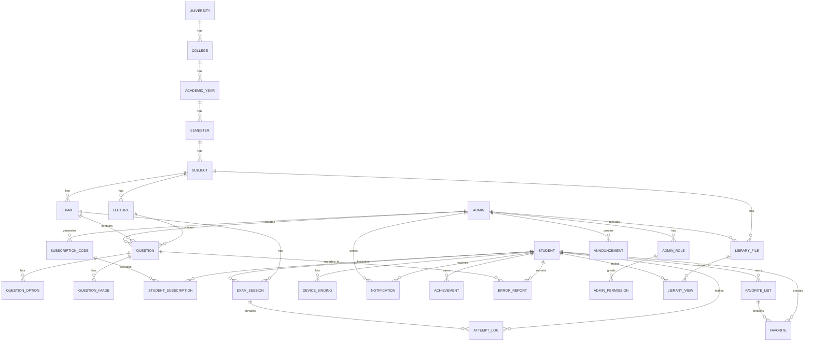

# INFORMATION_ARCHITECTURE.md — Phase 8: Information Architecture

> **الهيكل المعماري للمعلومات الكامل**. يحدد خريطة الموقع، هيكل التنقّل، تصنيف المحتوى، بنية الـ URLs، وعلاقات الكيانات في المنصة.

**المرحلة**: Phase 8
**الحالة**: ✅ Completed
**تاريخ الإنجاز**: 2026-07-30

---

## جدول المحتويات

1. [مقدمة عن الـ Information Architecture](#1-مقدمة)
2. [الأهداف والمبادئ](#2-الأهداف-والمبادئ)
3. [خريطة الموقع الكاملة (Sitemap)](#3-خريطة-الموقع-الكاملة)
4. [هيكل التنقّل (Navigation Structure)](#4-هيكل-التنقّل)
5. [تصنيف المحتوى (Content Taxonomy)](#5-تصنيف-المحتوى)
6. [بنية الـ URLs (URL Structure)](#6-بنية-الـ-urls)
7. [علاقات الكيانات (Entity Relationships)](#7-علاقات-الكيانات)
8. [تسمية الصفحات (Page Naming)](#8-تسمية-الصفحات)
9. [الـ Breadcrumbs](#9-الـ-breadcrumbs)
10. [إدارة الحالات (State Management)](#10-إدارة-الحالات)
11. [الـ Deep Linking](#11-الـ-deep-linking)
12. [الـ SEO والـ Meta Tags](#12-الـ-seo-والـ-meta-tags)
13. [خريطة التحويل (Conversion Map)](#13-خريطة-التحويل)
14. [قواعد إدارة المحتوى](#14-قواعد-إدارة-المحتوى)
15. [قائمة فحص الـ IA](#15-قائمة-فحص-الـ-ia)

---

## 1. مقدمة

### 1.1 ما هو الـ Information Architecture؟

الـ Information Architecture (IA) هو **فن وعلم تنظيم المعلومات** في المنصة لتسهيل:
- **الإيجاد**: المستخدم يجد ما يريد بسرعة.
- **الفهم**: يفهم أين هو وكيف وصل.
- **التنقّل**: يتنقّل بسلاسة بين الصفحات.
- **الاستكشاف**: يكتشف محتوى ذا صلة.

### 1.2 المكوّنات الأساسية للـ IA

```
┌─────────────────────────────────────────────────┐
│                                                 │
│   1. Sitemap (خريطة الموقع)                    │
│      ↓                                          │
│   2. Navigation (التنقّل)                       │
│      ↓                                          │
│   3. Taxonomy (التصنيف)                        │
│      ↓                                          │
│   4. URL Structure (بنية الروابط)              │
│      ↓                                          │
│   5. Entity Relationships (علاقات الكيانات)    │
│      ↓                                          │
│   6. Metadata (البيانات الوصفية)               │
│                                                 │
└─────────────────────────────────────────────────┘
```

### 1.3 لماذا الـ IA مهمّة لـ CMS؟

- ✅ **عدد صفحات كبير**: 50+ صفحة للطلاب + 25+ للمدير.
- ✅ **محتوى هرمي**: جامعة ← كلية ← سنة ← فصل ← مادة.
- ✅ **بحث واكتشاف**: محتوى متنوّع يحتاج تنظيم.
- ✅ **SEO**: بنية واضحة تُحسّن ترتيب البحث.
- ✅ **قابلية التوسع**: إضافة جامعات/كليات دون إعادة هيكلة.

---

## 2. الأهداف والمبادئ

### 2.1 الأهداف الذكية (SMART Goals)

| # | الهدف | المعيار |
|---|------|--------|
| G1 | المستخدم يجد أي صفحة في ≤ 3 نقرات | اختبار قابلية الاستخدام |
| G2 | الـ Breadcrumbs واضحة في كل صفحة | 100% coverage |
| G3 | URL واضح ومعبّر | بدون parameters معقّدة |
| G4 | SEO-friendly URLs | kebab-case + keywords |
| G5 | دعم Deep Linking لكل صفحة | 100% routes |

### 2.2 المبادئ السبعة (Seven IA Principles)

#### IA-1: البساطة (Simplicity)
- أقل عدد من المستويات الهرمية.
- لا تعميق أكثر من 5 مستويات.
- تبسيط المسارات.

#### IA-2: التوقّع (Predictability)
- URL ينبئ بالمحتوى.
- اسم الصفحة يطابق محتواها.
- لا مفاجآت في التنقّل.

#### IA-3: الاتساق (Consistency)
- نفس الـ patterns في كل المنصة.
- نفس بنية الـ URLs.
- نفس الـ Breadcrumbs logic.

#### IA-4: التدرّج (Progressive Disclosure)
- ابدأ بالعام، ثم الخاص.
- لا تُغرق المستخدم بالتفاصيل.
- كشف المعلومات تدريجياً.

#### IA-5: التكرار المضبوط (Controlled Redundancy)
- نفس المحتوى قد يصل من مسارين.
- لكن الـ URL الأساسي واحد (canonical).
- تجنّب المحتوى المكرّر الحرفي.

#### IA-6: قابلية التوسع (Scalability)
- البنية تتحمّل إضافة جامعات/كليات.
- لا hardcoding للأسماء.
- كل البيانات تأتي من DB.

#### IA-7: الوصولية (Accessibility)
- كل الصفحات يمكن الوصول لها بالكيبورد.
- Breadcrumbs دلالية.
- ARIA labels واضحة.

---

## 3. خريطة الموقع الكاملة (Sitemap)

### 3.1 Sitemap — Student App

```mermaid
flowchart TD
    Root[cms.example.com] --> Public[الصفحات العامة]
    Root --> Auth[المصادقة]
    Root --> Student[تطبيق الطالب]
    Root --> Resources[الموارد]
    
    %% Public Pages
    Public --> Landing[الصفحة الرئيسية العامة]
    Public --> About[من نحن]
    Public --> Features[الميزات]
    Public --> Pricing[الأسعار]
    Public --> Contact[تواصل معنا]
    Public --> FAQ[الأسئلة الشائعة]
    Public --> Privacy[سياسة الخصوصية]
    Public --> Terms[شروط الاستخدام]
    
    %% Auth Pages
    Auth --> Login[تسجيل الدخول]
    Auth --> Register[تسجيل جديد]
    Auth --> ForgotPassword[نسيت كلمة المرور]
    Auth --> ResetPassword[إعادة تعيين]
    Auth --> VerifyOTP[التحقق OTP]
    Auth --> ActivateCode[تفعيل كود]
    
    %% Student App
    Student --> Dashboard[لوحة التحكم]
    Student --> Academic[الهيكل الأكاديمي]
    Student --> Study[الدراسة]
    Student --> Library[المكتبة]
    Student --> Search[البحث]
    Student --> Profile[الملف الشخصي]
    Student --> Social[المجتمع]
    Student --> Settings[الإعدادات]
    
    %% Academic Hierarchy
    Academic --> Universities[الجامعات]
    Universities --> UniversityPage[جامعة محددة]
    UniversityPage --> Colleges[الكليات]
    Colleges --> CollegePage[كلية محددة]
    CollegePage --> Years[السنوات]
    Years --> YearPage[سنة محددة]
    YearPage --> Semesters[الفصول]
    Semesters --> SemesterPage[فصل محدد]
    SemesterPage --> Subjects[المواد]
    Subjects --> SubjectPage[مادة محددة]
    
    %% Study Section
    SubjectPage --> SubjectLectures[تبويب المحاضرات]
    SubjectPage --> SubjectExams[تبويب الدورات]
    SubjectPage --> SubjectLibrary[تبويب المكتبة]
    SubjectPage --> SubjectStats[تبويب الإحصائيات]
    
    SubjectLectures --> LecturePage[محاضرة محددة]
    LecturePage --> QuestionsList[قائمة الأسئلة]
    QuestionsList --> QuestionPage[سؤال محدد]
    
    SubjectExams --> ExamPage[دورة محددة]
    ExamPage --> ExamSession[جلسة اختبار]
    ExamSession --> ExamResults[نتائج الاختبار]
    
    %% Library
    Library --> LibraryHome[مكتبة عامة]
    Library --> SubjectLibrary2[مكتبة مادة]
    SubjectLibrary --> FilePage[ملف محدد]
    FilePage --> PDFReader[قارئ PDF]
    FilePage --> HTMLReader[قارئ HTML]
    FilePage --> ImageViewer[عارض صور]
    FilePage --> VideoPlayer[مشغل فيديو]
    
    %% Search
    Search --> SearchPage[صفحة البحث]
    SearchPage --> SearchResults[نتائج البحث]
    
    %% Profile
    Profile --> ProfileHome[الملف الشخصي]
    Profile --> MySubscriptions[اشتراكاتي]
    Profile --> MyStats[إحصائياتي]
    Profile --> MyResults[نتائجي]
    Profile --> MyFavorites[المفضلة]
    MyFavorites --> FavoriteLists[قوائم المفضلة]
    FavoriteLists --> FavoriteListPage[قائمة محددة]
    
    %% Social
    Social --> Leaderboard[لوحة المتصدرين]
    Social --> Achievements[الإنجازات]
    Social --> Notifications[الإشعارات]
    
    %% Settings
    Settings --> SettingsGeneral[عام]
    Settings --> SettingsNotifications[الإشعارات]
    Settings --> SettingsSecurity[الأمان]
    Settings --> SettingsAppearance[المظهر]
    Settings --> SettingsAccount[الحساب]
    
    %% Resources
    Resources --> Help[مركز المساعدة]
    Resources --> Support[الدعم الفني]
    Resources --> ReportBug[الإبلاغ عن خطأ]
    Resources --> Offline[المحتوى Offline]
```



### 3.2 Sitemap — Admin App

```mermaid
flowchart TD
    AdminRoot[admin.cms.example.com] --> AdminAuth[المصادقة]
    AdminRoot --> AdminApp[لوحة الإدارة]
    
    AdminAuth --> AdminLogin[تسجيل دخول المدير]
    AdminAuth --> Admin2FA[التحقق 2FA]
    AdminAuth --> AdminForgot[نسيت كلمة المرور]
    
    AdminApp --> AdminDashboard[لوحة المعلومات]
    AdminApp --> AdminAcademic[الهيكل الأكاديمي]
    AdminApp --> AdminContent[إدارة المحتوى]
    AdminApp --> AdminUsers[إدارة المستخدمين]
    AdminApp --> AdminSubscriptions[الاشتراكات]
    AdminApp --> AdminCommunication[التواصل]
    AdminApp --> AdminReports[التقارير]
    AdminApp --> AdminSystem[النظام]
    
    %% Academic Management
    AdminAcademic --> ManageUniversities[إدارة الجامعات]
    AdminAcademic --> ManageColleges[إدارة الكليات]
    AdminAcademic --> ManageYears[إدارة السنوات]
    AdminAcademic --> ManageSemesters[إدارة الفصول]
    AdminAcademic --> ManageSubjects[إدارة المواد]
    AdminAcademic --> ManageLectures[إدارة المحاضرات]
    
    %% Content Management
    AdminContent --> ManageQuestions[بنك الأسئلة]
    AdminContent --> ManageExams[الدورات الامتحانية]
    AdminContent --> ManageLibrary[المكتبة]
    AdminContent --> ManageFiles[الملفات]
    AdminContent --> ManageVideos[الفيديوهات]
    AdminContent --> ImportQuestions[استيراد أسئلة]
    AdminContent --> ImportFiles[استيراد ملفات]
    
    %% User Management
    AdminUsers --> ManageStudents[الطلاب]
    AdminUsers --> ManageAdmins[المدراء]
    AdminUsers --> ManageRoles[الأدوار]
    AdminUsers --> ManagePermissions[الصلاحيات]
    AdminUsers --> DeviceBindings[ربط الأجهزة]
    
    %% Subscriptions
    AdminSubscriptions --> ManageCodes[الأكواد]
    AdminSubscriptions --> GenerateCodes[توليد أكواد]
    AdminSubscriptions --> ActiveSubscriptions[الاشتراكات النشطة]
    AdminSubscriptions --> ExpiredSubscriptions[الاشتراكات المنتهية]
    AdminSubscriptions --> CodeBatches[دفعات الأكواد]
    
    %% Communication
    AdminCommunication --> ManageNotifications[الإشعارات]
    AdminCommunication --> SendNotification[إرسال إشعار]
    AdminCommunication --> Announcements[الإعلانات]
    AdminCommunication --> Messages[الرسائل]
    AdminCommunication --> Reports[البلاغات]
    
    %% Reports
    AdminReports --> DashboardStats[إحصائيات لوحة التحكم]
    AdminReports --> UsageReport[تقرير الاستخدام]
    AdminReports --> RevenueReport[تقرير الإيرادات]
    AdminReports --> PerformanceReport[تقرير الأداء]
    AdminReports --> SecurityReport[تقرير الأمان]
    AdminReports --> ExportReports[تصدير التقارير]
    
    %% System
    AdminSystem --> SystemSettings[إعدادات النظام]
    AdminSystem --> SecurityLogs[سجلات الأمان]
    AdminSystem --> AuditLog[سجل العمليات]
    AdminSystem --> SystemHealth[صحة النظام]
    AdminSystem --> Backups[النسخ الاحتياطي]
    AdminSystem --> Integrations[التكاملات]
```



### 3.3 إحصائيات الصفحات

| التطبيق | عدد الصفحات الرئيسية | عدد الصفحات الفرعية | الإجمالي |
|---------|--------------------|--------------------|---------|
| Student App | 8 أقسام | 45 صفحة | 53 |
| Admin App | 8 أقسام | 38 صفحة | 46 |
| Public Pages | — | 8 صفحات | 8 |
| **الإجمالي** | 16 قسم | 91 صفحة | **107 صفحة** |

---

## 4. هيكل التنقّل (Navigation Structure)

### 4.1 الـ Navigation Layers

التنقّل في CMS ينقسم إلى 4 طبقات:

```
Layer 1: Global Navigation (التنقّل العام)
  ├── Navbar (شريط علوي)
  └── Sidebar (شريط جانبي - Desktop)

Layer 2: Local Navigation (التنقّل المحلي)
  ├── Tabs (تبويبات)
  └── In-page navigation

Layer 3: Contextual Navigation (التنقّل السياقي)
  ├── Breadcrumbs
  ├── Related links
  └── Quick actions

Layer 4: Supplementary Navigation (التنقّل التكميلي)
  ├── Search
  ├── Command Palette (Ctrl+K)
  ├── Footer links
  └── Sitemap (للمدير)
```

### 4.2 Navbar — Student App

#### Desktop (≥ 1024px)
```
┌───────────────────────────────────────────────────────────────────┐
│ [Logo] [Universities ▾] [Search...........] [⌨️] [🌙] [🔔(3)] [👤] │
└───────────────────────────────────────────────────────────────────┘
```

| العنصر | الوظيفة | الـ URL |
|--------|---------|--------|
| Logo | العودة للوحة التحكم | `/dashboard` |
| Universities ▾ | Dropdown للجامعات | `/universities` |
| Search | بحث شامل | `/search` |
| ⌨️ | Command Palette | (modal) |
| 🌙 | تبديل الوضع الليلي | (toggle) |
| 🔔(3) | الإشعارات | `/notifications` |
| 👤 | الملف الشخصي | `/profile` |

#### Mobile (< 1024px)
```
┌───────────────────────────────────────┐
│ [☰]  [Logo]  ............  [🔔] [👤] │
└───────────────────────────────────────┘
```

| العنصر | الوظيفة |
|--------|---------|
| ☰ | فتح الـ Sidebar كـ Drawer |
| Logo | العودة للوحة التحكم |
| 🔔 | الإشعارات |
| 👤 | الملف الشخصي |

### 4.3 Sidebar — Student App

#### Desktop (ثابت)
```
┌────────────────────────┐
│ 🏠 لوحة التحكم          │
│ 🎓 الجامعات             │
│ ⭐ المفضلة              │
│ 🔍 البحث                │
│ 🏆 الإنجازات            │
│                        │
│ ─── التصنيفات ───      │
│ 📚 الباطنة              │
│ 📚 الجراحة              │
│ �ks النسائية            │
│ ...                    │
│                        │
│ ─── إحصائيات ───       │
│ التقدم: 65%            │
│ أسئلة: 342/500         │
│ الدقة: 78%             │
└────────────────────────┘
```

#### Mobile (Drawer)
يفتح من اليمين عند النقر على ☰.

### 4.4 Bottom Navigation — Mobile Only

```
┌───────────────────────────────────────────┐
│  🏠      🎓      ⭐      🔍      👤      │
│ الرئيسية  الجامعات  المفضلة  البحث  حسابي │
└───────────────────────────────────────────┘
```

### 4.5 Navbar — Admin App

#### Desktop
```
┌─────────────────────────────────────────────────────────────────────┐
│ [CMS Admin] [🔍 Search...] [⌨️] [🌙] [🔔(5)] [د. خالد ▾] [Logout] │
└─────────────────────────────────────────────────────────────────────┘
```

### 4.6 Sidebar — Admin App

```
┌────────────────────────┐
│ 📊 لوحة المعلومات       │
│                        │
│ ─── الأكاديمي ───      │
│ 🏛️ الجامعات             │
│ 🎓 الكليات              │
│ 📅 السنوات              │
│ 📚 الفصول               │
│ 📘 المواد               │
│ 📝 المحاضرات            │
│                        │
│ ─── المحتوى ───        │
│ ❓ الأسئلة              │
│ 📋 الدورات              │
│ 📁 المكتبة              │
│ 🎥 الفيديوهات           │
│                        │
│ ─── المستخدمون ───     │
│ 👥 الطلاب               │
│ 🔐 المدراء              │
│ 🛡️ الأدوار              │
│                        │
│ ─── الاشتراكات ───     │
│ 🎫 الأكواد              │
│ ✅ الاشتراكات النشطة    │
│                        │
│ ─── التواصل ───        │
│ 🔔 الإشعارات            │
│ 📢 الإعلانات            │
│ 📨 البلاغات             │
│                        │
│ ─── التقارير ───       │
│ 📈 الإحصائيات           │
│ 💰 الإيرادات            │
│ 🛡️ الأمان              │
│                        │
│ ─── النظام ───         │
│ ⚙️ الإعدادات            │
│ 🔍 السجلات              │
└────────────────────────┘
```

> **ملاحظة**: الـ Sidebar يُفلتر حسب صلاحيات المدير. المدير الذي يدير "كلية الطب" فقط يرى ما يتعلّق بها.

### 4.7 قواعد التنقّل

#### NR-1: عمق التنقّل
- الحد الأقصى: 5 مستويات من الـ Navbar.
- مثال: Navbar → Subjects → Subject → Lectures → Question.

#### NR-2: التراجع
- في كل صفحة، يمكن التراجع خطوة للخلف.
- عبر Breadcrumbs أو زر "رجوع".

#### NR-3: العودة للرئيسية
- من أي صفحة، يمكن العودة للوحة التحكم بنقرة واحدة.
- عبر الـ Logo في الـ Navbar.

#### NR-4: التنقّل بالكيبورد
- كل روابط التنقّل يمكن الوصول لها بالكيبورد.
- Tab للتنقّل، Enter للتفعيل.

#### NR-5: الحالة النشطة
- العنصر النشط في الـ Sidebar له style مميّز.
- يحدّد تلقائياً حسب الـ URL.

#### NR-6: التنقّل الذكي
- عند العودة لصفحة، يتم الحفاظ على موضع التمرير.
- عند العودة لقائمة، يتم الحفاظ على الفلاتر.

---

## 5. تصنيف المحتوى (Content Taxonomy)

### 5.1 الـ Taxonomy Layers

```
Layer 1: Content Types (أنواع المحتوى)
  ↓
Layer 2: Categories (التصنيفات الرئيسية)
  ↓
Layer 3: Tags (الوسوم)
  ↓
Layer 4: Metadata (البيانات الوصفية)
```

### 5.2 أنواع المحتوى (Content Types)

| النوع | الوصف | المكان |
|------|------|--------|
| **Question** | سؤال تفاعلي | بنك الأسئلة |
| **Exam** | دورة امتحانية | الدورات |
| **Lecture** | محاضرة | المحاضرات |
| **Subject** | مادة دراسية | المواد |
| **PDF File** | ملف PDF | المكتبة |
| **HTML File** | ملف HTML تفاعلي | المكتبة |
| **Image** | صورة تعليمية | المكتبة |
| **Video** | فيديو يوتيوب | المكتبة |
| **Summary** | ملخص | المكتبة |
| **Comprehensive** | ملف شامل | المكتبة |
| **Paragraph** | فقرة قصيرة | المكتبة |
| **Announcement** | إعلان | الإعلانات |
| **Notification** | إشعار | الإشعارات |
| **Achievement** | إنجاز | الإنجازات |
| **User** | مستخدم (طالب/مدير) | المستخدمون |

### 5.3 التصنيفات الرئيسية (Categories)

#### C1: التصنيف الأكاديمي (Academic)
- جامعة (University)
- كلية (College)
- سنة (Academic Year)
- فصل (Semester)
- مادة (Subject)
- محاضرة (Lecture)

#### C2: تصنيف المحتوى (Content)
- أسئلة (Questions)
- ملفات (Files)
- فيديوهات (Videos)
- دورات (Exams)

#### C3: تصنيف النوع (Type)
- PDF
- HTML
- صورة
- فيديو
- ملخص
- شامل
- فقرة

#### C4: تصنيف الصعوبة (Difficulty)
- سهل (Easy)
- متوسط (Medium)
- صعب (Hard)

#### C5: تصنيف الحالة (Status)
- مسودة (Draft)
- منشور (Published)
- مؤرشف (Archived)
- محذوف (Deleted)

#### C6: تصنيف الوسوم (Tags)
- وسوم حرة (Free-form tags).
- مثال: `#cardiology`, `#ecg`, `#hypertension`.

### 5.4 نظام الوسوم (Tagging System)

#### قواعد الوسوم
- ✅ كل وسم: 2-30 حرف.
- ✅ أحرف صغيرة (lowercase).
- ✅ بدون فراغات (استخدم `-` للفصل).
- ✅ بالعربية أو الإنجليزية.
- ✅ الحد الأقصى: 7 وسوم لكل سؤال/ملف.

#### أمثلة وسوم مقترحة (للطب)
```
#cardiology       #ecg              #hypertension
#respiratory      #asthma           #copd
#gastrointestinal #liver            #cirrhosis
#neurology        #stroke           #epilepsy
#endocrine        #diabetes         #thyroid
#rheumatology     #arthritis        #lupus
#nephrology       #kidney           #dialysis
#hematology       #anemia           #leukemia
#infectious       #sepsis           #covid-19
#pediatrics       #neonatal         #child
#obstetrics       #pregnancy        #delivery
#surgery          #trauma           #emergency
#pharmacology     #antibiotics      #analgesics
#anatomy          #physiology       #histology
#pathology        #biochemistry     #immunology
```

### 5.5 البيانات الوصفية (Metadata)

#### M1: بيانات كل سؤال
```yaml
question:
  id: UUID
  type: mcq | true_false | multiple_select | ...
  text: string (required)
  options: array (2-10)
  correct_answer: string
  explanation: string (required)
  tags: array (max 7)
  difficulty: easy | medium | hard
  subject_id: UUID (required)
  lecture_id: UUID (optional)
  exam_id: UUID (optional)
  year: integer (e.g., 2024)
  reference: string (optional)
  image_url: URL (optional)
  status: draft | published | archived
  created_by: UUID (admin_id)
  created_at: datetime
  updated_at: datetime
  views_count: integer
  attempts_count: integer
  correct_rate: float
  reports_count: integer
```

#### M2: بيانات كل ملف
```yaml
file:
  id: UUID
  type: pdf | html | image | video | summary | comprehensive | paragraph
  title: string (required)
  description: string (optional)
  subject_id: UUID (required)
  lecture_id: UUID (optional)
  file_url: URL (R2 signed URL)
  file_size: integer (bytes)
  file_format: string
  duration: integer (seconds, for videos)
  pages: integer (for PDFs)
  thumbnail_url: URL (optional)
  tags: array (max 7)
  status: draft | published | archived
  created_by: UUID (admin_id)
  created_at: datetime
  updated_at: datetime
  views_count: integer
  avg_view_duration: integer
```

#### M3: بيانات كل مستخدم
```yaml
user:
  id: UUID
  type: student | admin
  phone: string (students)
  email: string (admins)
  password_hash: string
  full_name: string
  avatar_url: URL (optional)
  university_id: UUID (students)
  college_id: UUID (students)
  year_id: UUID (students)
  role: super_admin | university_admin | college_admin | year_admin | subject_admin (admins)
  permissions: array
  device_fingerprint: string
  status: active | suspended | banned
  created_at: datetime
  last_login: datetime
```

### 5.6 قواعد التصنيف

#### قاعدة 1: كل محتوى يجب أن ينتمي لمادة
- لا يمكن وجود سؤال/ملف بلا `subject_id`.
- الاستثناء: الإعلانات والإشعارات العامة.

#### قاعدة 2: الهرمية الأكاديمية إلزامية
- كل مادة تنتمي لفصل.
- كل فصل ينتمي لسنة.
- ... (الهرمية الكاملة).

#### قاعدة 3: الوسوم عامة عبر المواد
- وسم `#cardiology` يمكن استخدامه في مادة الباطنة والجراحة.
- ليس مرتبطاً بمادة معيّنة.

#### قاعدة 4: الحالة (Status) إلزامية
- كل محتوى له حالة (draft/published/archived).
- الطلاب يرون فقط المنشور.

---

## 6. بنية الـ URLs (URL Structure)

### 6.1 مبادئ الـ URLs

#### UP-1: واضحة ومعبّرة
- URL يصف المحتوى.
- مثال: `/subjects/cardiology/questions/123` بدل `/q?id=123`.

#### UP-2: RESTful
- أسماء موارد (resources).
- أفعال HTTP (GET, POST, PUT, DELETE).

#### UP-3: هرمية
- تعكس البنية الأكاديمية.
- من العام إلى الخاص.

#### UP-4: SEO-friendly
- kebab-case.
- كلمات مفتاحية.
- بدون parameters معقّدة.

#### UP-5: ثابتة (Permanent)
- لا تتغيّر بعد النشر.
- redirect إن تغيّرت.

#### UP-6: قصيرة قدر الإمكان
- لا تتجاوز 100 حرف.
- تجنّب التعميق الزائد.

### 6.2 النطاقات (Domains)

| النطاق | الغرض |
|--------|------|
| `cms.example.com` | تطبيق الطالب |
| `admin.cms.example.com` | لوحة الإدارة |
| `api.cms.example.com` | الـ API |
| `cdn.cms.example.com` | الـ CDN (Cloudflare) |
| `docs.cms.example.com` | توثيق API (Swagger) |
| `status.cms.example.com` | صفحة الحالة |

### 6.3 URL Structure — Student App

#### الصفحات العامة (Public)
```
/                         → الصفحة الرئيسية العامة
/about                    → من نحن
/features                 → الميزات
/pricing                  → الأسعار
/contact                  → تواصل معنا
/faq                      → الأسئلة الشائعة
/privacy                  → سياسة الخصوصية
/terms                    → شروط الاستخدام
```

#### المصادقة (Auth)
```
/login                    → تسجيل الدخول
/register                 → تسجيل جديد
/forgot-password          → نسيت كلمة المرور
/reset-password/:token    → إعادة تعيين كلمة المرور
/verify-otp               → التحقق من OTP
/activate                 → تفعيل كود اشتراك
/logout                   → تسجيل الخروج
```

#### تطبيق الطالب (Student App)
```
/dashboard                → لوحة التحكم الرئيسية
/universities             → قائمة الجامعات
/universities/:uniSlug    → صفحة جامعة محددة
  مثال: /universities/homs-university

/colleges/:collegeSlug    → صفحة كلية محددة
  مثال: /colleges/medicine

/years/:yearSlug          → صفحة سنة محددة
  مثال: /years/third-year

/semesters/:semesterSlug  → صفحة فصل محدد
  مثال: /semesters/first-semester

/subjects/:subjectSlug    → صفحة مادة محددة
  مثال: /subjects/internal-medicine

/subjects/:subjectSlug/lectures           → قائمة المحاضرات
/subjects/:subjectSlug/lectures/:lectureSlug
  مثال: /subjects/internal-medicine/lectures/cardiology-1

/subjects/:subjectSlug/exams              → قائمة الدورات
/subjects/:subjectSlug/exams/:examSlug    → صفحة دورة محددة
  مثال: /subjects/internal-medicine/exams/2023-final

/subjects/:subjectSlug/exams/:examSlug/start    → بدء جلسة اختبار
/subjects/:subjectSlug/exams/:examSlug/results  → نتائج الاختبار

/subjects/:subjectSlug/questions/:questionId    → سؤال محدد
  مثال: /subjects/internal-medicine/questions/abc123

/subjects/:subjectSlug/library           → مكتبة المادة
/subjects/:subjectSlug/library/:fileId   → ملف محدد
  مثال: /subjects/internal-medicine/library/pdf-123
  مثال: /subjects/internal-medicine/library/video-456
```

#### الموارد العامة (Resources)
```
/library                  → المكتبة العامة (كل المواد)
/search                   → صفحة البحث
/search?q=...&type=...    → نتائج البحث
/favorites                → المفضلة
/favorites/lists          → قوائم المفضلة
/favorites/lists/:listId  → قائمة محددة

/leaderboard              → لوحة المتصدرين
/leaderboard/:scope       → حسب النطاق
  مثال: /leaderboard/subject/internal-medicine
  مثال: /leaderboard/college/medicine
  مثال: /leaderboard/year/third-year

/achievements             → الإنجازات
/notifications            → الإشعارات
/notifications/:notifId   → إشعار محدد
```

#### الملف الشخصي (Profile)
```
/profile                  → الملف الشخصي
/profile/edit             → تعديل الملف
/profile/subscriptions    → اشتراكاتي
/profile/stats            → إحصائياتي
/profile/results          → نتائجي
/profile/results/:examId  → نتيجة محددة

/settings                 → الإعدادات
/settings/general         → عام
/settings/notifications   → الإشعارات
/settings/security        → الأمان
/settings/appearance      → المظهر (ثيم)
/settings/account         → الحساب
```

#### المساعدة (Help)
```
/help                     → مركز المساعدة
/help/:articleSlug        → مقال مساعدة
/support                  → الدعم الفني
/support/new              → تذكرة دعم جديدة
/support/:ticketId        → تذكرة محددة
/report-bug               → الإبلاغ عن خطأ
```

#### Offline (PWA)
```
/offline                  → صفحة Offline
/offline/subjects         → المواد المتاحة Offline
/offline/subjects/:subjectSlug/exams/:examSlug  → اختبار Offline
```

### 6.4 URL Structure — Admin App

#### المصادقة
```
/admin/login              → تسجيل دخول المدير
/admin/2fa                → التحقق 2FA
/admin/forgot-password    → نسيت كلمة المرور
/admin/logout             → تسجيل الخروج
```

#### لوحة الإدارة
```
/admin                    → لوحة المعلومات
/admin/dashboard          → لوحة المعلومات التفصيلية
```

#### الهيكل الأكاديمي
```
/admin/universities       → إدارة الجامعات
/admin/universities/new   → إضافة جامعة
/admin/universities/:id   → تفاصيل جامعة
/admin/universities/:id/edit

/admin/colleges           → إدارة الكليات
/admin/colleges/new
/admin/colleges/:id
/admin/colleges/:id/edit

/admin/years              → إدارة السنوات
/admin/years/new
/admin/years/:id
/admin/years/:id/edit

/admin/semesters          → إدارة الفصول
/admin/semesters/new
/admin/semesters/:id
/admin/semesters/:id/edit

/admin/subjects           → إدارة المواد
/admin/subjects/new
/admin/subjects/:id
/admin/subjects/:id/edit

/admin/lectures           → إدارة المحاضرات
/admin/lectures/new
/admin/lectures/:id
/admin/lectures/:id/edit
```

#### إدارة المحتوى
```
/admin/questions          → بنك الأسئلة
/admin/questions/new      → إضافة سؤال
/admin/questions/:id      → تفاصيل/تعديل سؤال
/admin/questions/import   → استيراد Excel
/admin/questions/export   → تصدير
/admin/questions/bulk     → إجراءات جماعية

/admin/exams              → الدورات الامتحانية
/admin/exams/new
/admin/exams/:id
/admin/exams/:id/edit

/admin/library            → المكتبة
/admin/library/new        → رفع ملف
/admin/library/:id
/admin/library/:id/edit

/admin/videos             → الفيديوهات
/admin/videos/new
/admin/videos/:id
/admin/videos/:id/edit

/admin/files              → كل الملفات
/admin/files/upload       → رفع ملفات متعددة
```

#### إدارة المستخدمين
```
/admin/students           → الطلاب
/admin/students/new       → إضافة طالب (مدير فقط)
/admin/students/:id       → تفاصيل طالب
/admin/students/:id/edit
/admin/students/:id/subscriptions  → اشتراكات الطالب
/admin/students/:id/security       → سجل الأمان

/admin/admins             → المدراء
/admin/admins/new
/admin/admins/:id
/admin/admins/:id/edit
/admin/admins/:id/permissions

/admin/roles              → الأدوار
/admin/roles/new
/admin/roles/:id
/admin/roles/:id/edit

/admin/devices            → ربط الأجهزة
/admin/devices/:id        → تفاصيل جهاز
```

#### الاشتراكات
```
/admin/codes              → الأكواد
/admin/codes/new          → إنشاء كود/دفعة
/admin/codes/:id          → تفاصيل كود
/admin/codes/batches      → دفعات الأكواد
/admin/codes/batches/:batchId

/admin/subscriptions      → كل الاشتراكات
/admin/subscriptions/active    → الاشتراكات النشطة
/admin/subscriptions/expired   → المنتهية
/admin/subscriptions/:id       → تفاصيل اشتراك
```

#### التواصل
```
/admin/notifications      → الإشعارات
/admin/notifications/new  → إرسال إشعار
/admin/notifications/:id  → تفاصيل إشعار
/admin/notifications/stats  → إحصائيات الإشعارات

/admin/announcements      → الإعلانات
/admin/announcements/new
/admin/announcements/:id
/admin/announcements/:id/edit

/admin/reports            → البلاغات
/admin/reports/:id        → تفاصيل بلاغ
/admin/reports/:id/resolve  → معالجة بلاغ
```

#### التقارير
```
/admin/reports/stats      → الإحصائيات العامة
/admin/reports/usage      → تقرير الاستخدام
/admin/reports/revenue    → تقرير الإيرادات
/admin/reports/performance → تقرير الأداء الأكاديمي
/admin/reports/security   → تقرير الأمان
/admin/reports/export     → تصدير التقارير
```

#### النظام
```
/admin/settings           → إعدادات النظام
/admin/settings/general
/admin/settings/security
/admin/settings/integrations

/admin/logs               → السجلات
/admin/logs/security      → سجلات الأمان
/admin/logs/audit         → سجل العمليات
/admin/logs/system        → سجلات النظام

/admin/health             → صحة النظام
/admin/backups            → النسخ الاحتياطي
/admin/backups/new        → إنشاء نسخة
/admin/backups/:id        → تفاصيل نسخة
```

### 6.5 الـ Slugs

#### قواعد الـ Slugs
- kebab-case (`internal-medicine`).
- أحرف إنجليزية صغيرة + أرقام + `-`.
- بدون فراغات أو رموز خاصة.
- الحد الأقصى: 50 حرف.
- فريدة داخل نطاقها.

#### أمثلة
| الاسم العربي | الـ Slug |
|------------|---------|
| جامعة حمص | `homs-university` |
| كلية الطب البشري | `medicine` |
| السنة الثالثة | `third-year` |
| الفصل الأول | `first-semester` |
| الباطنة | `internal-medicine` |
| الجراحة | `surgery` |
| محاضرة القلب 1 | `cardiology-1` |
| دورة 2023 النهائية | `2023-final` |

### 6.6 Query Parameters

#### المعاملات القياسية
```
?page=1              → رقم الصفحة
?pageSize=20         → عدد العناصر في الصفحة
?sort=createdAt      → الترتيب
?order=desc          → اتجاه الترتيب
?search=...          → البحث
?filter[field]=...   → الفلترة
?view=grid|list      → طريقة العرض
?lang=ar|en          → اللغة (مستقبلاً)
?theme=light|dark    → الثيم
```

#### أمثلة URLs مع معاملات
```
/admin/questions?page=2&pageSize=20&sort=createdAt&order=desc&search=cardiology&filter[difficulty]=hard

/subjects/internal-medicine/lectures?view=list

/leaderboard?scope=college&period=month
```

---

## 7. علاقات الكيانات (Entity Relationships)

### 7.1 مخطط ERD العام



### 7.2 الجداول التفصيلية

#### T1: universities
```yaml
universities:
  id: UUID (PK)
  name_ar: string (required, unique)
  name_en: string (optional)
  slug: string (required, unique)
  description: text (optional)
  logo_url: URL (optional)
  country: string (default: Syria)
  city: string (optional)
  website: URL (optional)
  status: enum (active, archived)
  sort_order: integer
  created_at: datetime
  updated_at: datetime
```

#### T2: colleges
```yaml
colleges:
  id: UUID (PK)
  university_id: UUID (FK → universities)
  name_ar: string (required)
  name_en: string (optional)
  slug: string (required, unique within university)
  description: text (optional)
  icon: string (optional)
  status: enum (active, archived)
  sort_order: integer
  created_at: datetime
  updated_at: datetime
```

#### T3: academic_years
```yaml
academic_years:
  id: UUID (PK)
  college_id: UUID (FK → colleges)
  name_ar: string (e.g., "السنة الثالثة")
  name_en: string (e.g., "Third Year")
  slug: string
  year_number: integer (1-6 for medicine)
  description: text (optional)
  status: enum
  sort_order: integer
  created_at: datetime
  updated_at: datetime
```

#### T4: semesters
```yaml
semesters:
  id: UUID (PK)
  academic_year_id: UUID (FK → academic_years)
  name_ar: string (e.g., "الفصل الأول")
  name_en: string
  slug: string
  semester_number: integer (1-2)
  status: enum
  sort_order: integer
  created_at: datetime
  updated_at: datetime
```

#### T5: subjects
```yaml
subjects:
  id: UUID (PK)
  semester_id: UUID (FK → semesters)
  name_ar: string (e.g., "الباطنة")
  name_en: string (e.g., "Internal Medicine")
  slug: string
  code: string (optional, e.g., "MED301")
  description: text
  icon: string
  color: string (hex)
  credits: integer (optional)
  status: enum
  sort_order: integer
  created_at: datetime
  updated_at: datetime
```

#### T6: lectures
```yaml
lectures:
  id: UUID (PK)
  subject_id: UUID (FK → subjects)
  title_ar: string
  title_en: string
  slug: string
  description: text
  lecture_number: integer
  duration_minutes: integer (estimated)
  status: enum
  sort_order: integer
  created_at: datetime
  updated_at: datetime
```

#### T7: exams
```yaml
exams:
  id: UUID (PK)
  subject_id: UUID (FK → subjects)
  title_ar: string
  title_en: string
  slug: string
  description: text
  exam_type: enum (final, midterm, quiz, practice)
  year: integer (e.g., 2024)
  duration_minutes: integer (default: 60)
  total_questions: integer
  passing_score: float (default: 60.0)
  shuffle_questions: boolean (default: true)
  shuffle_options: boolean (default: true)
  show_results_immediately: boolean
  allow_review: boolean
  status: enum
  created_at: datetime
  updated_at: datetime
```

#### T8: questions
```yaml
questions:
  id: UUID (PK)
  type: enum (mcq, true_false, multiple_select, ordering, matching, clinical, image_based, interactive)
  subject_id: UUID (FK → subjects)
  lecture_id: UUID (FK → lectures, nullable)
  exam_id: UUID (FK → exams, nullable)
  text: text (required)
  text_html: text (rich text version)
  options: JSON (array of options)
  correct_answer: string (or array for multiple)
  explanation: text (required)
  explanation_html: text
  tags: JSON (array of strings)
  difficulty: enum (easy, medium, hard)
  year: integer
  reference: string (optional)
  image_url: URL (optional)
  status: enum (draft, published, archived, deleted)
  views_count: integer (default: 0)
  attempts_count: integer (default: 0)
  correct_attempts: integer (default: 0)
  reports_count: integer (default: 0)
  created_by: UUID (FK → admins)
  created_at: datetime
  updated_at: datetime
```

#### T9: students
```yaml
students:
  id: UUID (PK)
  phone: string (required, unique)
  password_hash: string
  full_name: string
  avatar_url: URL (optional)
  university_id: UUID (FK)
  college_id: UUID (FK)
  academic_year_id: UUID (FK)
  email: string (optional)
  gender: enum (male, female, prefer_not_to_say)
  birth_date: date (optional)
  device_fingerprint: string
  status: enum (active, suspended, banned)
  ban_reason: text (nullable)
  ban_until: datetime (nullable)
  last_login: datetime
  login_count: integer
  created_at: datetime
  updated_at: datetime
```

#### T10: admins
```yaml
admins:
  id: UUID (PK)
  email: string (required, unique)
  password_hash: string
  full_name: string
  avatar_url: URL
  phone: string (optional)
  role_id: UUID (FK → admin_roles)
  two_factor_enabled: boolean (default: false)
  two_factor_secret: string (nullable)
  recovery_codes: JSON (nullable)
  scope_university_id: UUID (nullable)
  scope_college_id: UUID (nullable)
  scope_year_id: UUID (nullable)
  scope_subject_id: UUID (nullable)
  status: enum (active, suspended, disabled)
  last_login: datetime
  created_at: datetime
  updated_at: datetime
```

#### T11: subscription_codes
```yaml
subscription_codes:
  id: UUID (PK)
  code: string (required, unique, 12 chars)
  batch_id: UUID (FK → code_batches, nullable)
  scope_type: enum (subject, semester, year, college, university)
  scope_university_id: UUID (nullable)
  scope_college_id: UUID (nullable)
  scope_year_id: UUID (nullable)
  scope_subject_id: UUID (nullable)
  duration_days: integer (alternative to start/end)
  starts_at: date (nullable)
  expires_at: date (nullable)
  code_expires_at: datetime (when code itself expires)
  status: enum (active, used, expired, cancelled)
  used_by: UUID (FK → students, nullable)
  used_at: datetime (nullable)
  created_by: UUID (FK → admins)
  notes: text (internal)
  created_at: datetime
  updated_at: datetime
```

#### T12: student_subscriptions
```yaml
student_subscriptions:
  id: UUID (PK)
  student_id: UUID (FK → students)
  code_id: UUID (FK → subscription_codes)
  scope_type: enum
  scope_university_id: UUID
  scope_college_id: UUID
  scope_year_id: UUID
  scope_subject_id: UUID
  starts_at: datetime
  expires_at: datetime
  status: enum (active, expired, cancelled)
  cancelled_at: datetime (nullable)
  cancelled_reason: text (nullable)
  created_at: datetime
  updated_at: datetime
```

#### T13: attempt_logs
```yaml
attempt_logs:
  id: UUID (PK)
  student_id: UUID (FK)
  question_id: UUID (FK)
  exam_session_id: UUID (FK → exam_sessions, nullable)
  selected_answer: string
  is_correct: boolean
  is_first_attempt: boolean (critical for stats)
  attempt_number: integer
  duration_seconds: integer
  created_at: datetime
```

#### T14: exam_sessions
```yaml
exam_sessions:
  id: UUID (PK)
  student_id: UUID (FK)
  exam_id: UUID (FK)
  started_at: datetime
  completed_at: datetime (nullable)
  duration_seconds: integer
  total_questions: integer
  answered_questions: integer
  correct_answers: integer
  score: float (percentage)
  passed: boolean
  status: enum (in_progress, completed, abandoned, expired)
  is_first_attempt: boolean
  created_at: datetime
  updated_at: datetime
```

#### T15: favorites
```yaml
favorites:
  id: UUID (PK)
  student_id: UUID (FK)
  question_id: UUID (FK)
  list_id: UUID (FK → favorite_lists, nullable)
  notes: text (optional)
  created_at: datetime
```

#### T16: favorite_lists
```yaml
favorite_lists:
  id: UUID (PK)
  student_id: UUID (FK)
  name: string (required)
  description: text (optional)
  color: string (hex, optional)
  is_private: boolean (default: true)
  questions_count: integer (denormalized)
  created_at: datetime
  updated_at: datetime
```

#### T17: library_files
```yaml
library_files:
  id: UUID (PK)
  subject_id: UUID (FK)
  lecture_id: UUID (FK, nullable)
  type: enum (pdf, html, image, video, summary, comprehensive, paragraph)
  title: string (required)
  description: text
  file_url: string (R2 path)
  file_size: integer (bytes)
  file_format: string
  duration_seconds: integer (videos, nullable)
  pages_count: integer (PDFs, nullable)
  thumbnail_url: URL (nullable)
  youtube_video_id: string (videos, nullable)
  youtube_playlist_id: string (nullable)
  tags: JSON
  status: enum
  views_count: integer
  created_by: UUID (FK → admins)
  created_at: datetime
  updated_at: datetime
```

#### T18: library_views
```yaml
library_views:
  id: UUID (PK)
  student_id: UUID (FK)
  file_id: UUID (FK → library_files)
  viewed_at: datetime
  duration_seconds: integer
  pages_viewed: integer (PDFs)
  completion_percentage: float
  created_at: datetime
```

#### T19: notifications
```yaml
notifications:
  id: UUID (PK)
  type: enum (announcement, subscription_alert, new_content, security, message)
  title: string (required)
  body: text (required)
  icon: string (optional)
  action_url: URL (optional)
  action_label: string (optional)
  target_type: enum (student, subject, semester, year, college, university, all)
  target_id: UUID (nullable, for specific target)
  sent_by: UUID (FK → admins)
  scheduled_at: datetime (nullable)
  sent_at: datetime (nullable)
  status: enum (draft, scheduled, sent, cancelled)
  created_at: datetime
  updated_at: datetime
```

#### T20: notification_deliveries
```yaml
notification_deliveries:
  id: UUID (PK)
  notification_id: UUID (FK)
  student_id: UUID (FK)
  channel: enum (push, in_app, toast)
  status: enum (pending, sent, delivered, failed, read, clicked)
  sent_at: datetime (nullable)
  delivered_at: datetime (nullable)
  read_at: datetime (nullable)
  clicked_at: datetime (nullable)
  failure_reason: text (nullable)
  created_at: datetime
```

#### T21: device_bindings
```yaml
device_bindings:
  id: UUID (PK)
  student_id: UUID (FK)
  device_fingerprint: string (required)
  device_name: string (e.g., "iPhone 12 - Safari")
  device_type: enum (mobile, tablet, desktop)
  os: string
  browser: string
  user_agent: text
  ip_address: string
  location: string (optional, GeoIP)
  is_active: boolean
  bound_at: datetime
  last_used: datetime
  created_at: datetime
  updated_at: datetime
```

#### T22: security_logs
```yaml
security_logs:
  id: UUID (PK)
  student_id: UUID (FK, nullable)
  admin_id: UUID (FK, nullable)
  event_type: enum (login_success, login_failed, device_change, devtools_detected, screenshot_attempt, copy_attempt, download_attempt, multiple_accounts_suspected, ban_issued, ban_lifted)
  severity: enum (info, warning, critical)
  description: text
  ip_address: string
  user_agent: text
  device_fingerprint: string (nullable)
  metadata: JSON (additional context)
  created_at: datetime
```

#### T23: error_reports
```yaml
error_reports:
  id: UUID (PK)
  student_id: UUID (FK)
  question_id: UUID (FK)
  reason_type: enum (scientific, typo, missing_option, unclear_explanation, other)
  description: text (required)
  screenshot_url: URL (nullable)
  status: enum (pending, reviewing, resolved, rejected)
  resolved_by: UUID (FK → admins, nullable)
  resolution_notes: text (nullable)
  created_at: datetime
  resolved_at: datetime (nullable)
```

#### T24: admin_roles
```yaml
admin_roles:
  id: UUID (PK)
  name: string (required, unique)
  description: text
  is_system: boolean (true for default roles)
  created_at: datetime
  updated_at: datetime
```

#### T25: admin_permissions
```yaml
admin_permissions:
  id: UUID (PK)
  role_id: UUID (FK → admin_roles)
  resource: enum (universities, colleges, years, semesters, subjects, lectures, questions, exams, library, videos, codes, students, admins, roles, notifications, announcements, reports, settings, logs)
  actions: JSON (array: view, create, edit, delete, export, import)
  scope: enum (own, all)
  created_at: datetime
```

#### T26: announcements
```yaml
announcements:
  id: UUID (PK)
  title: string
  body: text
  type: enum (info, warning, success, danger)
  icon: string
  target_audience: enum (all, students, admins, specific)
  dismissible: boolean (default: true)
  starts_at: datetime
  ends_at: datetime
  status: enum
  created_by: UUID (FK → admins)
  created_at: datetime
  updated_at: datetime
```

#### T27: code_batches
```yaml
code_batches:
  id: UUID (PK)
  name: string (e.g., "دفعة الجراحة - ديسمبر 2024")
  description: text
  quantity: integer
  scope_type: enum
  duration_days: integer
  created_by: UUID (FK → admins)
  created_at: datetime
```

#### T28: achievements
```yaml
achievements:
  id: UUID (PK)
  student_id: UUID (FK)
  type: enum (first_question, streak_7, streak_30, exam_passed, subject_completed, top_10, top_3, etc.)
  title: string
  description: text
  icon: string
  earned_at: datetime
  metadata: JSON (additional data)
```

### 7.3 علاقات إضافية

#### R1: Student → Subjects (via Subscriptions)
- Many-to-Many عبر `student_subscriptions`.
- الطالب يصل للمواد المشمولة في اشتراكه.

#### R2: Question → Tags
- Many-to-Many عبر جدول وسيط `question_tags`.
- أو stored as JSON array (أبسط).

#### R3: Admin → Scope
- المدير له نطاق محدد (university_id, college_id, ...).
- يرى فقط البيانات داخل نطاقه.

---

## 8. تسمية الصفحات (Page Naming)

### 8.1 قواعد التسمية

#### PN-1: عنوان الصفحة (Page Title)
- `<title>` في HTML.
- تنسيق: `[اسم الصفحة] | [اسم المنصة]`.
- مثال: `الباطنة - محاضرة 1 | CMS`.

#### PN-2: الـ H1
- عنوان رئيسي واحد لكل صفحة.
- يطابق اسم الصفحة (بدون اسم المنصة).

#### PN-3: الـ Breadcrumbs
- تعكس المسار الكامل.
- آخر عنصر = الصفحة الحالية.

### 8.2 أمثلة التسمية

| الصفحة | `<title>` | `<h1>` | Breadcrumbs |
|--------|----------|--------|-------------|
| Dashboard | لوحة التحكم \| CMS | لوحة التحكم | — |
| Subject | الباطنة \| CMS | مادة الباطنة | الرئيسية / الجامعات / حمص / الطب / السنة 3 / الفصل 1 / الباطنة |
| Question | سؤال 42 - الباطنة \| CMS | السؤال 42 | ... / الباطنة / محاضرة 1 / السؤال 42 |
| Library File | ملف: أمراض القلب \| CMS | أمراض القلب | ... / الباطنة / المكتبة / أمراض القلب |

### 8.3 Open Graph & Twitter Cards

```html
<meta property="og:title" content="..." />
<meta property="og:description" content="..." />
<meta property="og:image" content="..." />
<meta property="og:url" content="..." />
<meta property="og:type" content="website" />
<meta name="twitter:card" content="summary_large_image" />
```

> **ملاحظة**: المحتوى المحمي (أسئلة، ملفات) لا يُعرض في Open Graph (للحماية).

---

## 9. الـ Breadcrumbs

### 9.1 قواعد الـ Breadcrumbs

#### BR-1: هرمية كاملة
- من الرئيسية حتى الصفحة الحالية.
- لا تتجاوز 5 مستويات.

#### BR-2: آخر عنصر غير قابل للنقر
- الصفحة الحالية = نص فقط (ليس رابط).

#### BR-3: فاصل واضح
- استخدام `ChevronLeft` في RTL (←).
- أو `/` كfallback.

#### BR-4: Aria-current
- آخر عنصر له `aria-current="page"`.

### 9.2 أمثلة Breadcrumbs

```
الرئيسية / الجامعات / جامعة حمص / كلية الطب / السنة الثالثة / الفصل الأول / الباطنة

الرئيسية / الباطنة / المحاضرة 1 / السؤال 42

الرئيسية / المفضلة / قائمتي الأولى

الرئيسية / الإعدادات / الأمان
```

### 9.3 تنفيذ الـ Breadcrumbs

```tsx
<Breadcrumbs
  items={[
    { label: 'الرئيسية', href: '/dashboard' },
    { label: 'الباطنة', href: '/subjects/internal-medicine' },
    { label: 'محاضرة 1', href: '/subjects/internal-medicine/lectures/1' },
    { label: 'السؤال 42', current: true },
  ]}
/>
```

---

## 10. إدارة الحالات (State Management)

### 10.1 أنواع الحالة (State Types)

#### S1: Server State (حالة الخادم)
- البيانات من API.
- تُدار بـ **TanStack Query** (React Query).
- مثال: قائمة الأسئلة، بيانات الطالب.

#### S2: Client State (حالة العميل)
- بيانات محلية للواجهة.
- تُدار بـ **Zustand**.
- مثال: الـ Sidebar مفتوح/مغلق، الثيم الحالي.

#### S3: URL State (حالة الـ URL)
- بيانات في الـ URL (query params).
- تُدار بـ **React Router** + `useSearchParams`.
- مثال: `?page=2&sort=createdAt`.

#### S4: Form State (حالة النماذج)
- بيانات النماذج.
- تُدار بـ **React Hook Form**.
- مثال: نموذج تسجيل الدخول.

#### S5: Persistent State (حالة دائمة)
- بيانات محفوظة في localStorage/IndexedDB.
- مثال: الثيم، تفضيلات المستخدم، التقدّم Offline.

### 10.2 Zustand Stores

#### Store 1: Auth Store
```typescript
interface AuthStore {
  user: Student | Admin | null;
  isAuthenticated: boolean;
  isLoading: boolean;
  login: (credentials) => Promise<void>;
  logout: () => void;
  refresh: () => Promise<void>;
}
```

#### Store 2: UI Store
```typescript
interface UIStore {
  sidebarOpen: boolean;
  sidebarCollapsed: boolean;
  theme: 'light' | 'dark';
  commandPaletteOpen: boolean;
  toggleSidebar: () => void;
  toggleTheme: () => void;
}
```

#### Store 3: Notifications Store
```typescript
interface NotificationsStore {
  notifications: Notification[];
  unreadCount: number;
  fetchNotifications: () => Promise<void>;
  markAsRead: (id: string) => Promise<void>;
}
```

### 10.3 React Query Patterns

```typescript
// قائمة الأسئلة
const { data, isLoading } = useQuery({
  queryKey: ['questions', { subjectId, page, search }],
  queryFn: () => fetchQuestions({ subjectId, page, search }),
  staleTime: 1000 * 60 * 5, // 5 دقائق
});

// إضافة سؤال (للمدير)
const mutation = useMutation({
  mutationFn: createQuestion,
  onSuccess: () => {
    queryClient.invalidateQueries({ queryKey: ['questions'] });
    toast.success('تم إنشاء السؤال');
  },
});
```

---

## 11. الـ Deep Linking

### 11.1 ما هو الـ Deep Linking؟

القدرة على الوصول لصفحة محدّدة عبر رابط مباشر، حتى لو كان التطبيق PWA.

### 11.2 الأنواع

#### DL-1: Web Deep Links
- روابط عادية: `https://cms.example.com/subjects/...`.
- تعمل في المتصفح + PWA المثبّت.

#### DL-2: Push Notification Deep Links
- الإشعار يحتوي على `action_url`.
- النقر على الإشعار يفتح الصفحة.

#### DL-3: Share Links
- "مشاركة السؤال" ينسخ رابط داخلي.
- المستلم يفتح الرابط → يصل للسؤال مباشرة (إن كان لديه اشتراك).

### 11.3 قواعد الـ Deep Linking

#### DL-R1: المصادقة مطلوبة
- كل الروابط الداخلية تتطلب تسجيل دخول.
- إن لم يكن مسجّلاً → redirect لـ Login → ثم للرابط الأصلي.

#### DL-R2: التحقق من الاشتراك
- روابط المحتوى تتطلب اشتراكاً نشطاً.
- إن لا → redirect لصفحة "اشترك للوصول".

#### DL-R3: معالجة الأخطاء
- رابط غير صحيح → 404.
- رابط لمحتوى محذوف → "المحتوى غير متاح".
- رابط لمحتوى مؤرشف → "المحتوى مؤرشف".

### 11.4 أمثلة

```
https://cms.example.com/subjects/internal-medicine/questions/abc123
  → تسجيل دخول → تفعيل اشتراك → عرض السؤال

https://cms.example.com/subjects/internal-medicine/library/pdf-456
  → تسجيل دخول → تفعيل اشتراك → عرض الـ PDF

https://cms.example.com/leaderboard/subject/internal-medicine
  → تسجيل دخول → عرض لوحة المتصدرين
```

---

## 12. الـ SEO والـ Meta Tags

### 12.1 استراتيجية الـ SEO

> **ملاحظة مهمّة**: معظم محتوى CMS محمي (يتطلب اشتراك). لذا، الـ SEO يركّز على:
> 1. الصفحات العامة (Landing, About, Features, Pricing).
> 2. صفحات الجامعات/الكليات (metadata فقط).
> 3. مقالات مركز المساعدة.

### 12.2 Meta Tags القياسية

```html
<!-- الأساسية -->
<title>...</title>
<meta name="description" content="..." />
<meta name="keywords" content="..." />
<link rel="canonical" href="..." />

<!-- Open Graph -->
<meta property="og:title" content="..." />
<meta property="og:description" content="..." />
<meta property="og:image" content="..." />
<meta property="og:url" content="..." />
<meta property="og:type" content="website" />
<meta property="og:locale" content="ar_SY" />

<!-- Twitter -->
<meta name="twitter:card" content="summary_large_image" />
<meta name="twitter:title" content="..." />
<meta name="twitter:description" content="..." />
<meta name="twitter:image" content="..." />

<!-- Robots -->
<meta name="robots" content="index, follow" />
<!-- للمحتوى المحمي -->
<meta name="robots" content="noindex, nofollow" />
```

### 12.3 Structured Data (Schema.org)

```json
{
  "@context": "https://schema.org",
  "@type": "EducationalOrganization",
  "name": "CMS - College Medical System",
  "description": "منصة تعليمية طبية",
  "url": "https://cms.example.com",
  "logo": "https://cms.example.com/logo.png",
  "sameAs": [
    "https://facebook.com/...",
    "https://twitter.com/..."
  ]
}
```

### 12.4 Sitemap.xml

```xml
<?xml version="1.0" encoding="UTF-8"?>
<urlset xmlns="http://www.sitemaps.org/schemas/sitemap/0.9">
  <url>
    <loc>https://cms.example.com/</loc>
    <changefreq>weekly</changefreq>
    <priority>1.0</priority>
  </url>
  <url>
    <loc>https://cms.example.com/about</loc>
    <changefreq>monthly</changefreq>
    <priority>0.8</priority>
  </url>
  <url>
    <loc>https://cms.example.com/features</loc>
    <changefreq>monthly</changefreq>
    <priority>0.8</priority>
  </url>
  <url>
    <loc>https://cms.example.com/pricing</loc>
    <changefreq>monthly</changefreq>
    <priority>0.9</priority>
  </url>
  <url>
    <loc>https://cms.example.com/faq</loc>
    <changefreq>weekly</changefreq>
    <priority>0.7</priority>
  </url>
  <!-- صفحات الجامعات (metadata فقط) -->
  <url>
    <loc>https://cms.example.com/universities/homs-university</loc>
    <changefreq>monthly</changefreq>
    <priority>0.6</priority>
  </url>
</urlset>
```

### 12.5 robots.txt

```
# robots.txt
User-agent: *
Allow: /
Allow: /about
Allow: /features
Allow: /pricing
Allow: /faq
Allow: /contact

# منع فهرسة المحتوى المحمي
Disallow: /dashboard
Disallow: /subjects/
Disallow: /library/
Disallow: /profile
Disallow: /favorites
Disallow: /notifications
Disallow: /admin

Sitemap: https://cms.example.com/sitemap.xml
```

---

## 13. خريطة التحويل (Conversion Map)

### 13.1 مسار التحويل الرئيسي

```
زائر → مشترك → طالب نشط → طالب وفّي
   ↓        ↓          ↓           ↓
Landing  Register   Activate   Daily Use
```

### 13.2 نقاط التحويل

#### CP-1: زائر → مسجّل
- **الصفحات**: Landing, Features, Pricing.
- **CTA**: "ابدأ مجاناً" / "سجّل الآن".
- **نقطة التحويل**: إكمال نموذج التسجيل.

#### CP-2: مسجّل → مشترك
- **الصفحات**: Activate Code, Pricing.
- **CTA**: "فعّل كودك".
- **نقطة التحويل**: تفعيل كود اشتراك.

#### CP-3: مشترك → طالب نشط
- **الصفحات**: Dashboard, Subject, Lecture.
- **CTA**: "ابدأ الدراسة" / "حل أول سؤال".
- **نقطة التحويل**: حل أول سؤال.

#### CP-4: طالب نشط → طالب وفّي
- **الصفحات**: Dashboard, Achievements, Leaderboard.
- **CTA**: "حافظ على تقدّمك" / "تحدَّ نفسك".
- **نقطة التحويل**: استخدام يومي ≥ 5 أسئلة.

### 13.3 Funnel Metrics

| المرحلة | المؤشر | الهدف |
|---------|--------|------|
| زائر → مسجّل | معدل التحويل | 10% |
| مسجّل → مشترك | معدل التفعيل | 70% |
| مشترك → نشط (أول سؤال) | معدل التفعيل الأول | 85% |
| نشط → وفّي (7 أيام) | معدل الاحتفاظ | 60% |

---

## 14. قواعد إدارة المحتوى

### 14.1 دورة حياة المحتوى

```
إنشاء → مراجعة → نشر → استخدام → أرشفة → حذف
  ↓        ↓        ↓        ↓         ↓        ↓
Draft   Review   Published  Active   Archived  Deleted
```

### 14.2 الحالات (States)

#### State 1: Draft (مسودة)
- يراها المدير فقط.
- يمكن تعديلها.
- لا تظهر للطلاب.

#### State 2: Review (مراجعة)
- بانتظار مراجعة مدير آخر (إن لزم).
- يمكن إرجاعها لمسودة.

#### State 3: Published (منشور)
- يراه الطلاب (إن كان لديهم اشتراك).
- يمكن تعديله (مع تحذير).

#### State 4: Archived (مؤرشف)
- لا يراه الطلاب الجدد.
- يبقى متاحاً لمن بدأه.
- يمكن إعادة نشره.

#### State 5: Deleted (محذوف)
- حذف ناعم (soft delete).
- يبقى في DB لـ 30 يوماً.
- يمكن استعادته.
- بعد 30 يوماً → حذف نهائي.

### 14.3 قواعد الإدارة

#### CM-1: لا حذف نهائي فوري
- الحذف دائماً soft delete.
- استعادة خلال 30 يوماً.

#### CM-2: التحقق قبل النشر
- الأسئلة يجب مراجعتها قبل النشر.
- الملفات يجب فحصها (فيروسات).

#### CM-3: سجل التغييرات (Audit Log)
- كل تعديل موثّق.
- من عدّل، متى، ماذا تغيّر.

#### CM-4: النسخ الاحتياطي
- نسخ يومي للمحتوى.
- احتفاظ 30 يوماً.

---

## 15. قائمة فحص الـ IA

### 15.1 قبل اعتماد أي صفحة جديدة

#### Sitemap
- [ ] الصفحة مضافة للـ sitemap.
- [ ] مكانها الهرمي صحيح.
- [ ] لا يتجاوز عمق التنقّل 5 مستويات.

#### Navigation
- [ ] يمكن الوصول لها من الـ Navbar/Sidebar.
- [ ] الـ Breadcrumbs صحيحة.
- [ ] زر "رجوع" موجود.

#### URL
- [ ] URL واضح ومعبّر.
- [ ] kebab-case.
- [ ] SEO-friendly.
- [ ] لا يتجاوز 100 حرف.

#### Content
- [ ] التصنيف صحيح.
- [ ] الوسوم مناسبة.
- [ ] البيانات الوصفية كاملة.

#### State
- [ ] حالة المحتوى محدّدة (draft/published/...).
- [ ] سجل التغييرات مفعّل.

#### Accessibility
- [ ] يمكن الوصول لها بالكيبورد.
- [ ] ARIA labels واضحة.
- [ ] Breadcrumbs دلالية.

#### SEO
- [ ] `<title>` صحيح.
- [ ] `meta description`.
- [ ] `canonical` URL.
- [ ] `robots` meta (إن لزم).

#### Deep Linking
- [ ] يمكن الوصول لها برابط مباشر.
- [ ] معالجة المصادقة.
- [ ] معالجة الاشتراك.

### 15.2 اختبار شامل (بعد إضافة صفحات متعدّدة)

- [ ] اختبار "3 نقرات": كل صفحة في ≤ 3 نقرات من الرئيسية.
- [ ] اختبار البحث: يمكن العثور على كل صفحة عبر البحث.
- [ ] اختبار التنقّل: Breadcrumbs صحيحة في كل صفحة.
- [ ] اختبار Mobile: التنقّل يعمل على الجوال.
- [ ] اختبار الوصولية: كل الصفحات يمكن الوصول لها بالكيبورد.

---

## 16. ملخص الـ IA

### 16.1 الإحصائيات

| المؤشر | القيمة |
|--------|--------|
| **عدد الصفحات** | 107 (53 student + 46 admin + 8 public) |
| **عدد الجداول في DB** | 28 جدول |
| **عدد نقاط التنقّل** | 16 قسم رئيسي |
| **أنواع المحتوى** | 15 نوع |
| **التصنيفات الرئيسية** | 6 تصنيفات |
| **عمق الهرمية الأكاديمية** | 8 مستويات (جامعة ← سؤال) |
| **URL patterns** | 50+ pattern |
| **Query parameters** | 8 قياسية |

### 16.2 الالتزامات

- ✅ كل صفحة لها URL واضح وثابت.
- ✅ كل صفحة يمكن الوصول لها في ≤ 3 نقرات.
- ✅ Breadcrumbs في كل صفحة (ما عدا الرئيسية).
- ✅ كل المحتوى مصنّف وموسوم.
- ✅ علاقات الكيانات واضحة ومحكمة.
- ✅ Deep Linking مدعوم لكل صفحة.
- ✅ SEO-friendly (للصفحات العامة).
- ✅ قابلية التوسع (إضافة جامعات/كليات دون إعادة هيكلة).

---

## 17. الخطوة التالية

الانتقال إلى **Phase 9: Wireframes** لتصميم الـ Wireframes لكل شاشة:
- 30+ شاشة للطالب.
- 25+ شاشة للمدير.
- Mobile + Tablet + Desktop لكل الشاشات الرئيسية.

**المخرجات المتوقعة من Phase 9**:
- `docs/WIREFRAMES.md`
- مخططات Wireframes (ASCII art أو Mermaid)
- مواصفات كل شاشة (عناصر، ترتيب، تفاعلات)

---

**نهاية ملف INFORMATION_ARCHITECTURE.md**
