# USER_FLOWS.md — Phase 7: User Flows

> **رحلات المستخدم الكاملة**. توثيق تفصيلي لكل تدفق رئيسي في المنصة مع مخططات Mermaid، نقاط القرار، حالات الخطأ، والاعتبارات الخاصة بالوصولية.

**المرحلة**: Phase 7
**الحالة**: ✅ Completed
**تاريخ الإنجاز**: 2026-07-30

---

## جدول المحتويات

1. [مقدمة عن User Flows](#1-مقدمة)
2. [الـ Personas المرجعية](#2-الـ-personas-المرجعية)
3. [Flow 1: تسجيل الدخول والتسجيل](#flow-1-تسجيل-الدخول-والتسجيل)
4. [Flow 2: تفعيل كود الاشتراك](#flow-2-تفعيل-كود-الاشتراك)
5. [Flow 3: الدخول لمادة وحل اختبار](#flow-3-الدخول-لمادة-وحل-اختبار)
6. [Flow 4: الإبلاغ عن خطأ + المفضلة](#flow-4-الإبلاغ-عن-خطأ--المفضلة)
7. [Flow 5: مشاهدة ملف في المكتبة](#flow-5-مشاهدة-ملف-في-المكتبة)
8. [Flow 6: مشاهدة فيديو يوتيوب مدمج](#flow-6-مشاهدة-فيديو-يوتيوب-مدمج)
9. [Flow 7: البحث الشامل](#flow-7-البحث-الشامل)
10. [Flow 8: دخول لوحة الإدارة](#flow-8-دخول-لوحة-الإدارة)
11. [Flow 9: إنشاء كود اشتراك](#flow-9-إنشاء-كود-اشتراك)
12. [Flow 10: رفع ملفات المكتبة](#flow-10-رفع-ملفات-المكتبة)
13. [Flow 11: إرسال إشعارات](#flow-11-إرسال-إشعارات)
14. [Flow 12: إدارة الأسئلة](#flow-12-إدارة-الأسئلة)
15. [ملخص التدفقات وخرائط التنقّل](#15-ملخص-التدفقات)
16. [قواعد تصميم التدفقات](#16-قواعد-تصميم-التدفقات)

---

## 1. مقدمة

### 1.1 ما هو الـ User Flow؟

الـ User Flow هو **خريطة طريق** تصف رحلة المستخدم الكاملة لتحقيق هدف محدّد في المنصة. كل تدفق يحدّد:

1. **نقطة البداية** (Entry Point): من أين يبدأ المستخدم؟
2. **الخطوات** (Steps): ماذا يفعل بالترتيب؟
3. **نقاط القرار** (Decision Points): متى يختار المستخدم بين مسارين؟
4. **حالات الخطأ** (Error States): ماذا يحدث عند الفشل؟
5. **حالة النجاح** (Success State): متى نعتبر الهدف محققاً؟
6. **الحالات الحدّية** (Edge Cases): ماذا لو حدث شيء غير متوقع؟

### 1.2 لماذا User Flows مهمّة؟

- ✅ **كشف المشاكل مبكراً**: قبل كتابة أي كود.
- ✅ **توجيه التصميم**: تعرف كل شاشة هدفها.
- ✅ **اختبار شامل**: تحدد سيناريوهات الاختبار.
- ✅ **تواصل أفضل**: كل الفريق يفهم الرحلة.
- ✅ **تحسين التجربة**: نكتشف الخطوات الزائدة.

### 1.3 رموز Mermaid المستخدمة

```
[مستطيل]       → خطوة/إجراء
{معيّن}        → قرار (نعم/لا)
(دائري)        → بداية/نهاية
[مستطيل مزدوج]  → حالة نجاح
[مستطيل أحمر]   → حالة خطأ
```

### 1.4 مستوى التفصيل

كل تدفق يحتوي على:
- **User Story**: بيان موجز للهدف.
- **Persona**: من المستخدم؟
- **Entry Points**: من أين يبدأ؟
- **Mermaid Flowchart**: الرسم البصري.
- **Steps Detail**: شرح كل خطوة.
- **Decision Points**: نقاط الاختيار.
- **Error States**: حالات الفشل + رسائل الخطأ.
- **Success States**: ماذا يحدث عند النجاح.
- **Edge Cases**: الحالات غير المتوقعة.
- **Accessibility**: اعتبارات الوصولية.
- **Analytics**: ما نقيسه (للتحسين المستمر).

---

## 2. الـ Personas المرجعية

التدفقات تستخدم الـ Personas المعرّفة في `docs/BRAND_GUIDELINES.md`:

| Persona | الدور | الاستخدام في التدفقات |
|---------|------|---------------------|
| **أحمد** | طالب طب سنة 3 | Flows 1-7 (Student) |
| **سارة** | طالبة طب سنة 5 | Flows 3, 5, 7 |
| **د. خالد** | مدير أكاديمي | Flows 8-12 (Admin) |
| **محمد** | طالب محدود الإمكانيات | Flows 1, 2, 3 |

---

## Flow 1: تسجيل الدخول والتسجيل

### 1.1 User Story
> **بصفتي** طالباً جديداً،
> **أريد** التسجيل في المنصة وتسجيل الدخول،
> **حتى** أتمكن من الوصول للمحتوى التعليمي.

### 1.2 Persona
أحمد (طالب طب سنة 3، يستخدم Samsung A52)

### 1.3 Entry Points
- إعلان على واتساب من زميل.
- بحث Google عن "بنك أسئلة طب".
- روابط مباشرة من الفريق العلمي.

### 1.4 Mermaid Flowchart

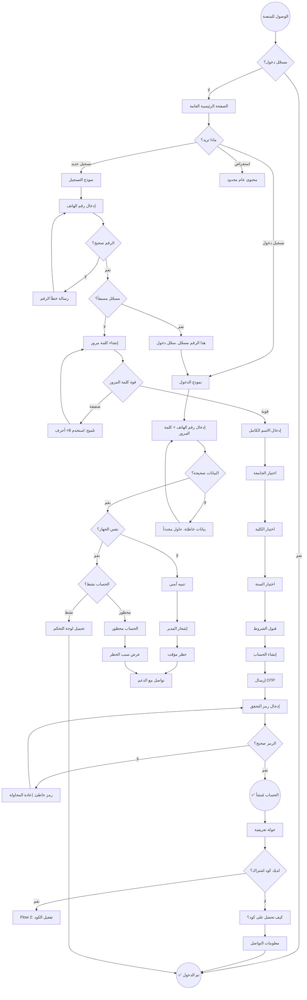

### 1.5 الخطوات بالتفصيل

#### Step 1: الوصول للمنصة
- **المستخدم**: يكتب `cms.example.com` في المتصفح.
- **النظام**: يتحقق من حالة المصادقة (JWT في localStorage).
- **النتيجة**: redirect حسب الحالة.

#### Step 2: التسجيل (إن لم يكن مسجّلاً)
1. **رقم الهاتف**: 
   - يجب أن يبدأ بـ `09` (سوريا).
   - 10 أرقام إجمالاً.
   - تحقق فوري عند `blur` (لا على كل ضغطة).
2. **كلمة المرور**:
   - 8 أحرف على الأقل.
   - يجب أن تحتوي: حرف + رقم.
   - مؤشر قوة كلمة المرور (weak/medium/strong).
   - زر إظهار/إخفاء.
3. **الاسم الكامل**: 3-50 حرفاً.
4. **الجامعة**: قائمة منسدلة (تجلب من DB).
5. **الكلية**: تُحدّث ديناميكياً حسب الجامعة.
6. **السنة**: تُحدّث ديناميكياً حسب الكلية.
7. **الشروط**: checkbox إلزامي.

#### Step 3: التحقق OTP
- **الطريقة**: OTP 4 أرقام عبر واتساب أو SMS.
- **المدة**: 60 ثانية للإدخال.
- **إعادة إرسال**: زر يظهر بعد 60 ثانية.
- **عدد المحاولات**: 5 محاولات كحد أقصى.
- **بعد 5 محاولات**: قفل 15 دقيقة.

#### Step 4: تسجيل الدخول
1. **رقم الهاتف + كلمة المرور**.
2. **"تذكّرني"**: يحفظ الجلسة لـ 30 يوماً.
3. **فحص الجهاز**: 
   - يقارن device fingerprint مع المسجّل.
   - إذا اختلف → رفض + تنبيه المدير + حظر مؤقت.

### 1.6 نقاط القرار

| القرار | الشرط | المسار |
|--------|------|--------|
| مسجّل دخول؟ | JWT موجود وفعال | نعم → Dashboard |
| الرقم مسجّل؟ | DB check | نعم → Login |
| قوة كلمة المرور؟ | regex | ضعيفة → hint |
| OTP صحيح؟ | DB check | لا → retry |
| نفس الجهاز؟ | device fingerprint | لا → block |
| الحساب نشط؟ | status field | محظور → reason |

### 1.7 حالات الخطأ

| الخطأ | الرسالة | الإجراء |
|------|--------|---------|
| رقم هاتف خاطئ | "الرقم يجب أن يبدأ بـ 09 ويكون 10 أرقام" | إعادة الإدخال |
| رقم مسجّل | "هذا الرقم مسجّل مسبقاً. سجّل الدخول" | redirect لـ Login |
| كلمة مرور ضعيفة | "استخدم 8 أحرف على الأقل مع حرف ورقم" | إعادة الإدخال |
| OTP خاطئ | "الرمز غير صحيح. لديك X محاولات متبقية" | إعادة المحاولة |
| انتهاء صلاحية OTP | "انتهت صلاحية الرمز. اطلب رمزاً جديداً" | زر إعادة إرسال |
| بيانات دخول خاطئة | "رقم الهاتف أو كلمة المرور غير صحيحة" | إعادة المحاولة |
| جهاز مختلف | "تم رصد محاولة دخول من جهاز غير معروف. تم إشعار المدير" | انتظار موافقة |
| حساب محظور | "حسابك محظور. السبب: [reason]. تواصل مع الدعم" | رابط دعم |
|太多 محاولات | "محاولات كثيرة. حاول بعد 15 دقيقة" | انتظار |

### 1.8 حالات النجاح

- ✅ **التسجيل**: حساب مُنشأ + OTP مُفعّل + redirect لـ Onboarding.
- ✅ **الدخول**: JWT صالح + redirect للوحة التحكم.
- ✅ **Onboarding**: جولة تعريفية (4-5 خطوات) تشرح الميزات.

### 1.9 Edge Cases

#### EC-1: فقدان الاتصال أثناء التسجيل
- **الحالة**: انقطع الإنترنت بعد إدخال البيانات.
- **السلوك**: حفظ المسودة في localStorage + رسالة "حفظنا بياناتك. أكمل عند عودة الاتصال".

#### EC-2: OTP وصل متأخراً
- **الحالة**: المستخدم انتظر دقيقة ولم يصل الرمز.
- **السلوك**: زر "إعادة إرسال" يظهر بعد 60 ثانية + زر "تغيير رقم الهاتف".

#### EC-3: نسيت كلمة المرور
- **الحالة**: المستخدم لا يتذكّر كلمة المرور.
- **السلوك**: رابط "نسيت كلمة المرور؟" → إدخال رقم الهاتف → OTP → كلمة مرور جديدة.

#### EC-4: الجلسة انتهت
- **الحالة**: المستخدم ترك الصفحة مفتوحة لساعات.
- **السلوك**: refresh تلقائي للـ token عبر refresh token. إذا فشل → redirect لـ Login مع رسالة "انتهت جلستك".

#### EC-5: تسجيل دخول من تبويبين
- **الحالة**: المستخدم سجّل دخوله على تبويبين.
- **السلوك**: 
  - نفس الجهاز: مسموح (حتى 3 جلسات).
  - أكثر من 3: إنهاء أقدم جلسة.

### 1.10 اعتبارات الوصولية

- ✅ كل الحقول لها `<label>` واضح.
- ✅ أخطاء الإدخال تُعلن بـ `aria-live`.
- ✅ زر "تذكّرني" يمكن الوصول له بالكيبورد.
- ✅ OTP input: `inputMode="numeric"` + `autoComplete="one-time-code"`.
- ✅ تباين كافٍ للنصوص الخافتة.
- ✅ لا اعتماد على اللون فقط (أيقونة + نص).

### 1.11 Analytics

نقيس لتحسين التدفق:
- معدل التحويل: زوار → مسجّلون.
- متوسط زمن التسجيل.
- نقاط التسرّب (drop-off points).
- معدل نجاح OTP في المحاولة الأولى.
- عدد محاولات "نسيت كلمة المرور".

---

## Flow 2: تفعيل كود الاشتراك

### 2.1 User Story
> **بصفتي** طالباً مسجّلاً،
> **أريد** تفعيل كود اشتراك حصلت عليه،
> **حتى** أتمكن من الوصول للمواد المشمولة.

### 2.2 Persona
محمد (طالب محدود الإمكانيات، حصل على كود مجاني من الفريق العلمي)

### 2.3 Entry Points
- بعد التسجيل مباشرة (Onboarding).
- من الملف الشخصي (اشتراكاتي).
- إشعار "اشتراكك ينتهي قريباً".
- زر "تفعيل كود" في الـ Navbar.

### 2.4 Mermaid Flowchart

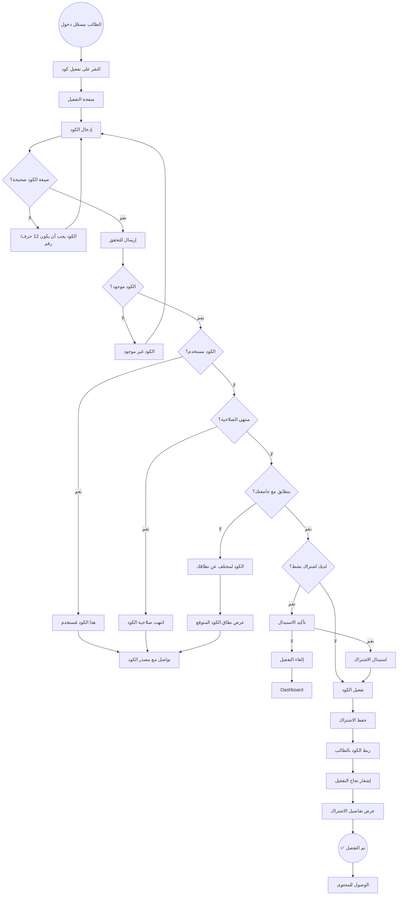

### 2.5 الخطوات بالتفصيل

#### Step 1: صفحة التفعيل
- **المظهر**: حقل CodeInput (12 خانة منفصلة).
- **ميزات**: 
  - auto-advance بين الخانات.
  - دعم paste للكود كاملاً.
  - تحويل تلقائي لـ uppercase.
  - تجاهل الأحرف غير الصالحة.

#### Step 2: التحقق من الصيغة
- **الصيغة**: 12 حرف (أحرف إنجليزية + أرقام).
- **مثال**: `CMS7X9K2M4Q8`.
- **تحقق**: client-side regex قبل الإرسال.

#### Step 3: التحقق من الخادم
- يرسل الكود لـ `POST /api/v1/codes/activate`.
- الـ server يتحقق من:
  - وجود الكود.
  - حالة الكود (غير مستخدم).
  - تاريخ الانتهاء.
  - نطاق الكود (جامعة/كلية/سنة/مادة).
  - تطابق نطاق الكود مع بيانات الطالب.

#### Step 4: تأكيد الاستبدال (إن لزم)
- إذا كان الطالب لديه اشتراك نشط لنفس النطاق:
  - خيارات: "استبدال" (يحل الجديد محل القديم) أو "إلغاء".
- إذا كان لديه اشتراك لنطاق مختلف:
  - الاشتراكات تتراكم (يصل لكلاهما).

#### Step 5: التفعيل
- تحديث حالة الكود → "مستخدم".
- ربط الكود بـ `student_id`.
- إنشاء سجل `student_subscriptions`.
- حساب تاريخ الانتهاء تلقائياً.
- إرسال إشعار للمدير (تنبيه تفعيل).

### 2.6 نقاط القرار

| القرار | الشرط | المسار |
|--------|------|--------|
| صيغة صحيحة؟ | regex | لا → error |
| الكود موجود؟ | DB lookup | لا → not found |
| مستخدم؟ | `used_by IS NOT NULL` | نعم → already used |
| منتهي؟ | `expires_at < NOW()` | نعم → expired |
| نطاق مطابق؟ | student.college == code.college | لا → mismatch |
| اشتراك نشط؟ | existing subscription | نعم → confirm replace |

### 2.7 حالات الخطأ

| الخطأ | الرسالة | الإجراء |
|------|--------|---------|
| صيغة خاطئة | "الكود يجب أن يكون 12 حرفاً (أحرف وأرقام)" | إعادة الإدخال |
| غير موجود | "الكود غير موجود. تأكد من الكتابة" | إعادة المحاولة |
| مستخدم | "هذا الكود مُستخدم بالفعل" | تواصل مع المصدر |
| منتهي | "انتهت صلاحية هذا الكود في [date]" | طلب كود جديد |
| نطاق مختلف | "هذا الكود لـ [university]. حسابك في [other]" | تغيير الحساب أو كود آخر |
| خطأ شبكة | "حدث خطأ. حاول مرة أخرى" | retry |

### 2.8 حالات النجاح

- ✅ الاشتراك مفعّل ومرئي في الملف الشخصي.
- ✅ المواد المشمولة تظهر في لوحة التحكم.
- ✅ Toast: "تم تفعيل اشتراكك! تستطيع الآن الوصول لـ [scope]".
- ✅ إشعار للمدير بالتفعيل.

### 2.9 Edge Cases

#### EC-1: كود بـ lowercase
- **السلوك**: تحويل تلقائي لـ uppercase قبل التحقق.

#### EC-2: كود مع فراغات
- **السلوك**: إزالة الفراغات تلقائياً.

#### EC-3: كود انتهى اليوم
- **السلوك**: السماح بالتفعيل حتى نهاية اليوم (23:59:59).

#### EC-4: اشتراك نشط ينتهي قريباً + كود جديد
- **السلوك**: 
  - خيار "تمديد": يبدأ الجديد بعد انتهاء القديم.
  - خيار "استبدال": يلغي القديم ويبدأ الجديد فوراً.

#### EC-5: كود تم إلغاؤه من المدير
- **السلوك**: رسالة "تم إلغاء هذا الكود. تواصل مع المصدر".

### 2.10 اعتبارات الوصولية

- ✅ CodeInput: كل خانة لها `aria-label`.
- ✅ إعلان النجاح بـ `aria-live="polite"`.
- ✅ رسائل الأخطاء `role="alert"`.
- ✅ لوحة المفاتيح: Tab للتنقّل بين الخانات.

### 2.11 Analytics

- معدل التفعيل الناجح.
- متوسط عدد المحاولات.
- أكثر أسباب الفشل شيوعاً.
- متوسط زمن التفعيل.

---

## Flow 3: الدخول لمادة وحل اختبار

### 3.1 User Story
> **بصفتي** طالباً،
> **أريد** الدخول لمادة وحل اختبار كامل،
> **حتى** أختبر معلوماتي قبل الامتحان.

### 3.2 Persona
سارة (طالبة سنة 5، تتحضّر للامتحان النهائي)

### 3.3 Entry Points
- من لوحة التحكم → اختيار مادة.
- من بحث → نتيجة اختبار.
- من رابط مباشر.
- من "متابعة الدراسة" في الـ dashboard.

### 3.4 Mermaid Flowchart

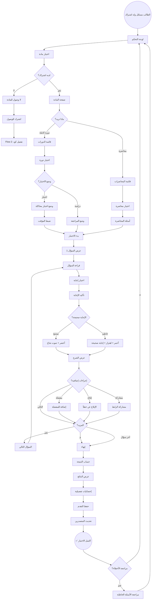

### 3.5 الخطوات بالتفصيل

#### Step 1: اختيار المادة
- عرض بطاقات المواد المتاحة.
- لكل بطاقة: شعار، اسم، عدد الأسئلة، تقدّم الطالب.
- فلترة: الكل / مكتملة / قيد التقدّم / لم تبدأ.

#### Step 2: صفحة المادة
- **تبويبات**: 
  - التصنيفات (محاضرات).
  - الدورات الكاملة.
  - المكتبة (Flow 5).
  - الإحصائيات.
- عرض تقدّم إجمالي + ring progress.

#### Step 3: اختيار الوضع
- **محاضرة**: أسئلة مرتّبة حسب المحاضرة.
- **دورة كاملة**: كل أسئلة دورة معيّنة (مثلاً دورة 2023).
- **وضع الاختبار**: 
  - محاكاة امتحان حقيقي.
  - مؤقت (يمكن ضبطه: 30د، 60د، 90د، 120د).
  - لا عرض للإجابات فوراً.
  - تقرير في النهاية.
- **وضع المراجعة**:
  - عرض الإجابات فوراً.
  - لا مؤقت.
  - مناسب للدراسة.

#### Step 4: حل السؤال
1. **عرض السؤال**: 
   - نص السؤال (يدعم صور + LaTeX).
   - خيارات (A, B, C, D...).
   - معلومات إضافية (محاضرة، صعوبة، وسوم).
2. **اختيار الإجابة**: 
   - نقر على خيار.
   - يمكن تغييره قبل التأكيد.
3. **التأكيد**: 
   - زر "تأكيد الإجابة".
   - أو اختصار Enter.
4. **التغذية الراجعة**:
   - **صحيح**: 
     - خيار أخضر.
     - صوت نجاح (نغمة قصيرة سماوية).
     - icon ✓.
     - "أحسنت! +1 نقطة".
   - **خاطئ**: 
     - خيار أحمر.
     - إجابة صحيحة بالأخضر.
     - اهتزاز الجهاز (200ms).
     - صوت خطأ (نغمة قصيرة).
     - icon ✗.
   - **عرض الشرح**: 
     - شرح تفصيلي (يدعم صور + LaTeX).
     - مرجع إن وُجد.

#### Step 5: إجراءات إضافية (لكل سؤال)
- **إضافة للمفضلة**: قلب أيقونة.
- **إنشاء قائمة مفضلة**: نافذة منبثقة.
- **الإبلاغ عن خطأ**: 
  - نافذة بـ reason (خطأ علمي، خطأ إملائي، خيار ناقص، شرح غير واضح، أخرى).
  - وصف إلزامي.
  - إرسال للمدير.
- **مشاركة الرابط**: 
  - نسخ رابط داخلي.
  - أو مشاركة عبر واتساب.

#### Step 6: إنهاء الاختبار
- **في وضع المراجعة**: "إنهاء" في أي وقت.
- **في وضع الاختبار**: 
  - "إنهاء" قبل الوقت → تأكيد.
  - انتهاء الوقت → إنهاء تلقائي.
- **عرض النتائج**:
  - النتيجة الإجمالية (X/Y).
  - النسبة المئوية.
  - الوقت المستغرق.
  - توزيع الإجابات (رسم بياني).
  - مقارنة مع متوسط الطلاب.
- **حفظ النتائج**:
  - تسجيل "أول محاولة فقط" للإحصائيات.
  - تحديث تقدّم الطالب.
  - تحديث لوحة المتصدرين (إن كانت أول محاولة).

### 3.6 نقاط القرار

| القرار | الشرط |
|--------|------|
| لديه اشتراك؟ | subscription active + scope matches |
| محاضرة أم دورة؟ | user choice |
| وضع اختبار أم مراجعة؟ | user choice |
| الإجابة صحيحة؟ | compare with correct_answer |
| المزيد من الأسئلة؟ | not last question |
| مراجعة الأخطاء؟ | had wrong answers |

### 3.7 حالات الخطأ

| الخطأ | الرسالة |
|------|--------|
| لا اشتراك | "اشترك للوصول لهذه المادة" |
| انقطع الاتصال | "انقطع الاتصال. سنحفظ تقدمك ونكمل عند العودة" |
| خطأ تحميل سؤال | "تعذّر تحميل السؤال. تخطّي / إعادة المحاولة" |
| خطأ حفظ النتيجة | "لم نتمكن من حفظ نتيجتك. سنحاول لاحقاً" |

### 3.8 حالات النجاح

- ✅ الاختبار مكتمل.
- ✅ النتيجة محفوظة.
- ✅ التقدّم محدّث.
- ✅ لوحة المتصدرين محدّثة (إن لزم).
- ✅ إحصائيات الطالب محدّثة.
- ✅ Toast: "أحسنت! أنهيت الاختبار بنجاب X%".

### 3.9 Edge Cases

#### EC-1: المستخدم خرج من الاختبار
- **السلوك**: 
  - حفظ تلقائي كل إجابة.
  - عند العودة: "أكمل من حيث توقفت؟".
  - أو "ابدأ من جديد".

#### EC-2: انقطع الاتصال أثناء الاختبار
- **السلوك**: 
  - في وضع المراجعة: إكمال Offline (إن كانت الأسئلة محمّلة).
  - في وضع اختبار: حفظ التقدم + متابعة عند العودة.

#### EC-3: انتهى الوقت
- **السلوك**: 
  - إنهاء تلقائي.
  - الأسئلة غير المجابة تُحسب خاطئة.
  - رسالة: "انتهى الوقت. إليك نتيجتك".

#### EC-4: تبويب أغلق فجأة
- **السلوك**: 
  - حفظ كل إجابة فوراً في localStorage.
  - عند العودة: استئناف من نفس النقطة.

#### EC-5: عدد كبير من الأخطاء المتتالية
- **السلوك**: 
  - بعد 5 أخطاء متتالية: رسالة تشجيعية.
  - اقتراح مراجعة المحاضرة.
  - اقتراح وضع المراجعة.

### 3.10 اعتبارات الوصولية

- ✅ كل خيار قابل للوصول بالكيبورد (Tab + Enter).
- ✅ إعلان النتيجة بـ `aria-live`.
- ✅ صوت + اهتزاز + لون (لا اعتماد على لون فقط).
- ✅ دعم قارئ الشاشة: "السؤال 1 من 10. خيار A: ...".
- ✅ احترام `prefers-reduced-motion` (لا اهتزاز).

### 3.11 Analytics

- متوسط مدة الاختبار.
- معدل الإكمال (start → finish).
- نسبة الإجابات الصحيحة.
- أكثر الأسئلة خطأً.
- معدل التسرّب (drop-off).

---

## Flow 4: الإبلاغ عن خطأ + المفضلة

### 4.1 User Story
> **بصفتي** طالباً،
> **أريد** الإبلاغ عن خطأ في سؤال وإضافته للمفضلة،
> **حتى** أساهم في تحسين المحتوى وأراجعه لاحقاً.

### 4.2 Persona
أحمد (طالب مجتهد، يلاحظ الأخطاء بسرعة)

### 4.3 Entry Points
- من داخل سؤال (Flow 3).
- من قائمة المفضلة (مراجعة).
- من إشعار "تم إصلاح الخطأ الذي أبلغت عنه".

### 4.4 Mermaid Flowchart

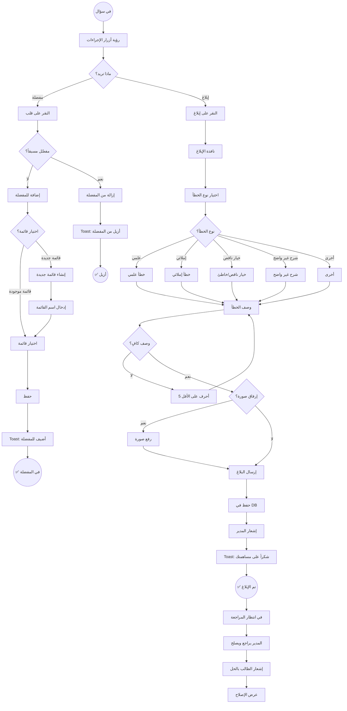

### 4.5 الخطوات بالتفصيل

#### المفضلة

##### Step 1: النقر على القلب
- أيقونة قلب في شريط أدوات السؤال.
- يتحوّل لـ "مملوء" عند الإضافة.
- يتحوّل لـ "فارغ" عند الإزالة.

##### Step 2: اختيار القائمة
- **قائمة موجودة**: عرض قوائم الطالب.
- **قائمة جديدة**: نافذة لإنشاء قائمة.
  - اسم القائمة (إلزامي).
  - وصف (اختياري).
  - لون (اختياري).

##### Step 3: الحفظ
- حفظ في `favorites` table.
- عرض toast: "أُضيف لـ [list name]".
- زر "عرض القائمة".

#### الإبلاغ عن خطأ

##### Step 1: فتح نافذة الإبلاغ
- زر "إبلاغ عن خطأ" (أيقونة flag).
- نافذة منبثقة (Dialog).

##### Step 2: اختيار نوع الخطأ
- **خطأ علمي**: الإجابة الصحيحة خاطئة.
- **خطأ إملائي**: أخطاء في النص.
- **خيار ناقص/خاطئ**: خيار غير منطقي أو ناقص.
- **شرح غير واضح**: الشرح غير مفهوم.
- **أخرى**: أي شيء آخر.

##### Step 3: وصف الخطأ
- textarea (5-500 حرف).
- placeholder حسب نوع الخطأ.

##### Step 4: إرفاق صورة (اختياري)
- رفع صورة (JPG/PNG, max 5MB).
- معاينة قبل الإرسال.

##### Step 5: الإرسال
- حفظ في `error_reports` table.
- إرسال إشعار للمدير.
- عرض toast: "شكراً على مساهمتك! سنراجع تقريرك".

### 4.6 حالات الخطأ

| الخطأ | الرسالة |
|------|--------|
| وصف قصير | "اكتب 5 أحرف على الأقل لنفهم المشكلة" |
| صورة كبيرة | "حجم الصورة يجب أن يكون أقل من 5MB" |
| خطأ شبكة | "تعذّر إرسال البلاغ. حاول مرة أخرى" |
| سبق الإبلاغ | "لقد أبلغت عن هذا السؤال مسبقاً. نراجعه" |

### 4.7 حالات النجاح

- ✅ المفضلة: السؤال في القائمة + toast.
- ✅ الإبلاغ: البلاغ مُرسل + toast + إشعار للمدير.

### 4.8 Edge Cases

#### EC-1: إضافة نفس السؤال مرتين
- **السلوك**: لا تكرار. رسالة "موجود في القائمة بالفعل".

#### EC-2: قائمة ممتلئة
- **السلوك**: حد 100 سؤال لكل قائمة. رسالة "القائمة ممتلئة".

#### EC-3: بلاغ مكرّر من طلاب مختلفين
- **السلوك**: المدير يرى عدد البلاغات للسؤال الواحد.

#### EC-4: السؤال محذوف بعد البلاغ
- **السلوك**: إغلاق البلاغ تلقائياً + إشعار الطلاب "تمت معالجة البلاغ".

### 4.9 اعتبارات الوصولية

- ✅ النافذة: focus trap + ESC للإغلاق.
- ✅ Select reason: radio group قابل للكيبورد.
- ✅ Upload: زر واضح + progress bar.
- ✅ Toast: `aria-live="polite"`.

### 4.10 Analytics

- عدد البلاغات لكل سؤال.
- متوسط زمن المعالجة.
- أكثر أنواع الأخطاء شيوعاً.
- نسبة المفضلة مقابل الأسئلة المحلولة.

---

## Flow 5: مشاهدة ملف في المكتبة

### 5.1 User Story
> **بصفتي** طالباً،
> **أريد** مشاهدة ملف PDF/HTML في مكتبة المادة،
> **حتى** أراجع المادة بعمق.

### 5.2 Persona
سارة (طالبة منظّمة، تحب المراجعة من الملفات)

### 5.3 Entry Points
- من صفحة المادة → تبويب المكتبة.
- من نتائج البحث.
- من "متابعة الدراسة".

### 5.4 Mermaid Flowchart

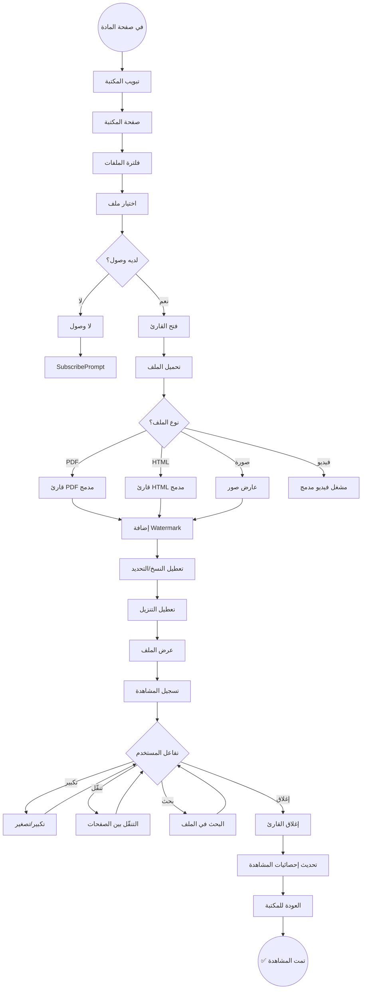

### 5.5 الخطوات بالتفصيل

#### Step 1: صفحة المكتبة
- عرض الملفات في بطاقات.
- فلترة حسب:
  - النوع (PDF, HTML, صورة, فيديو).
  - المحاضرة المرتبطة.
  - الأحدث/الأقدم/الأكثر مشاهدة.
- بحث داخل المكتبة.

#### Step 2: فتح القارئ
- النقر على بطاقة الملف.
- فتح في صفحة منفصلة أو modal كامل الشاشة.
- تحميل الملف من Cloudflare R2 (signed URL).

#### Step 3: تطبيق الحماية
1. **Watermark ديناميكي**:
   - اسم الطالب + رقمه + التاريخ.
   - شفاف منخفض (opacity 0.1).
   - يتكرّر في كل صفحة PDF.
2. **تعطيل النسخ**:
   - `user-select: none`.
   - تعطيل `Ctrl+C`.
   - تعطيل context menu.
3. **تعطيل التنزيل**:
   - إخفاء زر download في الـ PDF viewer.
   - headers تمنع Save As.
4. **منع فتح في تبويب خارجي**:
   - signed URL بصلاحية 5 دقائق.
   - فحص referer.

#### Step 4: أدوات القارئ
- **PDF**: 
  - تكبير/تصغير (50%-200%).
  - التنقّل بين الصفحات.
  - البحث في النص.
  - ملء الشاشة.
  - عرض صفحة واحدة / متواصل.
- **HTML**: 
  - عرض كما هو (داخل iframe محمي).
  - تنسيق متناسق مع المنصة.
- **صورة**: 
  - تكبير باللمس/الفأرة.
  - عرض ملء الشاشة.
- **فيديو**: 
  - مشغّل مدمج (Flow 6).

#### Step 5: تسجيل المشاهدة
- حفظ في `library_views` table.
- تحديث `views_count` للملف.
- حساب مدة المشاهدة.

### 5.6 حالات الخطأ

| الخطأ | الرسالة |
|------|--------|
| لا وصول | "اشترك للوصول لهذا الملف" |
| ملف محذوف | "هذا الملف لم يعد متاحاً" |
| خطأ تحميل | "تعذّر تحميل الملف. حاول مرة أخرى" |
| انقطع الاتصال | "انقطع الاتصال. أعد المحاولة" |
| ملف كبير | "الملف كبير. قد يستغرق التحميل وقتاً" |

### 5.7 حالات النجاح

- ✅ الملف يُعرض في القارئ المدمج.
- ✅ Watermark ظاهر.
- ✅ لا يمكن نسخ/تنزيل.
- ✅ المشاهدة مسجّلة.

### 5.8 Edge Cases

#### EC-1: محاولة فتح في تبويب خارجي
- **السلوك**: 
  - signed URL منتهي الصلاحية.
  - redirect لصفحة "وصول مرفوض".

#### EC-2: محاولة نسخ عبر DevTools
- **السلوك**: 
  - كشف فتح DevTools.
  - إخفاء المحتوى.
  - تسجيل المحاولة + إشعار المدير.

#### EC-3: ملف كبير + إنترنت بطيء
- **السلوك**: 
  - progress bar.
  - رسالة "جاري التحميل... X%".
  - إمكانية الإلغاء.

#### EC-4: PDF مع حماية طباعة
- **السلوك**: 
  - إزالة طبقة الطباعة برمجياً.
  - عرض كصور (إن لزم).

### 5.9 اعتبارات الوصولية

- ✅ قارئ PDF: تنقّل بالكيبورد (Arrow keys).
- ✅ أوصاف بديلة للصور في PDF (إن أمكن).
- ✅ تباين كافٍ للـ Watermark (لا يحجب المحتوى).
- ✅ دعم قارئ الشاشة للنصوص.

### 5.10 Analytics

- أكثر الملفات مشاهدة.
- متوسط مدة المشاهدة.
- معدل الإكمال (كم صفحة طُلعت).
- نقاط التسرّب.

---

## Flow 6: مشاهدة فيديو يوتيوب مدمج

### 6.1 User Story
> **بصفتي** طالباً،
> **أريد** مشاهدة فيديو تعليمي داخل المنصة،
> **حتى** أتعلم بصرياً دون مغادرة التطبيق.

### 6.3 Persona
أحمد (يتعلّم بالفيديو أفضل من النص)

### 6.4 Mermaid Flowchart

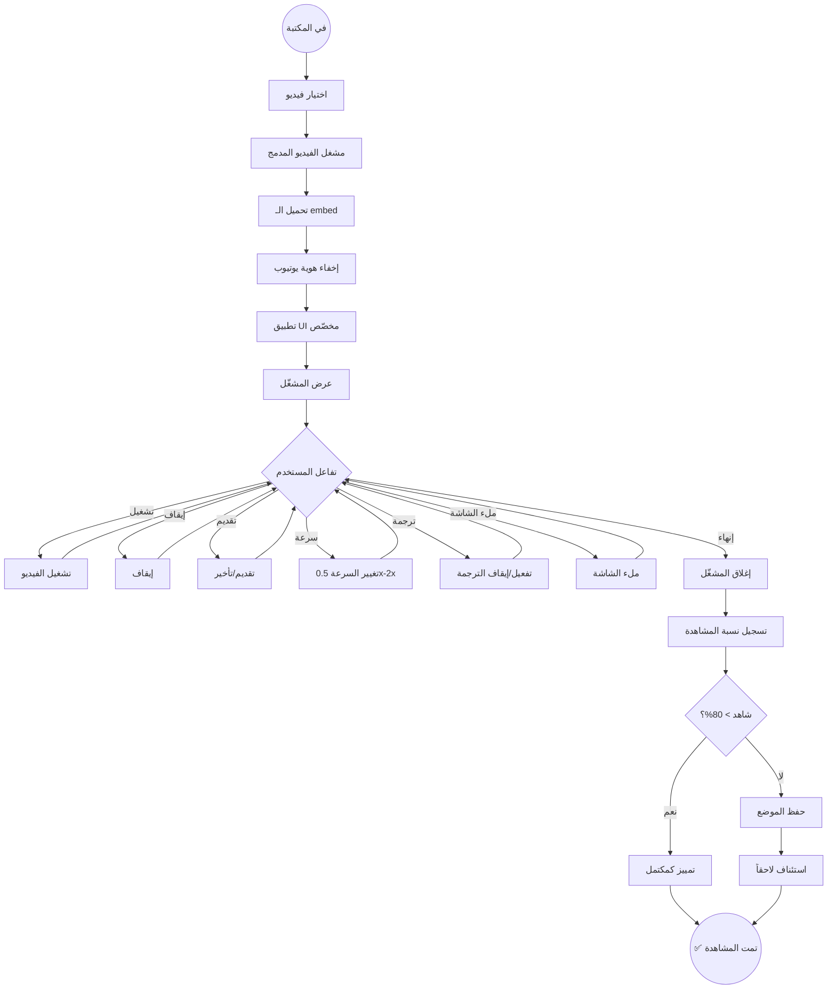

### 6.5 الخطوات بالتفصيل

#### Step 1: المشغّل المدمج
- استخدم YouTube IFrame API.
- إخفاء شعار يوتيوب (`modestbranding=1`).
- إخفاء معلومات القناة (`showinfo=0`).
- تعطيل الفيديوهات المقترحة في النهاية (`rel=0`).
- تعطيل الـ annotations.

#### Step 2: UI مخصّص
- شريط تحكم مخصّص ( play/pause/seek/volume).
- عرض اسم الفيديو (من قاعدة البيانات).
- لا روابط لـ youtube.com.

#### Step 3: ميزات المشغّل
- تشغيل/إيقاف.
- شريط تقدّم قابل للسحب.
- زر الصوت + مستوى الصوت.
- ملء الشاشة.
- سرعة التشغيل (0.5x, 1x, 1.25x, 1.5x, 2x).
- ترجمة عربية (إن توفّرت).

#### Step 4: تتبّع المشاهدة
- حفظ موضع المشاهدة كل 10 ثوانٍ.
- عند الإكمال (> 80%) → تمييز كمكتمل.
- عند العودة: "تابع من [time]".

### 6.6 حالات الخطأ

| الخطأ | الرسالة |
|------|--------|
| فيديو محذوف من يوتيوب | "هذا الفيديو لم يعد متاحاً" |
| فيديو مقيد جغرافياً | "هذا الفيديو غير متاح في منطقتك" |
| خطأ تحميل | "تعذّر تحميل الفيديو. حاول مرة أخرى" |
| انقطع الاتصال | "انقطع الاتصال. الفيديو متوقّف" |

### 6.7 حالات النجاح

- ✅ الفيديو يلعب بسلاسة.
- ✅ لا تظهر هوية يوتيوب.
- ✅ نسبة المشاهدة محفوظة.
- ✅ إحصائيات محدّثة.

### 6.8 Edge Cases

#### EC-1: الفيديو طويل + إنترنت بطيء
- **السلوك**: 
  - بدء من أدنى جودة.
  - خيار تبديل الجودة (إن أمكن).

#### EC-2: تبديل التبويب أثناء التشغيل
- **السلوك**: 
  - إيقاف الفيديو تلقائياً.
  - استئناف عند العودة.

#### EC-3: انقطاع الإنترنت
- **السلوك**: 
  - إيقاف مؤقت.
  - "في انتظار عودة الاتصال".
  - استئناف تلقائي عند العودة.

### 6.9 اعتبارات الوصولية

- ✅ مشغّل قابل للوصول بالكيبورد.
- ✅ ترجمة عربية إلزامية إن توفّرت.
- ✅ transcript نصّي (إن أمكن).
- ✅ إعلان تغيّر الحالة بـ `aria-live`.

### 6.10 Analytics

- متوسط مدة المشاهدة.
- معدل الإكمال.
- نقاط التسرّب (متى يغادر المستخدم).
- أكثر الفيديوهات مشاهدة.

---

## Flow 7: البحث الشامل

### 7.1 User Story
> **بصفتي** طالباً،
> **أريد** البحث في الأسئلة والملفات والمحاضرات،
> **حتى** أجد ما أحتاج بسرعة.

### 7.2 Persona
سارة (تبحث عن مواضيع محدّدة للمراجعة)

### 7.3 Entry Points
- شريط البحث في الـ Navbar.
- صفحة بحث مخصّصة.
- اختصار `Ctrl+K` (Command Palette).

### 7.4 Mermaid Flowchart

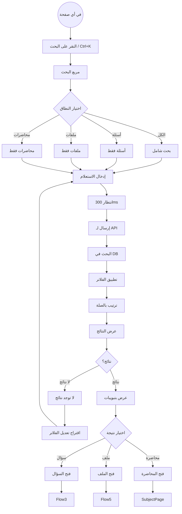

### 7.5 الخطوات بالتفصيل

#### Step 1: إدخال الاستعلام
- بحث فوري (debounce 300ms).
- اقتراحات أثناء الكتابة (autocomplete).
- دعم الأخطاء الإملائية (fuzzy search).
- تطبيع الأحرف العربية (أ، إ، آ = ا).

#### Step 2: اختيار النطاق
- **الكل**: بحث في كل المحتوى.
- **أسئلة**: نص السؤال، الخيارات، الشرح، الوسوم.
- **ملفات**: العنوان، الوصف.
- **محاضرات**: العنوان، الوصف.

#### Step 3: الفلاتر المتقدّمة
- **المادة**: فلترة حسب مادة.
- **المحاضرة**: فلترة حسب محاضرة.
- **سنة الدورة**: فلترة حسب سنة.
- **الصعوبة**: سهل/متوسط/صعب.
- **الوسوم**: اختيار متعدّد.

#### Step 4: عرض النتائج
- تبويبات: الكل / أسئلة / ملفات / محاضرات.
- كل نتيجة:
  - عنوان مميّز (highlight المطابق).
  - مقتطف من المحتوى.
  - نوع النتيجة (badge).
  - مادة مرتبطة.
- عدد النتائج لكل نوع.
- ترقيم صفحات (إن > 20 نتيجة).

#### Step 5: فتح نتيجة
- النقر على نتيجة يفتح الصفحة المناسبة.
- حفظ في سجل البحث (آخر 10 عمليات).

### 7.6 حالات الخطأ

| الخطأ | الرسالة |
|------|--------|
| استعلام فارغ | "اكتب كلمة للبحث" |
| استعلام قصير | "اكتب حرفين على الأقل" |
| لا نتائج | "لا توجد نتائج لـ [query]. جرّب كلمات أخرى" |
| خطأ شبكة | "تعذّر البحث. حاول مرة أخرى" |

### 7.7 حالات النجاح

- ✅ نتائج دقيقة ومرتّبة.
- ✅ Highlight واضح للمطابق.
- ✅ فتح النتيجة بسرعة.
- ✅ سجل البحث محفوظ.

### 7.8 Edge Cases

#### EC-1: استعلام طويل جداً
- **السلوك**:截 إلى 100 حرف + رسالة.

#### EC-2: رموز خاصة
- **السلوك**: تطهير الاستعلام (escape special chars).

#### EC-3: بحث متكرّر
- **السلوك**: cache النتائج لـ 5 دقائق.

#### EC-4: بحث أثناء الكتابة
- **السلوك**: 
  - debounce 300ms.
  - إلغاء الطلبات السابقة (AbortController).

### 7.9 اعتبارات الوصولية

- ✅ مربع البحث: `aria-label="بحث"`.
- ✅ عدد النتائج: `aria-live="polite"`.
- ✅ تنقّل بالكيبورد في النتائج (Arrow up/down).
- ✅ Enter لفتح النتيجة.

### 7.10 Analytics

- أكثر الاستعلامات شيوعاً.
- معدل النقر على النتائج (CTR).
- متوسط عدد النتائج.
- نسبة "لا نتائج".

---

## Flow 8: دخول لوحة الإدارة

### 8.1 User Story
> **بصفتي** مديراً أكاديمياً،
> **أريد** الدخول للوحة الإدارة،
> **حتى** أدير المحتوى والمستخدمين.

### 8.2 Persona
د. خالد (مدير أكاديمي، MacBook Pro + iPhone)

### 8.3 Entry Points
- نطاق منفصل: `admin.domain.com`.
- رابط مباشر من إيميل الترحيب.

### 8.4 Mermaid Flowchart

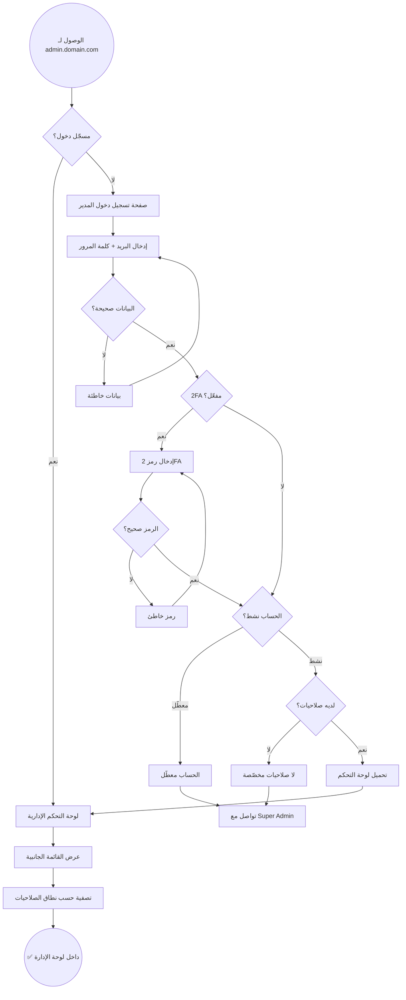

### 8.5 الخطوات بالتفصيل

#### Step 1: تسجيل دخول المدير
- **الفرق عن الطالب**:
  - بريد إلكتروني (بدل رقم هاتف).
  - كلمة مرور أقوى (12+ حرف).
  - 2FA إلزامي (إن كان مفعّلاً).
- **بعد التسجيل**: 
  - JWT مع `role: admin`.
  - claims للنطاقات (scope_university, scope_college, ...).

#### Step 2: التحقق من الصلاحيات
- لكل مدير: role + permissions.
- النطاقات:
  - **Super Admin**: كل شيء.
  - **University Admin**: جامعة معيّنة.
  - **College Admin**: كلية معيّنة.
  - **Subject Admin**: مادة معيّنة.
- القائمة الجانبية تُفلتر حسب الصلاحيات.

#### Step 3: لوحة التحكم
- **الإحصائيات السريعة**:
  - عدد الطلاب النشطين.
  - عدد الأكواد المُستخدمة.
  - عدد الأسئلة.
  - إيراد آخر شهر.
- **التنقّل السريع**:
  - الجامعات / الكليات / السنوات / ...
  - الأسئلة / المكتبة / الأكواد.
  - المستخدمون / المدراء.
  - الإشعارات / التقارير.

### 8.6 حالات الخطأ

| الخطأ | الرسالة |
|------|--------|
| بيانات خاطئة | "البريد أو كلمة المرور غير صحيحة" |
| 2FA خاطئ | "رمز التحقق غير صحيح" |
| حساب معطّل | "حسابك معطّل. تواصل مع Super Admin" |
| لا صلاحيات | "لا تملك صلاحيات بعد. انتظر موافقة Super Admin" |
| 很多 محاولات | "محاولات كثيرة. حاول بعد 15 دقيقة" |

### 8.7 Edge Cases

#### EC-1: المدير نسي 2FA
- **السلوك**: 
  - رموز استرداد (recovery codes).
  - أو تواصل مع Super Admin لإعادة التعيين.

#### EC-2: انتهاء جلسة المدير
- **السلوك**: 
  - refresh تلقائي (إن أمكن).
  - أو redirect لـ Login مع رسالة.

#### EC-3: محاولة الوصول لقسم خارج النطاق
- **السلوك**: 
  - 403 Forbidden.
  - رسالة "ليس لديك صلاحية للوصول لهذا القسم".

### 8.8 اعتبارات الوصولية

- ✅ كل ما ينطبق على Flow 1.
- ✅ جدول بيانات قابل للوصول بالكيبورد.

### 8.9 Analytics

- عدد الجلسات الإدارية يومياً.
- أكثر الأقسام استخداماً.
- متوسط مدة الجلسة.

---

## Flow 9: إنشاء كود اشتراك

### 9.1 User Story
> **بصفتي** مديراً،
> **أريد** إنشاء أكواد اشتراك للطلاب،
> **حتى** أتمكن من توزيعها ومنح الوصول.

### 9.2 Persona
د. خالد (ينشئ 50 كوداً لطلاب فصله)

### 9.3 Entry Points
- من لوحة الإدارة → الأكواد.
- من "إنشاء كود" في الـ dashboard.

### 9.4 Mermaid Flowchart

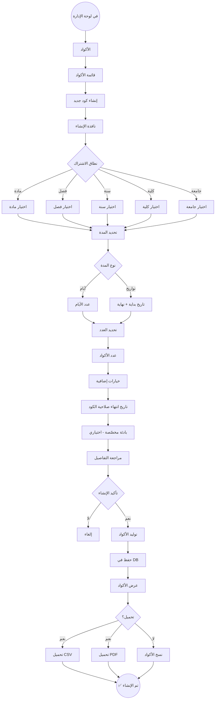

### 9.5 الخطوات بالتفصيل

#### Step 1: اختيار النطاق
- **مادة**: كود لمادة واحدة.
- **فصل**: كود لكل مواد فصل.
- **سنة**: كود لكل مواد سنة.
- **كلية**: كود لكل مواد كلية.
- **جامعة**: كود لكل مواد جامعة.
- الفلترة: المدير يرى فقط ما يملك صلاحية له.

#### Step 2: تحديد المدة
- **خيار 1**: عدد أيام (30، 90، 180، 365).
- **خيار 2**: تواريخ محدّدة (بداية + نهاية).

#### Step 3: تحديد العدد
- 1 إلى 1000 كود دفعة واحدة.
- preview قبل التوليد.

#### Step 4: خيارات إضافية
- **تاريخ انتهاء صلاحية الكود**: متى يصبح غير قابل للتفعيل (مختلف عن تاريخ انتهاء الاشتراك).
- **بادئة مخصّصة**: مثلاً `SURG-` لأكواد الجراحة.
- **ملاحظات داخلية**: للمدير فقط.

#### Step 5: التوليد
- خوارزمية: 12 حرف (A-Z, 2-9) - بدون أحرف ملتبسة (0/O, 1/I/L).
- ضمان عدم التكرار.
- حفظ في DB مع كل التفاصيل.

#### Step 6: العرض والتحميل
- عرض في جدول.
- خيارات:
  - تحميل CSV.
  - تحميل PDF (بطاقات قابلة للقص).
  - نسخ للحافظة.
  - طباعة.

### 9.6 حالات الخطأ

| الخطأ | الرسالة |
|------|--------|
| نطاق غير صالح | "اختر نطاقاً صالحاً" |
| تواريخ خاطئة | "تاريخ النهاية يجب أن يكون بعد البداية" |
| عدد كبير | "الحد الأقصى 1000 كود دفعة واحدة" |
| خطأ DB | "تعذّر حفظ الأكواد. حاول مرة أخرى" |

### 9.7 Edge Cases

#### EC-1: تكرار كود نادر
- **السلوك**: إعادة التوليد تلقائياً.

#### EC-2: المدير خارج نطاقه
- **السلوك**: لا يرى إلا نطاقاته. محاولة تجاوز → 403.

#### EC-3: توليد 1000 كود
- **السلوك**: 
  - background job.
  - إشعار عند الانتهاء.
  - تحميل من صفحة الأكواد.

### 9.8 اعتبارات الوصولية

- ✅ كل الحقول لها labels.
- ✅ الجدول قابل للوصول بالكيبورد.
- ✅ أزرار التحميل لها `aria-label`.

### 9.9 Analytics

- عدد الأكواد المنشأة شهرياً.
- أكثر النطاقات استخداماً.
- معدل التفعيل (أكواد مفعّلة / منشأة).

---

## Flow 10: رفع ملفات المكتبة

### 10.1 User Story
> **بصفتي** مديراً،
> **أريد** رفع ملفات للمكتبة،
> **حتى** أضيف محتوى تعليمياً للطلاب.

### 10.2 Persona
د. خالد (يرفع ملخصات ومحاضرات)

### 10.3 Entry Points
- من لوحة الإدارة → المكتبة.
- من "رفع ملف" في صفحة مادة.

### 10.4 Mermaid Flowchart

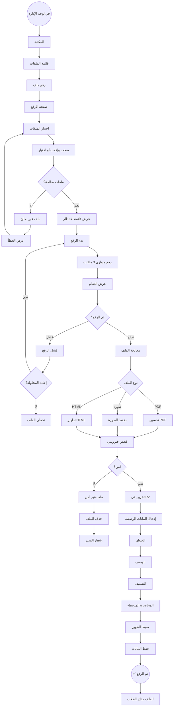

### 10.5 الخطوات بالتفصيل

#### Step 1: اختيار الملفات
- سحب وإفلات (drag & drop).
- أو اختيار من الجهاز.
- أنواع مدعومة: PDF, HTML, PNG, JPG, WebP, SVG.
- حد الحجم: 100MB للملف الواحد.

#### Step 2: الرفع
- رفع متوازي (3 ملفات في آنٍ).
- شريط تقدّم لكل ملف.
- إمكانية الإلغاء.
- resumable uploads (إن انقطع).

#### Step 3: المعالجة
- **PDF**: 
  - إزالة البيانات الوصفية.
  - تحسين الحجم.
  - (اختياري) تحويل لصور لمنع النسخ.
- **صورة**: 
  - تحويل لـ WebP.
  - ضغط (جودة 85%).
  - إنشاء thumbnail.
- **HTML**: 
  - تطهير (sanitize).
  - إزالة scripts خطيرة.

#### Step 4: الفحص الأمني
- فحص فيروسي (ClamAV أو خدمة سحابية).
- إن كان آمناً → متابعة.
- إن كان خطراً → حذف + إشعار المدير.

#### Step 5: التخزين
- تخزين في Cloudflare R2.
- اسم فريد (UUID).
- مسار: `library/{subject_id}/{file_uuid}.{ext}`.

#### Step 6: البيانات الوصفية
- **العنوان** (إلزامي).
- **الوصف** (اختياري).
- **التصنيف**: PDF, HTML, صورة, فيديو, ملخص, شامل, فقرة.
- **المحاضرة المرتبطة** (اختياري).
- **الظهور**: فوراً / مجدول / مسودة.

### 10.6 حالات الخطأ

| الخطأ | الرسالة |
|------|--------|
| نوع غير مدعوم | "النوع [ext] غير مدعوم. الأنواع المدعومة: PDF, HTML, PNG, JPG, WebP" |
| حجم كبير | "حجم الملف [size] يتجاوز الحد 100MB" |
| فشل الرفع | "تعذّر رفع الملف. حاول مرة أخرى" |
| ملف خطر | "تم رفض الملف. يبدو مصاباً. تواصل مع الدعم" |
| خطأ معالجة | "تعذّر معالجة الملف. تأكد من صحته" |

### 10.7 Edge Cases

#### EC-1: ملف بنفس الاسم موجود
- **السلوك**: 
  - الاسم لا يهم (UUID).
  - لكن العنوان قد يتكرر → تحذير.

#### EC-2: رفع 50 ملف دفعة
- **السلوك**: 
  - رفع متوازي (3 في آنٍ).
  - قائمة انتظار للباقي.
  - إشعار عند الانتهاء.

#### EC-3: انقطع أثناء الرفع
- **السلوك**: 
  - resumable upload.
  - متابعة من حيث توقّف.

#### EC-4: ملف HTML خطر
- **السلوك**: 
  - sanitize يزيل: scripts, iframes خارجية, event handlers.
  - حفظ النسخة المطهّرة فقط.

### 10.8 اعتبارات الوصولية

- ✅ منطقة السحب والإفلات: تعليمات واضحة + بديل زر.
- ✅ شريط التقدّم: `role="progressbar"`.
- ✅ رسائل الخطأ: `role="alert"`.

### 10.9 Analytics

- عدد الملفات المرفوعة شهرياً.
- متوسط زمن الرفع.
- أكثر الأنواع رفعاً.
- معدل الفشل.

---

## Flow 11: إرسال إشعارات

### 11.1 User Story
> **بصفتي** مديراً،
> **أريد** إرسال إشعارات للطلاب،
> **حتى** أعلنهم بتحديثات أو تنبيهات.

### 11.2 Persona
د. خالد (يرسل إشعار إضافة أسئلة جديدة)

### 11.3 Entry Points
- من لوحة الإدارة → الإشعارات.
- من "إرسال إشعار" في الـ dashboard.

### 11.4 Mermaid Flowchart

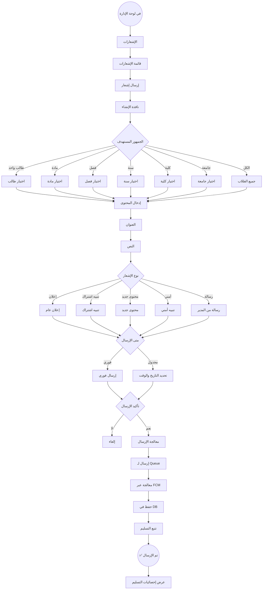

### 11.5 الخطوات بالتفصيل

#### Step 1: اختيار الجمهور
- **طالب واحد**: بحث بالاسم/الرقم.
- **مادة**: كل المشتركين في مادة.
- **فصل**: كل طلاب فصل.
- **سنة**: كل طلاب سنة.
- **كلية**: كل طلاب كلية.
- **جامعة**: كل طلاب جامعة.
- **الكل**: كل الطلاب (Super Admin فقط).
- عرض عدد المستهدفين قبل الإرسال.

#### Step 2: إدخال المحتوى
- **العنوان** (إلزامي، 5-100 حرف).
- **النص** (إلزامي، 10-500 حرف).
- **النوع**:
  - إعلان عام.
  - تنبيه اشتراك.
  - محتوى جديد.
  - تنبيه أمني.
  - رسالة من المدير.
- **أيقونة** (اختياري، حسب النوع).
- **رابط** (اختياري، deep link لصفحة).

#### Step 3: الجدولة
- **فوري**: إرسال مباشر.
- **مجدول**: تحديد تاريخ ووقت.
- **متكرّر** (اختياري): يومي/أسبوعي/شهري.

#### Step 4: الإرسال
- إدخال في queue (Redis).
- معالجة عبر FCM للـ Web Push.
- حفظ في `notifications` table.
- تتبع التسليم (sent, delivered, read, clicked).

### 11.6 حالات الخطأ

| الخطأ | الرسالة |
|------|--------|
| لا جمهور | "اختر الجمهور المستهدف" |
| عنوان قصير | "العنوان يجب أن يكون 5 أحرف على الأقل" |
| نص قصير | "النص يجب أن يكون 10 أحرف على الأقل" |
| فشل FCM | "تعذّر إرسال بعض الإشعارات. سنحاول لاحقاً" |
| جدولة خاطئة | "وقت الجدولة يجب أن يكون في المستقبل" |

### 11.7 Edge Cases

#### EC-1: إرسال لـ 10,000 طالب
- **السلوك**: 
  - batch processing.
  - تتبع التقدّم.
  - إشعار عند الانتهاء.

#### EC-2: FCMtoken منتهي
- **السلوك**: 
  - إزالة الـ token من DB.
  - تسجيل في سجل الأخطاء.

#### EC-3: إشعار مكرّر
- **السلوك**: 
  - تحذير "أرسلت إشعاراً مشابهاً قبل X دقيقة. تأكيد؟".

#### EC-4: طالب أوقف الإشعارات
- **السلوك**: 
  - لا يصل له (إلا الإشعارات الأمنية الحرجة).

### 11.8 اعتبارات الوصولية

- ✅ النصوص واضحة وموجزة.
- ✅ يمكن قراءة الإشعارات بقارئ الشاشة.

### 11.9 Analytics

- عدد الإشعارات المرسلة.
- معدل التسليم (delivered/sent).
- معدل القراءة (read/delivered).
- معدل النقر (clicked/read).
- أكثر الأنواع تفاعلاً.

---

## Flow 12: إدارة الأسئلة

### 12.1 User Story
> **بصفتي** مديراً،
> **أريد** إضافة وتعديل وحذف الأسئلة،
> **حتى** أبني بنك أسئلة شامل.

### 12.2 Persona
د. خالد (يدير 5000+ سؤال)

### 12.3 Entry Points
- من لوحة الإدارة → الأسئلة.
- من "إضافة سؤال" في صفحة مادة.

### 12.4 Mermaid Flowchart

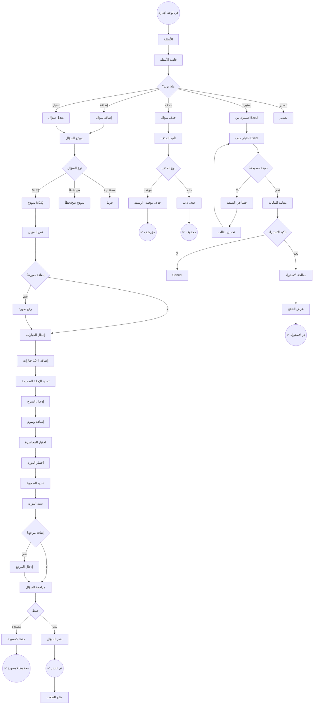

### 12.5 الخطوات بالتفصيل

#### Step 1: قائمة الأسئلة
- DataTable مع:
  - بحث + فلترة (مادة، محاضرة، صعوبة، وسوم).
  - ترتيب (الأحدث، الأقدم، الأكثر خطأً).
  - ترقيم صفحات.
  - اختيار متعدّد (bulk actions).
- كل سؤال: نص موجز، نوع، صعوبة، حالة (منشور/مسودة/مؤرشف).

#### Step 2: نموذج السؤال
- **نص السؤال** (إلزامي):
  - محرّر نصوص غني.
  - دعم LaTeX للصيغ الرياضية.
  - دعم صور مدمجة.
- **صورة للسؤال** (اختياري).
- **الخيارات** (لـ MCQ):
  - 4-10 خيارات.
  - كل خيار: نص + صورة (اختياري).
  - تحديد الإجابة الصحيحة (radio).
- **الشرح** (إلزامي):
  - محرّر نصوص غني.
  - دعم صور + LaTeX.
- **الوسوم**: متعدّد (مثلاً: #cardiology, #ecg).
- **المحاضرة**: اختيار من قائمة.
- **الدورة**: اختيار من قائمة.
- **الصعوبة**: سهل/متوسط/صعب.
- **سنة الدورة**: رقم (مثلاً 2023).
- **المرجع** (اختياري): كتاب، صفحة.

#### Step 3: حفظ أو نشر
- **مسودة**: لا يُرى من الطلاب.
- **نشر**: يُرى فوراً.

#### Step 4: استيراد من Excel
- تحميل قالب (template).
- ملء البيانات.
- رفع الملف.
- معاينة (preview) قبل الاستيراد.
- معالجة + تقرير (نجاح/فشل).

#### Step 5: تصدير
- تصدير CSV / Excel.
- فلترة قبل التصدير.

#### Step 6: الحذف
- **مؤقت (أرشفة)**: 
  - لا يُرى للطلاب.
  - يبقى في DB.
  - يمكن استعادته.
- **دائم**: 
  - حذف نهائي.
  - يتطلب تأكيد مضاعف.
  - لا يمكن التراجع.

### 12.6 حالات الخطأ

| الخطأ | الرسالة |
|------|--------|
| نص السؤال فارغ | "أدخل نص السؤال" |
| خيارات ناقصة | "أدخل 4 خيارات على الأقل" |
| لا إجابة صحيحة | "حدّد الإجابة الصحيحة" |
| شرح فارغ | "أدخل شرحاً للسؤال" |
| مادة غير محدّدة | "اختر مادة للسؤال" |
| خطأ Excel | "الصف X: [error]" |

### 12.7 Edge Cases

#### EC-1: سؤال محلول من طلاب
- **السلوك**: 
  - لا يمكن الحذف الدائم (يفقد الإحصائيات).
  - الحذف المؤقت فقط + رسالة.

#### EC-2: تعديل سؤال محلول
- **السلوك**: 
  - تحذير: "هذا السؤال حُلّ X مرة. التعديل لن يؤثر على المحاولات السابقة".
  - خيار: "إنشاء نسخة معدّلة" بدلاً من التعديل.

#### EC-3: استيراد 1000 سؤال
- **السلوك**: 
  - background job.
  - تتبع التقدّم.
  - إشعار عند الانتهاء.

#### EC-4: صور كبيرة
- **السلوك**: 
  - ضغط تلقائي.
  - تحويل لـ WebP.

### 12.8 اعتبارات الوصولية

- ✅ محرّر النصوص قابل للوصول بالكيبورد.
- ✅ DataTable: تنقّل بالكيبورد.
- ✅ رسائل الخطأ: `role="alert"`.

### 12.9 Analytics

- عدد الأسئلة الإجمالي.
- معدل الإضافة الشهري.
- أكثر المواد أسئلة.
- معدل الأخطاء المُبلّغ عنها.

---

## 15. ملخص التدفقات

### 15.1 إحصائيات التدفقات

| # | التدفق | الـ Persona | عدد الخطوات | نقاط القرار | حالات الخطأ |
|---|--------|------------|------------|-------------|------------|
| 1 | تسجيل الدخول والتسجيل | أحمد | 15+ | 6 | 9 |
| 2 | تفعيل كود الاشتراك | محمد | 10+ | 6 | 6 |
| 3 | الدخول لمادة وحل اختبار | سارة | 20+ | 6 | 4 |
| 4 | الإبلاغ + المفضلة | أحمد | 12+ | 5 | 4 |
| 5 | مشاهدة ملف في المكتبة | سارة | 12+ | 4 | 5 |
| 6 | مشاهدة فيديو يوتيوب | أحمد | 10+ | 3 | 4 |
| 7 | البحث الشامل | سارة | 8+ | 4 | 4 |
| 8 | دخول لوحة الإدارة | د. خالد | 10+ | 5 | 5 |
| 9 | إنشاء كود اشتراك | د. خالد | 12+ | 4 | 4 |
| 10 | رفع ملفات المكتبة | د. خالد | 15+ | 5 | 5 |
| 11 | إرسال إشعارات | د. خالد | 12+ | 4 | 5 |
| 12 | إدارة الأسئلة | د. خالد | 15+ | 6 | 6 |
| **الإجمالي** | | | **151+** | **58** | **61** |

### 15.2 خريطة تنقّل رئيسية

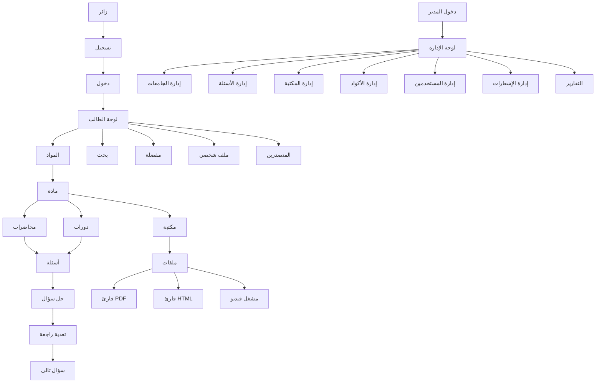

### 15.3 الـ Personas إلى التدفقات

| Persona | التدفقات |
|---------|---------|
| **أحمد** (طالب طموح) | 1, 3, 4, 6 |
| **سارة** (طالبة منظّمة) | 3, 5, 7 |
| **د. خالد** (مدير أكاديمي) | 8, 9, 10, 11, 12 |
| **محمد** (طالب محدود) | 1, 2, 3 |

### 15.4 التدفقات حسب الأهمية

#### P0 (Critical) — يجب أن تعمل في الإطلاق
- Flow 1: تسجيل الدخول والتسجيل
- Flow 2: تفعيل كود الاشتراك
- Flow 3: الدخول لمادة وحل اختبار
- Flow 8: دخول لوحة الإدارة
- Flow 12: إدارة الأسئلة

#### P1 (High) — مهمّة للإطلاق
- Flow 4: الإبلاغ + المفضلة
- Flow 5: مشاهدة ملف في المكتبة
- Flow 9: إنشاء كود اشتراك

#### P2 (Medium) — يمكن تأجيلها
- Flow 6: مشاهدة فيديو يوتيوب
- Flow 7: البحث الشامل
- Flow 10: رفع ملفات المكتبة
- Flow 11: إرسال إشعارات

---

## 16. قواعد تصميم التدفقات

### 16.1 المبادئ

#### FP1: البساطة
- أقل عدد خطوات ممكن.
- لا خطوات غير ضرورية.
- تجنّب الـ friction.

#### FP2: الوضوح
- المستخدم يعرف ما يحدث دائماً.
- رسائل واضحة لكل إجراء.
- لا مفاجآت.

#### FP3: التسامح مع الأخطاء
- يمكن التراجع عن الإجراءات.
- تأكيد قبل الإجراءات الحرجة.
- حفظ تلقائي للتقدّم.

#### FP4: الاستجابة
- تغذية راجعة فورية لكل تفاعل.
- لا انتظار صامت.
- skeleton + loading states.

#### FP5: الاتساق
- نفس الإجراء → نفس التجربة.
- أزرار في نفس المكان.
- ألوان متناسقة.

#### FP6: الوصولية
- كل تدفق قابل للوصول بالكيبورد.
- دعم قارئ الشاشة.
- تباين كافٍ.

### 16.2 قواعد إضافية

#### FR1: الحد الأقصى للخطوات
- أي تدفق يجب أن يكتمل في ≤ 7 خطوات (قاعدة Miller's 7±2).

#### FR2: نقاط القرار
- الحد الأقصى 3 نقاط قرار متتالية.
- بعد 3 قرارات، أرِح المستخدم بخطوة بسيطة.

#### FR3: حالات الخطأ
- كل قرار له مسار خطأ.
- رسالة خطأ + حل مقترح + زر إعادة.

#### FR4: حالات النجاح
- كل تدفق له نهاية واضحة.
- احتفال بالنهاية (toast + visual).

#### FR5: الحالات الحدّية
- فكّر في 3+ edge cases لكل تدفق.
- اختبرها قبل الإطلاق.

#### FR6: التحليلات
- لكل تدفق: نقاط قياس.
- تتبع التحويل + نقاط التسرّب.

### 16.3 قالب توثيق التدفق (للتدفقات المستقبلية)

```markdown
## Flow X: [اسم التدفق]

### X.1 User Story
> بصفتي [دور]، أريد [فعل]، حتى [فائدة].

### X.2 Persona
[اسم + وصف موجز]

### X.3 Entry Points
- [نقطة 1]
- [نقطة 2]

### X.4 Mermaid Flowchart
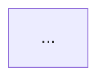

### X.5 الخطوات بالتفصيل
#### Step 1: [اسم]
- ...

### X.6 نقاط القرار
| القرار | الشرط |
|--------|------|

### X.7 حالات الخطأ
| الخطأ | الرسالة |
|------|--------|

### X.8 حالات النجاح
- ✅ ...

### X.9 Edge Cases
#### EC-1: [حالة]
- **السلوك**: ...

### X.10 اعتبارات الوصولية
- ✅ ...

### X.11 Analytics
- ...
```

---

## 17. الخطوة التالية

الانتقال إلى **Phase 8: Information Architecture** لتصميم الهيكل الكامل للتطبيق:
- خريطة الموقع الكاملة (Sitemap).
- هيكل التنقّل.
- تصنيف المحتوى.
- URL Structure.
- علاقات الكيانات.

**المخرجات المتوقعة من Phase 8**:
- `docs/INFORMATION_ARCHITECTURE.md`
- Sitemap diagram
- URL structure
- Entity relationships

---

**نهاية ملف USER_FLOWS.md**
