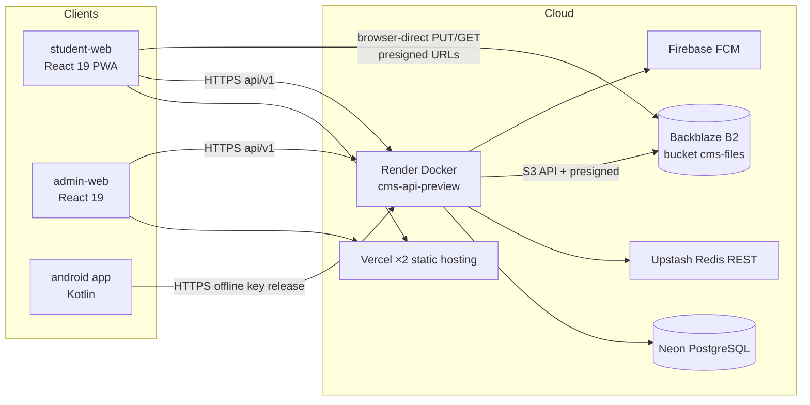
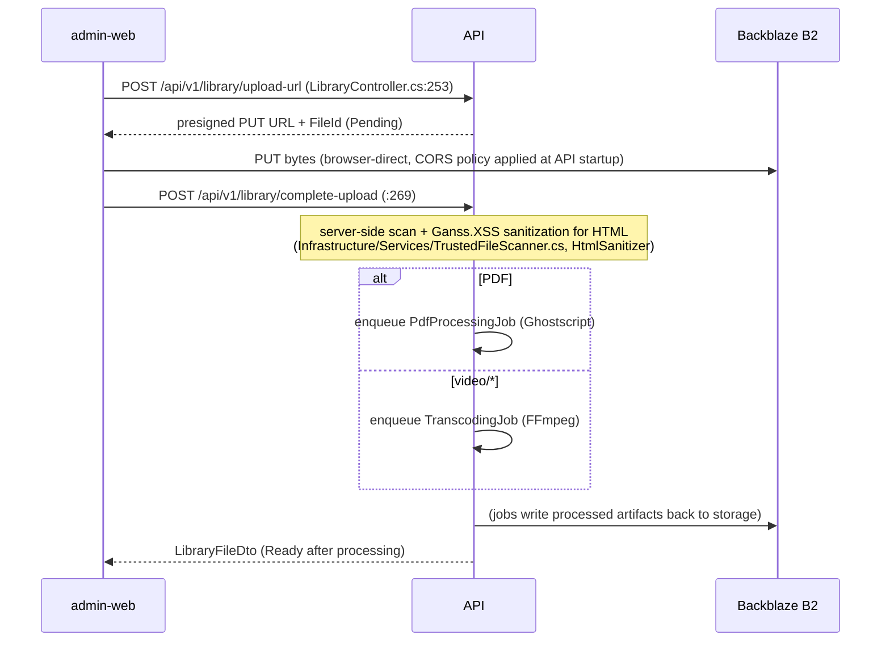
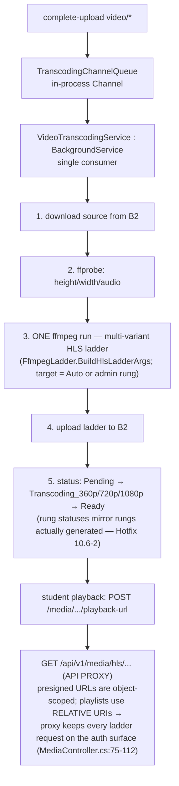

# 01 — البنية المعمارية

> تحليل قائم على الأدلة لبنية منصة CMS المعمارية.
> المستودع: `laith20218/cms-platform-manus` على `main` ‏(`af4a56a`، بتاريخ 2026-11-01).
> المنهج: تحليل ساكن (قراءة فقط). كل دعوى تستند إلى استشهاد بصيغة `file:line`. والدعاوى التي تعذّر التحقق منها معلَّمة بـ **UNVERIFIED**.

---

## 1. نظرة عامة على النظام

‏CMS مستودع موحَّد (monorepo) يضم أربع وحدات قابلة للنشر إضافة إلى حزم مشتركة:

| الوحدة | بيئة التشغيل | الدور |
|---|---|---|
| `apps/api` | ‏.NET 9 (ASP.NET Core) | واجهة REST برمجية، ومعالجة الوسائط، والمهام الخلفية |
| `apps/student-web` | ‏React 19 + Vite 6 (تطبيق ويب تقدمي PWA) | تجربة الطالب |
| `apps/admin-web` | ‏React 19 + Vite 6 | لوحة المشغلين والإدارة |
| `apps/android` | ‏Kotlin (لنظام Android) | بيئة تشغيل الامتحانات دون اتصال (غلاف محصَّن أمنياً) |
| `packages/{ui,utils,types}` | ‏TypeScript | حزم عمل مشتركة (صغيرة: 515 سطراً في المجمل) |

التنسيق: مساحات عمل pnpm 9 ‏(`pnpm-workspace.yaml`) مع Turborepo ‏(`package.json:7-10`، و`turbo.json`).



## 2. طبقات الطرف الخلفي (البنية النظيفة Clean Architecture)

خمسة مشاريع في `apps/api/CMS.sln`؛ واتجاه التبعيات متحقَّق منه من مدخلات `ProjectReference`:

```
CMS.Api ──▶ CMS.Infrastructure ──▶ CMS.Application ──▶ CMS.Domain
```

| الطبقة | الملفات | الأسطر | المحتويات (معدودة) |
|---|---|---|---|
| `CMS.Domain` | 21 | 2,538 | ‏41 صنف كيان في 12 ملفاً (`Entities/*.cs`)، والتعدادات (`Enums/`)، و`Constants/MediaPolicy.cs`، و`Exceptions/DomainException.cs`. لا مراجع للبنية التحتية إطلاقاً. |
| `CMS.Application` | 58 | 13,512 | ‏MediatR على نمط CQRS:‏ 15 مجلد `Commands/`، و16 مجلد `Handlers/`، و14 مجلد `DTOs/`، و5 مجلدات `Interfaces/`، و3 مجلدات `BackgroundJobs/`، و`Behaviors/`، و`Validators/`. حقن التبعيات: `DependencyInjection.cs`. |
| `CMS.Infrastructure` | 80 | 83,177 | ‏`Persistence/` ‏(ApplicationDbContext مع 53 ملف ترحيل ≈ 78.4 ألف سطر من الشيفرة المولَّدة للمصمم)، و18 مجلد `Services/`، و`Security/`، و`Repositories/`، وربط حقن التبعيات. |
| `CMS.Api` | 43 | 7,954 | ‏30 متحكماً في `Controllers/`، و5 وسائط في `Middleware/`، و`Authorization/`، و`Security/` (محدِّد محاولات دخول المشرفين)، و`Health/`، و`Program.cs` ‏(314 سطراً). |
| `CMS.Tests` | 65 | 14,509 | ‏59 ملف اختبار، و488 خاصية `[Fact]`/`[Theory]` (معدودة). |

الحزم الرئيسية (`apps/api/src/CMS.Api/CMS.Api.csproj:13-23`، و`CMS.Infrastructure.csproj:11-34`):‏ EF Core 9 مع Npgsql 9.0.2، وMediatR 12.4.1، وFluentValidation 11.10، وAutoMapper 15.1.1، وHangfire 1.8.14 ‏(مخزن PostgreSql)، وSerilog 4.0.2، وBCrypt.Net-Next 4.0.3، وKonscious Argon2 1.3.1، وHtmlSanitizer 9.2.1039 ‏(Ganss.XSS)، وAWSSDK.S3 3.7.421.10، وFirebaseAdmin 3.0.0، وSystem.IdentityModel.Tokens.Jwt 8.22.0.

إشارات هندسية جديرة بالملاحظة: تفعيل `TreatWarningsAsErrors` في المشاريع الإنتاجية الأربعة كلها (السطر 7 من كل `.csproj`)؛ و`InternalsVisibleTo CMS.Tests` في طبقتي Application و Infrastructure لإجراء اختبارات الصندوق الأبيض (`CMS.Application.csproj:36`، و`CMS.Infrastructure.csproj:45`)؛ وأثر واسع لتعليقات الإصلاحات العاجلة HOTFIX/Push الموزعة داخل الشيفرة (مثال ذلك حل مشكلة بصمة AWSSDK التحققية مع B2 في `CMS.Infrastructure.csproj:19-24`).

## 3. جذر التركيب في الطرف الخلفي

يبني `Program.cs` ‏(314 سطراً) خط الأنابيب بهذا الترتيب (الأسطر 226-278):

```
UseForwardedHeaders (X-Forwarded-For/Proto, ForwardLimit=1)   :240
[Dev only] Swagger                                            :242-250
CorrelationIdMiddleware                                      :252
Serilog request logging                                       :253
HTTPS redirection                                             :254
CORS ("CMS": two configured origins, credentials)             :255
RateLimiter (12 named policies)                               :256
Authentication (JWT Bearer, HMAC-SHA256, ClockSkew=0)         :257
SessionValidationMiddleware (sid/installation_id/tv vs DB)    :258
Authorization                                                 :259
ExceptionHandlingMiddleware (typed domain exceptions)         :260
SecurityHeadersMiddleware (CSP, HSTS, X-Frame-Options…)       :261
AuditLoggingMiddleware (final status observation)             :266
MapControllers + /health{,/ready,/live}                       :268-278
```

سياسات تحديد المعدل (Program.cs:131-142):‏ `login` ‏خمس محاولات كل 5 دقائق، و`otp` ثلاث كل 5 دقائق، و`password-reset` ثلاث كل 15 دقيقة، و`auth` ثماني كل 5 دقائق، و`questions` ‏60 في الدقيقة، و`search` ‏30 في الدقيقة، و`health` ‏600 في الدقيقة، و`static` ‏600 في الدقيقة، و`admin` ‏15 في الدقيقة، و`offline-package` خمس كل 15 دقيقة، و`favorites` ‏30 في الدقيقة، و`security-events` ست في الدقيقة. مفتاح التقسيم = `ip|account|installation` ‏(Program.cs:303-313). ويحمي دخول المشرفين محدِّدٌ مستقل ثنائي التقسيم يعمل داخل العملية (Program.cs:145-151؛ و`CMS.Api/Security/AdminLoginRateLimiter.cs`).

أثر جانبي عند الإقلاع: تدفع الواجهة البرمجية سياسة CORS لحاوية B2 عبر `PutBucketCors` في كل إقلاع (إصلاح عاجل HOTFIX 10.10، وProgram.cs:193-224) — عملية غير قابلة للكسر إن أُعيد تشغيلها، وبأفضل جهد ممكن، وتُتخطى في بيئة `Testing`.

## 4. بنية الطرف الأمامي

### 4.1 ‏student-web — مقطَّعة حسب الميزات

- نقطة الدخول: `src/main.tsx` ثم `src/app/App.tsx` ثم `src/app/router.tsx` ‏(93 سطراً) مع **تحميل كسول `lazy()` لكل صفحة** (router.tsx:9-35).
- الأغلفة والتخطيطات: `src/components/layouts/AppShell.tsx`، و`Navbar.tsx`، و`Sidebar.tsx`، و`BottomNav.tsx`؛ وحواجز الحماية `common/ProtectedRoute.tsx`؛ ومرونة التعامل مع الأخطاء `common/ErrorBoundary.tsx` (يغلف أيضاً إخفاقات المقاطع المحمَّلة كسولاً — router.tsx:97-103).
- المزوِّدات: `app/providers/AuthProvider.tsx` (زوج الرموز في sessionStorage مع التحديث)، و`ThemeProvider.tsx` (الوضع الداكن/الفاتح).
- **20 مجلد ميزات** تحت `src/features/` (معدودة). المهيمن: `media-player/` — 47 ملفاً، و15,256 سطراً = 53% من شيفرة src في التطبيق. بنيته:
  - `pdf/` — مكوّن PdfPlayer مع 13 وحدة مساندة (محرك البحث `pdf-search.ts`، وحلُّ مربعات الإصابة في DOM ‏`pdf-search-dom.ts`، والهندسة، وطبقة الملاحظات، وقوائم الدراسة، والمصغرات، ولوحة الأدوات)
  - `video/` — ‏`VideoPlayer.tsx`، وبث HLS عبر hls.js، والإشارات المرجعية، و`useMediaLease.ts` (محرك عقد الارتباطات الموقعة مسبقاً، نحو 700 سطر فأكثر مع دورة حياة موثقة IDLE→FETCHING→SWAPPING→RESTORING، وuseMediaLease.ts:15-43)
  - `audio/` — ‏`AudioPlayer.tsx` (مكتبة wavesurfer.js)
  - `protection/` — ‏`PlayerProtection.tsx` مع `usePlayerProtection.ts` (رادعات النسخ)
  - `hooks/__tests__/` — 4 ملفات اختبار منها الاختبار القائم على الخصائص `useMediaLease.p3-queue-property.test.ts`
- إدارة الحالة: ‏TanStack Query 5 لحالة الخادم (package.json:21)، وسياق React للمصادقة والسمة، ولا مخزن عميل شامل (لا يُستخدم zustand إلا في admin-web).

### 4.2 ‏admin-web — تطبيق صفحة واحدة بغلاف مفرد

- لا مكتبة مسارات: ملف `src/App.tsx` واحد من 1,045 سطراً ينسّق 26 مكوّن «مركز» (`src/components/*Center.tsx` — منها Academic و Admins و Activity و Audit و Codes و Courses و Exams و Library و Questions و Reports و Roles و Settings و Students) إضافة إلى النوافذ المنبثقة (EpisodeEdit و PermissionMatrixEditor و ReportsModeration و NotificationCompose و ProcessingTimeline وغيرها).
- المصادقة: عميل `lib/api.ts` خاص بها مع `login`/`refreshAccessToken` ‏(App.tsx:38)، والرمز في حالة المكوّن (App.tsx:95-98).
- الحالة: ‏`zustand` ‏(package.json:31) مع `react-hook-form` و`recharts` للتحليلات.
- الصلاحيات: `hooks/useUiPermissions.ts` مع `lib/uiPermissions.ts` ودالة `createCanFunction` ‏(App.tsx:39-40) ببوابات على مستوى علامات التبويب `can('tab:overview.metrics')` ‏(App.tsx:936-941). دلالات الفشل: خدمة صلاحيات الواجهة غير متاحة ← الخطأ 503، ولا يُعتمد أبداً «الفراغ بمعنى المنع» (ExceptionHandlingMiddleware.cs:44-49).

### 4.3 ‏android — بيئة تشغيل أمنية دون اتصال

12 ملف Kotlin تحت `app/src/main/java/com/cms/student/security/` (معدودة): منها `PlayIntegrityHelper`، و`EncryptedOfflinePackageStore`، و`OfflinePackageVerifier`، و`OfflineRuntimeCoordinator`، و`TrustedOfflineRuntime`، و`OfflinePackageModels`، والمزوِّدات والعملاء. إضافة إلى `OfflineExamActivity`. هذا عميل امتحانات دون اتصال مبني لغرض خاص، وليس تطبيق الطالب الرئيسي.

## 5. مخططات تدفق البيانات (Mermaid)

### 5.1 المصادقة ودورة حياة الجلسة

```mermaid
sequenceDiagram
    participant S as student-web
    participant A as API (Render)
    participant DB as Neon (user_sessions, students)
    S->>A: POST /api/v1/auth/login {phone, password, deviceFingerprint}
    Note over A: rate-limit "login" 5/5min (Program.cs:131)
    A->>DB: verify BCrypt hash, device binding (device_bindings)
    A->>DB: INSERT user_session (sid, family, token version tv)
    A-->>S: accessToken (15m; claims sub, role, sid, installation_id, tv) + refreshToken (7d)
    S->>S: sessionStorage.setItem (AuthProvider.tsx:27-28)
    Note over S: every request: Authorization: Bearer + X-Installation-Id
    S->>A: GET /api/v1/... (any protected)
    Note over A: JWT validation (ClockSkew=0) → SessionValidationMiddleware.cs:20-40<br/>IsActiveAsync(sid, tv, installation_id) → 401 if revoked
    A->>DB: throttled heartbeat TouchActivityAsync (60s) :46-53
    S->>A: POST /api/v1/auth/refresh (AuthController.cs:117-129)
    A->>DB: rotate refresh (unique hash idx, family idx — ApplicationDbContext.cs:89-91)
    A-->>S: new pair (reuse of old token invalidates family — UNVERIFIED exact reuse policy line)
```

الأدلة: `AuthController.cs:98-112` (تسجيل الدخول)، و`:117-129` (التحديث يطلب X-Device-Fingerprint)، و`:134-144` (تسجيل الخروج بحسب sid)؛ و`SessionValidationMiddleware.cs:12-57`؛ وإعداد JWT في `Program.cs:58-84`؛ وrender.yaml:50-59 (مدتا الانتهاء 15 دقيقة / 7 أيام).

### 5.2 رفع ملفات المكتبة (من المتصفح مباشرة إلى B2)



الأدلة: نقطتا الرفع والإكمال `LibraryController.cs:253-286`؛ وملاحظة CORS للارتباطات الموقعة مسبقاً عند `:113-115`؛ وتعليل حد حجم الطلب (الرفع يتجاوز الواجهة البرمجية — سقف 16 ميغابايت) في `Program.cs:36-49`.

### 5.3 معالجة الفيديو (سلم HLS عبر FFmpeg)



الأدلة: `VideoTranscodingService.cs:18-33` (تعليق تصميم خط الأنابيب)، و`:102` (BackgroundService)، و`:131` (دقة ffmpeg)، و`:144` (مسح الاسترداد عند الإقلاع للحالات العالقة)، و`:258-283` (الفحص ثم السلم ثم حالات الدرجات)؛ ودلالات الإلغاء `:64-77`؛ وتعليل وسيط HLS في `MediaController.cs:75-96`.

### 5.4 معالجة PDF (إعادة تضمين الخطوط عبر Ghostscript)

```mermaid
flowchart TD
    U[complete-upload application/pdf] --> Q[PdfProcessingChannelQueue]
    Q --> W[PdfProcessingService : BackgroundService<br/>single consumer — Ghostscript is CPU/RAM heavy]
    W --> C{size > ceiling?<br/>(runtime-tunable via system settings)}
    C -- yes --> SK[skip Ghostscript → Ready<br/>R19 fallback]
    C -- no --> D[download from B2]
    D --> G["gs -dNOPAUSE -dBATCH -sDEVICE=pdfwrite<br/>-dEmbedAllFonts=true -dSubsetFonts=true<br/>(GhostscriptArgs.Build :80-85)"]
    G --> F[FONTPATH=/app/ghostscript-fonts<br/>OFL Arabic pack: Amiri + Noto Naskh<br/>baked into Docker image]
    F --> UP[upload {key}-fixed → swap FileUrl]
    UP --> RDY[Ready]
```

الأدلة: `PdfProcessingService.cs:16-39` (التصميم)، و`:80-85` (متجه الوسائط)، و`:206-212` (تعليل المستهلك الوحيد)، و`:219-222` (السقف القابل للضبط وقت التشغيل)، و`:294-342` (الإعدادات وإعادة التضمين)؛ والخطوط في `apps/api/Dockerfile` ‏(`COPY assets/pdf-fonts/ /app/ghostscript-fonts/`)؛ ومعالجة SIGKILL/OOM ورقيب المهلة `:145-173`.

### 5.5 الوصول إلى الدورات (سلسلة الاستحقاق)

```mermaid
sequenceDiagram
    participant S as student-web
    participant A as API
    participant DB as Neon
    S->>A: POST /api/v1/entitlements/issue (EntitlementsController.cs:19-21)
    Note over A: studentId from JWT sub; installationId from X-Installation-Id
    A->>DB: active subscription? (student_subscriptions, SignedEntitlementService.cs:164)
    A-->>S: HMAC-SHA256 entitlement token (short TTL)
    S->>A: POST /api/v1/courses/episodes/{id}/access<br/>headers: X-Entitlement + X-Installation-Id (CoursesController.cs:70,110)
    A->>A: ValidateAsync — signature, expiry, lifetime bound, subscription still active<br/>(SignedEntitlementService.cs:77-133)
    A-->>S: presigned playback URL / lease
    S->>B2: GET bytes (Range) or HLS via API proxy
```

الأدلة: `EntitlementsController.cs` (الملف كاملاً، 45 سطراً)؛ و`SignedEntitlementService.cs:41-74` (الإصدار)، و`:77-133` (التحقق: التوقيع، وتفاوت ساعة ±1 دقيقة، والربط بمدة الحياة)، و`:164` (إعادة فحص حيوية الاشتراك)، و`:195` (خوارزمية HMAC-SHA256)؛ ودالة البوابة المساعدة `MediaController.cs:236-250` (النمط نفسه المعاد استخدامه في الدورات والمكتبة والوسائط).

## 6. المسائل الممتدة عبر البنية

| المسألة | التنفيذ | الدليل |
|---|---|---|
| التسجيل | ‏Serilog على الطرفية مع `Enrich.FromLogContext`، وخاصية التطبيق `CMS.Api`؛ وتسجيل لكل طلب | Program.cs:22-34, 253 |
| الارتباط | ‏`CorrelationIdMiddleware` أول عناصر خط الأنابيب | Program.cs:252؛ و`Middleware/CorrelationIdMiddleware.cs` |
| معالجة الأخطاء | منمَّطة: `ValidationException`← الخطأ 400، و`NotFoundException`← 404، و`ForbiddenException`← 403، و`UiPermissionsUnavailableException`← 503 (فشل مغلق، ولا صلاحيات فارغة أبداً)، و`ConflictException`← 409 | ExceptionHandlingMiddleware.cs:32-51 |
| الاستحقاقات | رموز موقعة HMAC، وترويسات `X-Entitlement` مع `X-Installation-Id`، والتحقق عند كل طلب | §5.5 |
| أمان الجلسات | وسيط إبطال من جهة الخادم + كاسح الخمول (`SessionSweeperService.cs`) | SessionValidationMiddleware.cs:42-53 |
| التدقيق | ‏`AuditLoggingMiddleware` يسجل الحالة النهائية شاملاً أخطاء 401/403/5xx، بلا رموز ولا بيانات شخصية؛ و`AdminActivityWriter.cs`؛ و`SecurityEventBatchService.cs`؛ والاحتفاظ عبر `SecurityAuditRetentionService.cs` | Program.cs:262-266؛ وInfrastructure/Services |
| ترويسات الأمان | ‏CSP، وX-Frame-Options SAMEORIGIN، وnosniff، وReferrer-Policy، وPermissions-Policy، وHSTS (لغير الارتباط المحلي فقط)، وCOOP/CORP | SecurityMiddleware.cs:22-55 |
| الأداء | ‏`PerformanceMiddleware` مع `PerformanceService` | Middleware/PerformanceMiddleware.cs |
| سياسة الوسائط | ملف مركزي `Domain/Constants/MediaPolicy.cs` (مدد الانتهاء والحدود) | مُشار إليه من MediaController.cs:15 |

## 7. ملاحظات معمارية (قائمة على الأدلة)

1. **طوابير داخل العملية، لا Hangfire، لخطوط أنابيب الوسائط.** يستخدم خطا أنابيب FFmpeg و Ghostscript طوابير `Channel` داخل العملية بمستهلك واحد (`VideoTranscodingService.cs:49-58`، و`PdfProcessingService.cs:54-63`) رغم تثبيت Hangfire (`CMS.Infrastructure.csproj:29-30`). النتيجة: المهام لا تنجو من إعادة تشغيل العملية — يخفَّف ذلك بمسح استرداد صريح عند الإقلاع (VideoTranscodingService.cs:131-144)، غير أن إعادة تشغيل على الشريحة المجانية من Render أثناء الترميز تُهدر العمل الجاري. استخدام Hangfire في النظام الجاري: **UNVERIFIED** (الحزمة مُشار إليها؛ ولم يُعثر على استدعاءات `RecurringJob`/`BackgroundJob.Enqueue` في `BackgroundJobs/*.cs`).
2. **وسيط HLS يركِّز حمل النطاق الترددي على الواجهة البرمجية.** ولأن ارتباطات B2 الموقعة مسبقاً محدودة بالكائن الواحد وتشير قوائم التشغيل إلى مسارات نسبية، تتدفق كل مقاطع HLS عبر `GET /api/v1/media/hls/...` ‏(MediaController.cs:75-112). اختيارٌ للصحة على حساب التكلفة — وهو على الشريحة المجانية من Render خطر التوسع الأبرز.
3. **عدم تناظر الطرف الأمامي.** student-web تطبيق PWA ذو مسارات مع تقطيع قوي للميزات؛ بينما admin-web تطبيق صفحة واحدة بغلاف مفرد ومنسِّق من 1,045 سطراً (App.tsx) — قرار مقصود (لوحة مشغلين قائمة على علامات التبويب)، لكنه السطح الأقل اختباراً (50 حالة اختبار Vitest مقابل 292 في student-web، معدودة).
4. **انحراف الوثائق.** يدَّعي README.md:51 استخدام Railway مع Cloudflare R2؛ بينما الركيزة الفعلية Render مع B2 ‏(render.yaml:1-13، وملاحظة "RETIRED" في .env.example). ويدَّعي README.md:101 وجود 28 جدولاً في قاعدة البيانات؛ بينما تحتوي الترحيلات على 41 (معدودة). وREADME/ROADMAP مجمَّدان عند مرحلة التصميم بتاريخ 2026-07-30 ‏(README.md:216).
5. **تعويضات مقصودة عن البنية التحتية ذات الشريحة المجانية** ظاهرة في كل مكان: رقباء مهلة لعشر دقائق لـ FFmpeg/Ghostscript («عالق، لا بطيء» — Dockerfile)، وإصلاح ذاتي لسياسة CORS للحاوية عند الإقلاع، ومسح استرداد الترميز عند الإقلاع.

---

*تقارير ذات صلة: [02-data-model.md](02-data-model.md) · [03-api-reference.md](03-api-reference.md) · [06-security.md](06-security.md)*
