# 02 — نموذج البيانات

> الأدلة: `ApplicationDbContext.cs`، ولقطات ترحيلات EF Core ‏(`apps/api/src/CMS.Infrastructure/Persistence/Migrations/`)، و31 ترحيلاً مسمى.
> جميع الأعداد أدناه معدودة آلياً من أحدث لقطة (`20261030102811_Phase60AddFileAnnotations.Designer.cs`، إضافة إلى `20261109120000_Phase61AddPdfProcessingStatus.cs` المُدرجة بـ commit بتاريخ 2026-10-30 والتي تضيف `pdf_processing_status`).

---

## 1. الملخص

| المقياس | القيمة (معدودة) |
|---|---|
| الجداول | **41** |
| أصناف الكيانات (طبقة النطاق Domain) | 41، في 12 ملفاً (`CMS.Domain/Entities/*.cs`) |
| المفاتيح الأجنبية | **58** علاقة FK فريدة |
| تعريفات الفهارس في اللقطة | 55 تعريف `HasIndex` صريحاً (إضافة إلى المفاتيح الأساسية) |
| فهارس العمود الواحد الفريدة | 3 (`subscription_codes.code`، و`user_sessions.refresh_token_hash`، و`system_settings.key`) |
| الترحيلات المسماة | 31 (من Phase 34 إلى Phase 61) |

## 2. مخطط علاقات الكيانات (كامل)

مولَّد من تصريحات المفاتيح الأجنبية في لقطة النموذج. المرجع `UserSession.UserId` مرجع **متعدد الأشكال** (يشير إلى `students` أو `admins` تبعاً لقيمة `UserType` — ‏SessionEntities.cs:15-17)، ولذلك رُسم بلا سهم مفتاح أجنبي.

```mermaid
erDiagram
    %% ── Academic tree ─────────────────────────────
    UNIVERSITY ||--o{ COLLEGE : "has"
    COLLEGE ||--o{ ACADEMIC_YEAR : "has"
    ACADEMIC_YEAR ||--o{ SEMESTER : "has"
    SEMESTER ||--o{ SUBJECT : "has"
    SUBJECT ||--o{ LECTURE : "has"
    SUBJECT ||--o{ COURSE : "has"
    SUBJECT ||--o{ EXAM : "has"
    SUBJECT ||--o{ LIBRARY_FILE : "has"
    LECTURE ||--o{ LIBRARY_FILE : "optional context"
    LECTURE ||--o{ EXAM : "optional context"
    LECTURE ||--o{ QUESTION : "optional context"

    %% ── Students & identity ───────────────────────
    UNIVERSITY ||--o{ STUDENT : "enrolls"
    COLLEGE ||--o{ STUDENT : "enrolls"
    ACADEMIC_YEAR ||--o{ STUDENT : "enrolls"
    STUDENT ||--o{ DEVICE_BINDING : "binds devices"
    STUDENT ||--o{ USER_SESSION : "polymorphic UserId"
    ADMIN ||--o{ USER_SESSION : "polymorphic UserId"
    ADMIN_ROLE ||--o{ ADMIN : "role"
    ADMIN_ROLE ||--o{ ADMIN_PERMISSION : "permissions"

    %% ── Question bank ─────────────────────────────
    QUESTION ||--o{ QUESTION_OPTION : "options"
    QUESTION ||--o{ QUESTION_IMAGE : "images"
    QUESTION ||--o{ ERROR_REPORT : "reported"
    EXAM ||--o{ EXAM_QUESTION : "contains"
    QUESTION ||--o{ EXAM_QUESTION : "in"

    %% ── Exam engine ───────────────────────────────
    EXAM ||--o{ EXAM_SESSION : "attempted"
    STUDENT ||--o{ EXAM_SESSION : "attempts"
    EXAM_SESSION ||--o{ EXAM_SESSION_QUESTION : "answers"
    EXAM_SESSION_QUESTION ||--o{ ATTEMPT_LOG : "answer history"

    %% ── Library & media ───────────────────────────
    LIBRARY_FILE ||--o{ LIBRARY_VIEW : "views"
    LIBRARY_FILE ||--o{ FILE_ANNOTATION : "annotated"
    STUDENT ||--o{ LIBRARY_VIEW : "views"
    STUDENT ||--o{ FILE_ANNOTATION : "annotates"
    LECTURE ||--o{ LECTURE_COMPLETION : "completed"
    STUDENT ||--o{ LECTURE_COMPLETION : "completes"
    STUDENT ||--o{ FAVORITE : "favorites"
    QUESTION ||--o{ FAVORITE : "favorited"
    LIBRARY_FILE ||--o{ FAVORITE : "favorited"
    COURSE_EPISODE ||--o{ FAVORITE : "favorited"
    STUDENT ||--o{ MEDIA_BOOKMARK : "bookmarks"
    STUDENT ||--o{ PLAYBACK_PROGRESS : "resumes"

    %% ── Courses ───────────────────────────────────
    COURSE ||--o{ COURSE_EPISODE : "episodes"

    %% ── Subscriptions ─────────────────────────────
    CODE_BATCH ||--o{ SUBSCRIPTION_CODE : "generates"
    SUBSCRIPTION_CODE ||--o| STUDENT_SUBSCRIPTION : "redeemed by"
    STUDENT ||--o{ STUDENT_SUBSCRIPTION : "holds"

    %% ── Ops: notifications, audit, security, offline ──
    ADMIN ||--o{ NOTIFICATION : "sends"
    NOTIFICATION ||--o{ NOTIFICATION_DELIVERY : "delivered"
    STUDENT ||--o{ NOTIFICATION_DELIVERY : "receives"
    ADMIN ||--o{ ADMIN_ACTIVITY_LOG : "acts"
    STUDENT ||--o{ SECURITY_LOG : "events"
    ADMIN ||--o{ SECURITY_LOG : "events"
    ADMIN ||--o{ ERROR_REPORT : "assigned/resolved/reviewed"
    STUDENT ||--o{ OFFLINE_PACKAGE_RECORD : "packages"
    OFFLINE_PACKAGE_RECORD ||--o{ OFFLINE_KEY_RELEASE_LOG : "key releases"
    ADMIN ||--o{ SYSTEM_SETTING : "updated_by"
```

قائمة الجداول (41، معدودة من الترحيلات): `academic_years, admins, admin_activity_logs, admin_permissions, admin_roles, attempt_logs, code_batches, colleges, course_episodes, courses, device_bindings, error_reports, exam_questions, exam_session_questions, exam_sessions, exams, favorites, file_annotations, lecture_completions, lectures, library_files, library_views, media_bookmarks, notification_deliveries, notifications, offline_key_release_logs, offline_package_records, playback_progress, question_images, question_options, questions, security_logs, semesters, student_subscriptions, students, subjects, subscription_codes, system_settings, universities, user_installations, user_sessions`.

## 3. المفاتيح الأجنبية مع سلوك الحذف (58، من اللقطة)

سلوكيات الحذف مقصودة وموثَّقة هنا من تصريحات القيود:

| التابع ← الأصل | عند الحذف | التعليل (من تعليقات الشيفرة والسلوك) |
|---|---|---|
| `college.university_id → universities` | Cascade | سلامة الشجرة |
| `academic_year.college_id → colleges` | Cascade | سلامة الشجرة |
| `semester.academic_year_id → academic_years` | Cascade | سلامة الشجرة |
| `subject.semester_id → semesters` | Cascade | سلامة الشجرة |
| `lecture.subject_id → subjects` | Cascade | المحتوى يتبع المادة |
| `student.{university_id, college_id, academic_year_id}` | **NoAction** | يجب ألا يختفي الطلاب عند تعديل الشجرة الأكاديمية (قيود `fk_students_*`) |
| `course.subject_id → subjects` | **Restrict** | يحمي الدورات ذات الحلقات والمفضلات |
| `course_episode.course_id → courses` | Cascade | دورة حياة الحلقة |
| `library_file.subject_id → subjects` | Cascade | تنظيف المكتبة |
| `library_file.lecture_id → lectures` | NoAction | ربط سياقي اختياري |
| `question.subject_id → subjects` | Cascade | تنظيف البنك |
| `question.{lecture_id, exam_id}` | NoAction | روابط اختيارية (exam_id إرث قديم) |
| `question_option/question_image.question_id → questions` | Cascade | عناصر مملوكة |
| `exam.subject_id → subjects` | Cascade | |
| `exam.lecture_id → lectures` | NoAction | اختياري |
| `exam_question.exam_id → exams` | Cascade | تركيب |
| `exam_question.question_id → questions` | **Restrict** | لا يجوز حذف أصل مشترك من البنك وهو مستخدم في امتحان |
| `exam_session.{exam_id, student_id}` | Cascade | تاريخ المحاولات |
| `exam_session_question.exam_session_id → exam_sessions` | Cascade | تركيب |
| `attempt_log.{exam_session_id, student_id, question_id}` | NoAction / Cascade / Cascade | مختلط: ربط الجلسة NoAction ‏(`fk_attempt_logs_exam_sessions_exam_session_id`)، والسؤال Cascade |
| `attempt_log.exam_session_question_id → exam_session_questions` | **Restrict** | حماية تاريخ الإجابات |
| `favorite.question_id → questions` | **NoAction** | محمي من جهة التطبيق؛ حارس RESTRICT ‏23503 للمفتاح الأجنبي للمفضلات في `CourseHandlers` يستخدم `Npgsql.PostgresException` (تعليق CMS.Application.csproj:20-24) |
| `favorite.library_file_id → library_files` | NoAction | |
| `favorite.course_episode_id → course_episodes` | **Restrict** | |
| `favorite.student_id → students` | Cascade | |
| `file_annotation.{file_id, student_id}` | Cascade | مزامنة التعليقات لكل طالب |
| `lecture_completion.{lecture_id, student_id}` | Cascade | |
| `library_view.{file_id, student_id}` | Cascade | التحليلات |
| `media_bookmark / playback_progress.student_id → students` | Cascade | |
| `admin.role_id → admin_roles` | Cascade | |
| `admin_permission.role_id → admin_roles` | Cascade | |
| `admin_activity_log.admin_id → admins` | **Restrict** | يجب أن يبقى أثر التدقيق بعد حذف المشرف |
| `notification.sent_by → admins` | Restrict | حفظ نسبة المُرسِل |
| `notification_delivery.{notification_id, student_id}` | Cascade | تنظيف التوزيع |
| `security_log.{student_id, admin_id}` | **NoAction** | أدلة الأمان غير قابلة للتعديل (`fk_security_logs_*`) |
| `error_report.{assigned_to, reviewed_by} → admins` | SetNull / SetNull | يُحفظ التقرير عند إزالة المشرف |
| `error_report.{student_id, question_id}` | Cascade | |
| `error_report.resolver_id → admins` | NoAction | |
| `system_setting.updated_by → admins` | SetNull | |
| `offline_*.{student_id, package_id}` | Cascade | دورة حياة العمل دون اتصال |
| `device_binding.student_id → students` | Cascade | |

النمط متسق: **Cascade للمحتوى المملوك، وRestrict/NoAction لأدلة التدقيق والأمان وللأصول المشتركة في البنك، وSetNull لنسبة المشرف الاختيارية.**

## 4. الفهارس والقيود (الغرض)

من `ApplicationDbContext.OnModelCreating` (الأسطر 81-116 وما بعدها) ومن اللقطة (55 تعريف `HasIndex`):

| الكيان | الفهرس | الغرض |
|---|---|---|
| `UserSession` | فهرس UNIQUE على `refresh_token_hash` | البحث عن رمز التحديث + التدوير (ApplicationDbContext.cs:89) |
| `UserSession` | `(family_id, status)` | كشف إعادة استخدام عائلة رموز التحديث / الإبطال (:90) |
| `UserSession` | `(user_id, installation_id, status)` | عرض جلسات الأجهزة لميزة «إبطال جهاز» في الإدارة (:91) |
| `UserSession` | `(status, last_activity_at)` | مسح كاسح الجلسات الخاملة (:94) |
| `UserInstallation` | فهرس UNIQUE على `(user_id, installation_id)` | صف واحد لكل جهاز لكل مستخدم (:100) |
| `SubscriptionCode` | فهرس UNIQUE على `code` | البحث عند الاستبدال (:104) |
| `SubscriptionCode` | `batch_id`، و`(status, scope_subject_id)` | استعلامات السجل (:105-106) |
| `StudentSubscription` | فهرس UNIQUE على `(student_id, subscription_code_id)` | استبدال واحد لكل رمز (:110) |
| `StudentSubscription` | `(student_id, status, expires_at)` | فحص الاستحقاق — المسار الساخن لـ `SignedEntitlementService.ValidateAsync` (:111) |
| `LectureCompletion` | فهرس UNIQUE على `(student_id, lecture_id)` | إكمال غير قابل للتكرار (:115) |
| `LectureCompletion` | `(student_id, completed_at)` | إحصاءات زمنية (:116) |
| `ErrorReport` | 5 فهارس | مرشحات طابور الإشراف (الحالة/المسند/السؤال/الطالب) |
| `SecurityLog` | 3 فهارس | استعلامات الأحداث بحسب الفاعل والزمن |
| `Question`، و`LibraryFile`، و`Student`، و`SystemSetting`، و`Favorite`، و`AttemptLog` | 3 لكل منها | مسارات استعلامات النطاق |
| `SystemSetting` | فهرس UNIQUE على `key` | جلب إعدادات المفتاح/القيمة |
| `CourseEpisode`، و`Exam`، و`LibraryView`، و`NotificationDelivery`، و`SubscriptionCode`، و`AdminActivityLog` | 1-2 لكل منها | دعم العرض والوصل |

**البحث النصي:** يؤدي `StudentSearchController` (المسار `api/v1/search`) بحثاً محدود النطاق؛ وما إن كان يستخدم فهارس PostgreSQL للبحث النصي الكامل/GIN أم `Contains` عبر LINQ فهو **UNVERIFIED** (لم يُفحص على مستوى المعالج).

## 5. سجل الترحيلات (31 ترحيلاً مسمى)

خط زمني مع المحاور (الأسماء كما أُدرجت؛ والطوابع الزمنية في أسماء الملفات):

| الفترة | الترحيلات | المحور |
|---|---|---|
| 2026-08-18/19 | ‏Phase 34 SecuritySessionsAndEntitlements؛ وPhase 35 AuthenticationDeviceHardening؛ وPhase 36 ×3 ‏(OfflinePackageLifecycle، وOfflineKeyReleaseToken، وOfflineKeyReleaseLog) | أسس الأمان والعمل دون اتصال (يبدأ تاريخ المستودع في منتصف المشروع — أول commit هو d08b64a بتاريخ 2026-08-20 «import CMS production release phase 48») |
| 2026-08-20/22 | ‏Phase 44 AuditCorrelationAndRetention؛ و45 OfflineDevicePublicKey؛ و47 WebBackendIntegrity؛ و49 AdminRoleActivation؛ و50 LectureMetadata؛ و51 AccessCodeScopes؛ و52 LectureCompletion | التدقيق، ومفاتيح الأجهزة دون اتصال، وأدوار المشرفين، وبيانات المحاضرات، ونطاقات الرموز |
| 2026-08-28 | ‏Phase 53 ×2 ‏(ExamManagementLifecycle، وExamAnalyticsTracking) | محرك الامتحانات |
| 2026-10-22 | ‏Phase 54 SystemSettings؛ و55 ReportsModeration؛ و56 NotificationExpiresAt؛ و57 FixNotificationSenderFk | ميزات لوحة ما بعد «الموجات» (الإعدادات والإشراف) + إصلاح مفتاح أجنبي |
| 2026-10-24 | ‏AddLibraryFileCategory؛ وPush2AdminActivityMonitor؛ وPush3UiPermissions؛ وPush4Courses | تصنيفات المكتبة، ونشاط المشرفين، وصلاحيات الواجهة، والدورات |
| 2026-10-25/26 | ‏AddMediaBookmarksAndPlaybackProgress؛ وAddMediaMetadata؛ وAddTargetQuality | تخزين مشغل الوسائط |
| 2026-10-27/28 | ‏AddEpisodeFavorites؛ وPhase58RestoreCountsAgainstLimit؛ وPhase59AddErrorReportForeignKeys | المفضلات؛ واستعادة العدادات؛ ومفاتيح تقارير الأخطاء |
| 2026-10-30 | ‏Phase60AddFileAnnotations؛ وPhase61AddPdfProcessingStatus (طابع اسم الملف 2026-11-09، أُدرج بـ commit ‏9811f5e بتاريخ 2026-10-30) | تعليقات الملفات؛ وحالة معالجة PDF |

ملاحظات:

- **انتظام التسمية يتراجع ثم يسترد**: تهيمن أسماء `PhaseNN_*` مبكراً؛ ثم `Add*`/`Push*` في منتصف الفترة؛ ثم تعود `PhaseNN` في النهاية. وكلها إضافية (لا توجد ترحيلات `Down` — ممارسة EF Core القياسية هنا؛ واستراتيجية التراجع هي `dotnet ef database update <target>`، انظر [08-deployment.md](08-deployment.md)).
- **فجوات ترقيم المراحل** (من 36 إلى 44، ومن 52 إلى 53، ومن 57 إلى 58) تعكس مراحل لم تحتاج تغييرات على المخطط، إضافة إلى بدء استيراد المستودع بمحتوى «المرحلة 48».
- ترحيلان منهما إصلاحان صرفان (`Phase57FixNotificationSenderFk` و`Phase59AddErrorReportForeignKeys`) — دليل على تحصين المخطط بعد اختبارات التكامل.
- يوجد `ApplicationDbContextFactory.cs` لعمليات التصميم الزمنية لأمر `dotnet ef`.

## 6. ملاحظات حجم البيانات وسلامتها

- ‏`user_sessions` و`security_logs` هما الجدولان كثيفا الكتابة (كل طلب يمس الجلسات عبر نبض القلب — SessionValidationMiddleware.cs:46-53؛ وتُجمَّع أحداث الأمان عبر `SecurityEventBatchService.cs`). ويوجد تقليم للاحتفاظ (`SecurityAuditRetentionService.cs`، وترحيل Phase 44 المسماة "AuditCorrelationAndRetention").
- ينمو `attempt_logs` مع استخدام الامتحانات؛ و`library_views` مع التشغيل — وكلاهما يُنظَّف تتابعياً مع أصله.
- أكبر عدد صفوف متوقع لكل كيان: `notification_deliveries` (توزيع لكل إشعار لكل طالب) و`attempt_logs`.

---

*ذو صلة: [01-architecture.md](01-architecture.md) · [03-api-reference.md](03-api-reference.md)*
