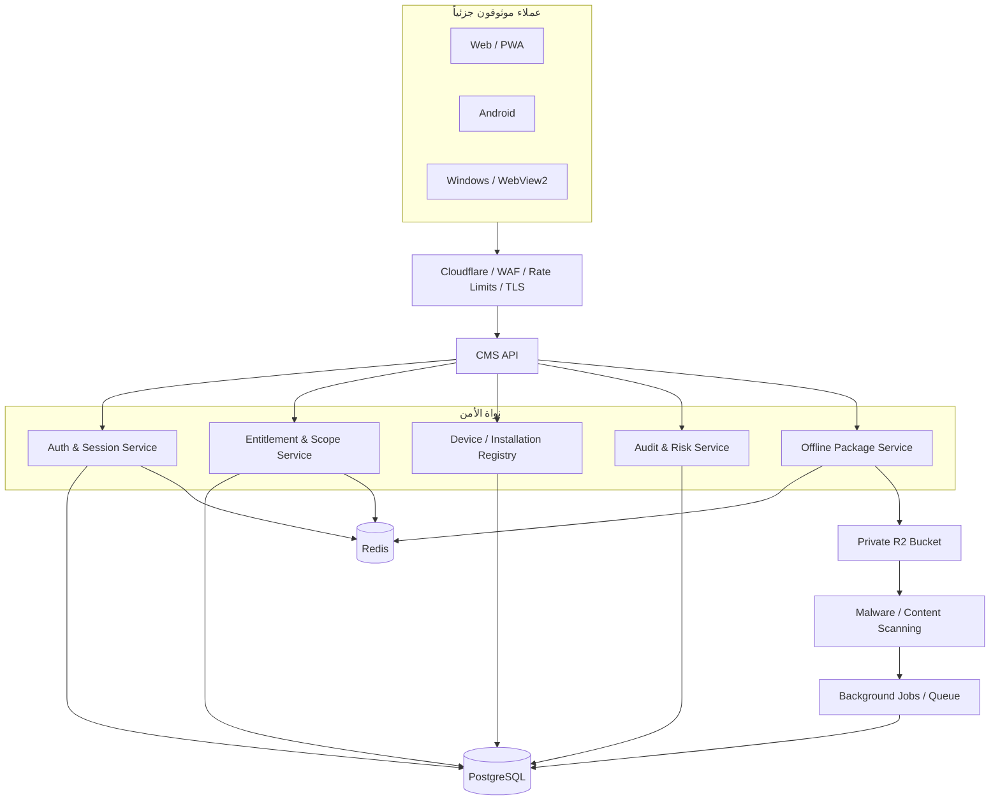

# CMS — Security Architecture Proposal for Phase 34+

**الحالة:** مقترح تصميم فقط. لا يمثل تنفيذاً ولا يغيّر أي ملف برمجي.  
**الهدف:** تحويل CMS إلى بنية واحدة يمكن أن تخدم Web وAndroid وWindows مع قرار وصول موحد، وتنزيلات Offline محكومة، ومراقبة قابلة للتوسع.

## مبادئ التصميم

1. **الخادم هو مصدر الحقيقة** للهوية والدور والاستحقاق وحالة الجلسة. لا تمنح الواجهة أو التطبيق قرار وصول نهائياً.
2. **المورد المحمي لا يصدر** — سؤال أو ملف أو حزمة — قبل قرار entitlement يتضمن المستخدم والجامعة والكلية والسنة والمادة والاشتراك والزمن.
3. **العميل غير موثوق.** بصمة الجهاز وtelemetry وclient claims إشارات تقييم فقط، وليست أدلة كافية وحدها.
4. **Offline هو وصول مقيد بزمن وليس حماية مطلقة للمحتوى.** هدفه تقليل الاستخراج ورفع تكلفة النسخ وربط التسريب، لا الوعد باستحالة نسخه.
5. **التصميم من أجل 3,000 مستخدم متزامن.** لا تضع فحصاً كثيفاً لكل نقرة؛ استخدم cache مضبوطاً وقرارات قصيرة العمر وbatch telemetry.

## البنية المستهدفة



## 1. Authentication and Sessions

| الموضوع | التصميم المقترح |
|---|---|
| Access token | JWT قصير العمر (5–15 دقيقة)، JTI وsession ID وrole claims minimal. |
| Refresh token | قيمة opaque عشوائية، يخزن server-side كـhash فقط مع session/device/expiry/rotation counter. |
| Refresh rotation | كل refresh يبدل token؛ إعادة استخدام token قديم تلغي session family وتسجل حدث خطر. |
| Logout | إبطال session/server token version؛ لا تعتمد على blacklist لا يقرأها JWT pipeline. |
| Password | BCrypt أو Argon2id بسياسة واضحة، rate limit، مراقبة فشل، reset OTP قوي. |
| OTP | 6–8 أرقام من CSPRNG، hash في store، TTL قصير، حد محاولات/إعادة إرسال، مزود رسائل مع audit. |
| 2FA admin | TOTP محقق بمكتبة موثوقة؛ secret مشفر؛ recovery codes hashed؛ فرض خطوة تحقق قبل التفعيل. |

## 2. Authorization and Entitlement

### قرار الوصول المطلوب

لكل طلب محمي، يبني الخادم سياقاً:

```text
Subject = user/session/device
Resource = university/college/year/subject/lecture/question/file/package
Action = read / answer / download / upload / manage / revoke
Constraints = subscription validity + role + scope + resource status + time
```

ثم يطبق قراراً واحداً قابلًا للاختبار. يجب ألا يسمح endpoint بمجرد أن token يحمل `student` أو `admin`.

| المستخدم | أمثلة قرارات لازمة |
|---|---|
| الطالب | هل اشتراكه فعال الآن؟ هل المادة ضمن الجامعة/الكلية/السنة والscope المدفوع؟ هل الملف منشور؟ هل يمكن تنزيله Offline؟ |
| مدير المادة | هل هو في نطاق المادة؟ هل يملك action المطلوب؟ لا يستطيع التأثير على طلاب/مواد خارج scope. |
| مدير كلية | يمكنه الموارد التابعة للكلية، لا الجامعات أو كليات أخرى. |
| Super Admin | وصول كامل بمراجعة محسّنة وتدقيق لكل عملية حساسة. |

### الأداء

Cache قرارات entitlement بمفتاح versioned مثل `ent:v{n}:{user}:{resource}:{action}` لمدة 30–120 ثانية. عند تغيير اشتراك أو دور أو حظر، زِد version أو انشر invalidation event. لا تستخدم Redis key scan في request path.

## 3. Device and Installation Binding

الهدف ليس تكوين بصمة متصفّح قابلة للتزوير، بل إدارة تثبيت/جلسة.

| المنصة | الإشارة الأساسية | التخزين |
|---|---|---|
| Web | installation ID عشوائي + WebAuthn عند الملاءمة + risk signals | IndexedDB/local storage كمعرف فقط، لا كسر للجلسة؛ sessions server-side. |
| Android | installation key في Android Keystore + attestation optional | مفتاح non-exportable وsession handle مشفر. |
| Windows | installation key محمي بـDPAPI/Windows Hello | Credential Manager/DPAPI. |

يجب أن تتضمن كل session `device_id` وتتحقق من حالته. الانتقال إلى جهاز جديد workflow واضح: تأكيد OTP/2FA، إبطال الجهاز السابق أو حد أجهزة، سجل تدقيق وإشعار.

## 4. Offline Packages

### Format مقترح

```text
Package manifest (signed by server)
- package_id, user_id, installation_id, entitlement_version
- allowed resource IDs, issued_at, expires_at, nonce
- ciphertext hashes, policy version

Encrypted payload
- AES-256-GCM ciphertext
- nonce per encrypted record
- AAD = package_id + user_id + installation_id + expiry
- manifest signature / MAC verified before use
```

لا يرسل الخادم key plaintext مع payload. يستخدم العميل مفتاح تثبيت محلياً لحماية package key الملفوف، مع إبقاء قرار إصدار/تجديد المفتاح من الخادم. عند sync، يتحقق الخادم من ملكية الحزمة وانتهاءها وتوقيعها وعضوية كل سؤال ومفتاح idempotency.

## 5. Content and File Security

1. bucket خاص بالكامل؛ لا يستخدم public CDN URL للملفات المدفوعة.
2. endpoint رابط موقّع ينفذ entitlement ثم ينشئ URL قصير العمر مخصصاً للobject/action.
3. upload يبدأ في quarantine prefix؛ file-type allowlist وفحص size/MIME/sniffing ثم malware scan؛ يرقى فقط بعد verdict نظيف.
4. HTML لا يعرض في origin التطبيق. يفضل تحويله إلى format آمن، أو عرضه في origin/iframe معزول بلا scripts وبـCSP مستقل شديد.
5. watermark ديناميكي رادع، ويفضل في raster/PDF rendering حيث يسمح المسار؛ لا يقدّم على أنه DRM كامل.

## 6. Audit, Telemetry, and Notifications

| نوع الحدث | طريقة التنفيذ |
|---|---|
| Login/refresh/device/subscription/admin changes | synchronous transactional audit في الخادم. |
| Copy/devtools/UX telemetry | client batch، best effort، rate limited، لا يحجب تجربة المستخدم. |
| Risk alerts | queue/background job؛ deduplicate وترسل notification للمسؤول عند thresholds. |
| أحداث critical | immutable audit record + alert channel + correlation ID. |

لا تجمع محتوى حساس في notifications، ولا تسجل headers أو tokens أو كلمات مرور. عرّف retention وaccess policy للسجلات.

## 7. Rate Limiting and Capacity

لخدمة ~10,000 مستخدم إجمالي و~3,000 متزامن، افصل الحدود:

| المسار | حد مقترح مبدئي | ملاحظات |
|---|---|---|
| Login / OTP / reset | IP + account + device، منخفض ومتدرج | Redis atomic counters، لا تعتمد على IP فقط. |
| Refresh | session ID + IP risk | rotation واكتشاف reuse أهم من حد بسيط. |
| Read API | user/session budget متوسط | cache للمواد والقوائم؛ لا cache ردود شخصية تحت مفتاح عام. |
| Signed file URL | user + resource + entitlement | cache القرار، لا cache الرابط عابراً للمستخدمين. |
| Offline sync | batch limits + idempotency key | process دفعات، transaction مدروسة، queue للأعمال الثانوية. |
| Telemetry | batch/async | لا DB write لكل click أو blur. |

يجب مراقبة p95 latency، نسبة cache hit، فشل authorization، rate-limit rejections، queue depth، واستخدام Redis/DB. اختبر load بصورة مصرح بها في staging بعد اكتمال الإصلاحات، لا في الإنتاج.

## ترتيب التنفيذ المقترح

1. **P0:** تدوير الأسرار المحتملة، إغلاق refresh bypass، بناء entitlement enforcement، فرض admin scope.
2. **P1:** session/device registry، logout/revocation، TOTP حقيقي، رفع ملفات محجور وفحص، إصلاح CI/lockfile.
3. **P2:** offline encryption/integrity، CSP وخفض XSS surface، telemetry/audit retention، contract/E2E tests.
4. **P3:** Android/Windows secure stores، native screenshot deterrence، platform attestation حيث يناسب القيمة والخصوصية.

> لا يبدأ تنفيذ هذا المقترح في Phase 33. يبدأ فقط بعد اعتماد التقرير وفتح Phase 34 رسمياً.
